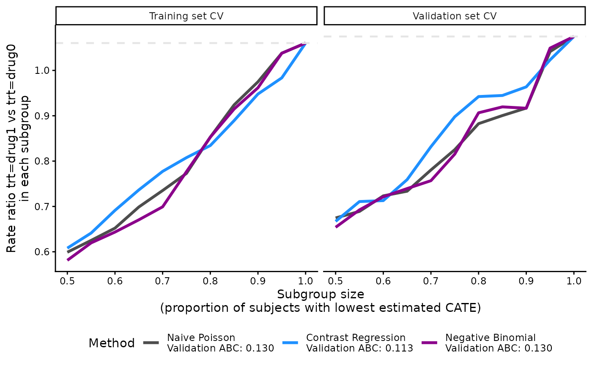
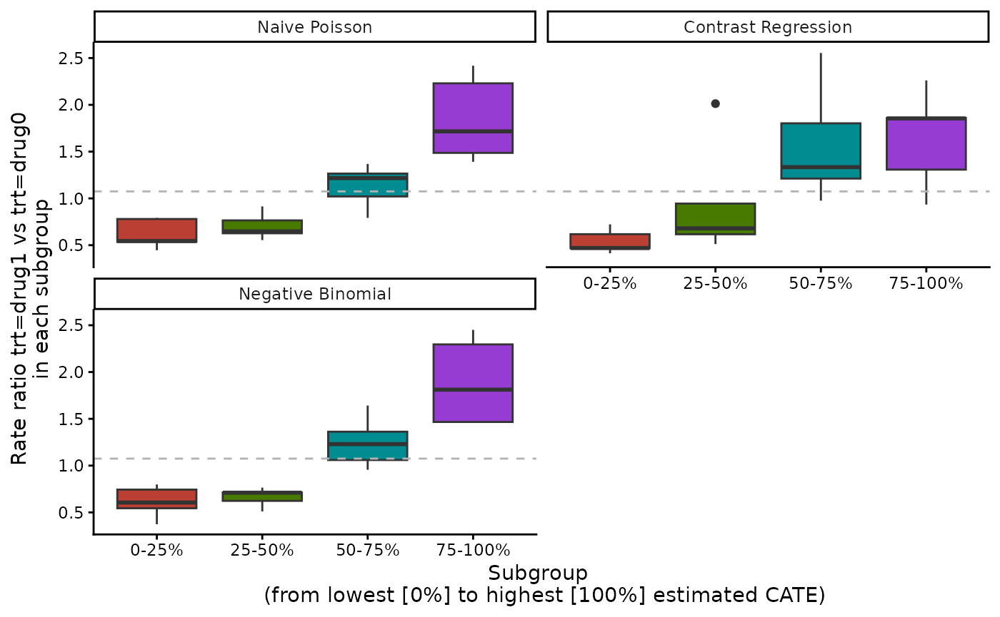
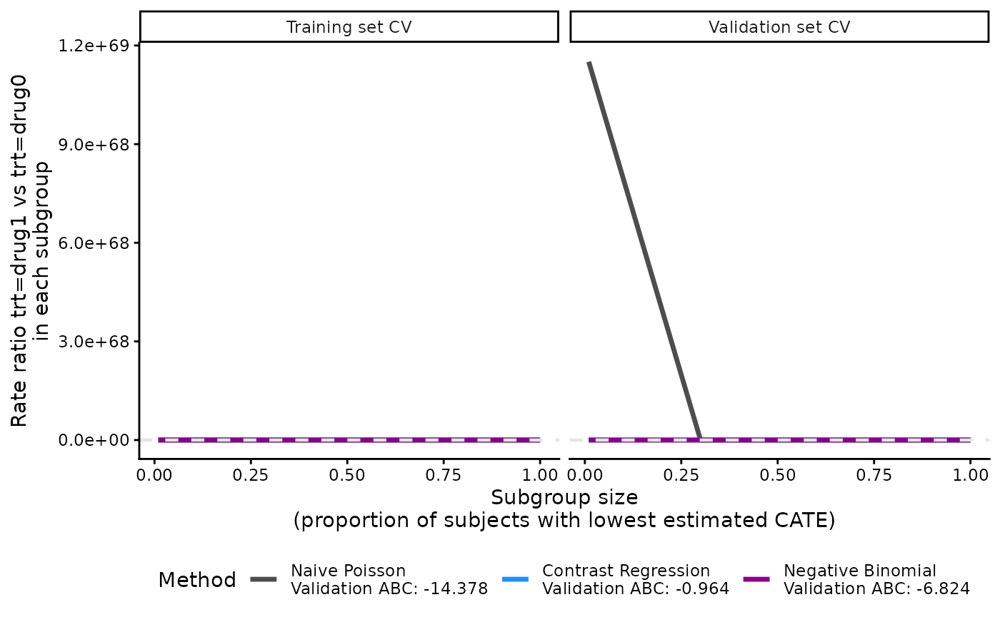
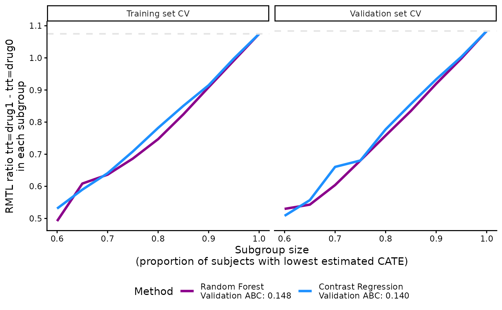
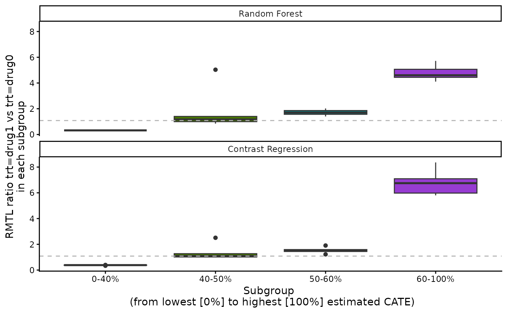
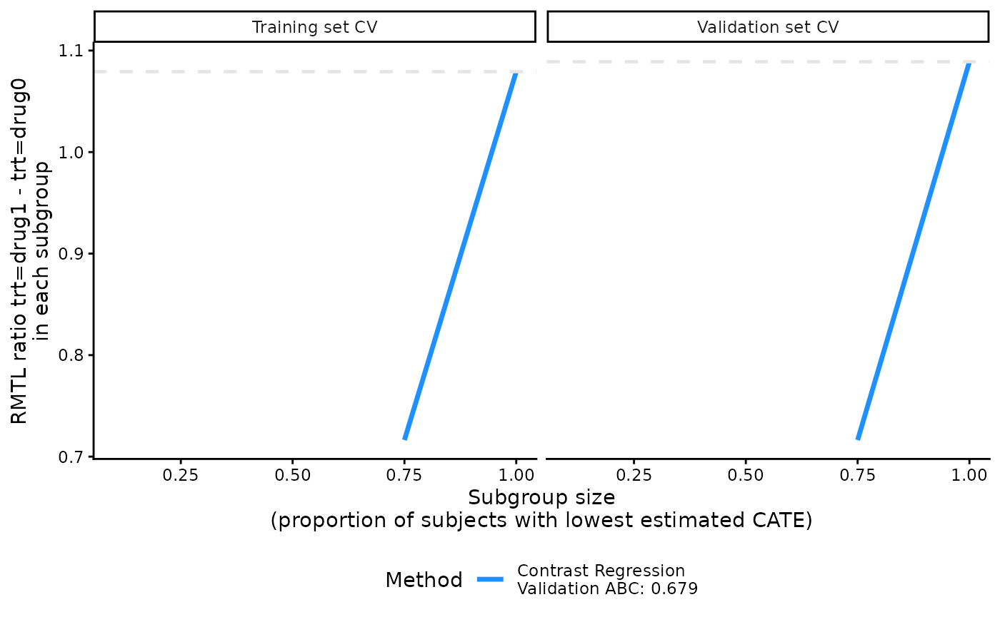
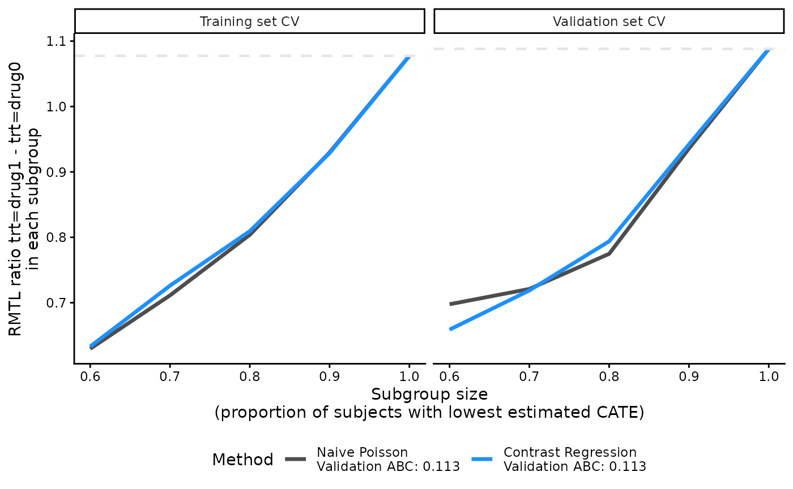

# Customizing CATE models and validation

[](https://cran.r-project.org/package=precmed)
[](https://cran.r-project.org/package=precmed)

This vignette builds on the worked examples for [count
outcomes](https://smartdata-analysis-and-statistics.github.io/precmed/articles/Count-examples.md)
and [survival
outcomes](https://smartdata-analysis-and-statistics.github.io/precmed/articles/Survival-examples.md).
It shows how to customize initial outcome models, define responder
subgroups, and choose censoring models and follow-up settings for CATE
estimation and validation.

## Load required packages

``` r

library(precmed)
library(dplyr)
library(ggplot2)
```

## Customize models for count outcomes

### Initial predictor method

If you choose two regressions or contrast regression as the scoring
method, there is an option to specify how the initial outcome regression
estimates ($`\hat\mu_r^k`$ where $`r = 0,1`$ is the treatment and $`k`$
is the CV fold) are calculated. See [Methods for estimating and
validating treatment
effects](https://smartdata-analysis-and-statistics.github.io/precmed/articles/Theoretical-details.md)
section for the background of these initial predictors and how they are
used in two and contrast regressions. Here is a list of all 3 options:

- “poisson” (Poisson regression from the
  [`glm()`](https://rdrr.io/r/stats/glm.html) function)
  - generalized linear model, strong assumption on Poisson distribution,
    fast
- “boosting” (gradient boosting machine from the `gbm3` R package)
  - ensemble method, typically tree-based, slow
- “gam” (generalized additive model from the `mgcv` package)
  - a combination of generalized linear model and additive models where
    the linear predictor is an additive function of the covariates, can
    be slow

The main example above used a Poisson regression but you can try the
other 2 non-linear and more flexible options. Below, we use
[`catecvcount()`](https://smartdata-analysis-and-statistics.github.io/precmed/reference/catecvcount.md)
as the example code but this can be applied to
[`catefitcount()`](https://smartdata-analysis-and-statistics.github.io/precmed/reference/catefitcount.md)
as well.

``` r

# An example of using GBM as the initial predictor method
catecvcount(data = countExample,
       score.method = c("poisson", "boosting", "twoReg", "contrastReg", "negBin"),
       n.cores = 1,
       cate.model = y ~ age + female + previous_treatment + previous_cost + previous_number_relapses + offset(log(years)),
       ps.model = trt ~ age + previous_treatment, 
       higher.y = FALSE,
       initial.predictor.method = "boosting",       # NEW
       cv.n = 5, 
       seed = 999,
       plot.gbmperf = FALSE,
       verbose = 0)

# An example of using GAM as the initial predictor method
catecvcount(data = countExample,
       score.method = c("poisson", "boosting", "twoReg", "contrastReg", "negBin"),
       n.cores = 1,
       cate.model = y ~ age + female + previous_treatment + previous_cost + previous_number_relapses + offset(log(years)),
       ps.model = trt ~ age + previous_treatment, 
       higher.y = FALSE, 
       initial.predictor.method = "gam",        # NEW
       xvar.smooth = c("age", "previous_cost"), # NEW
       cv.n = 5,
       seed = 999,
       plot.gbmperf = FALSE,
       verbose = 0)
```

Note that for the GAM method, there is an additional argument called
`xvar.smooth`. If left as default (which is NULL), GAM will include all
independent variables in `cate.model` as smooth terms with function
`s()` in the linear predictor. You can choose to specify only a subset
of the dependent variables as the smooth terms. In the example above,
the specifications `cate.model` and `xvar.smooth` lead to the following
GAM formula:
`y ~ female + previous_treatment + previous_number_relapses + s(age) + s(previous_cost)`,
where only age and previous medical costs are wrapped in the smooth
function and the remaining 3 independent variables are not.

Generally speaking, the “poisson” initial predictor method is the
fastest and “boosting” is the slowest among the 3 methods, while “gam”
is somewhere in between with longer computational time as the number of
smooth terms increases.

### Subgroup proportion

Chapter 20, “Visualization and interpretation of individualized
treatment rule results”, provides background on defining responder
subgroups and interpreting the resulting validation curves and responder
diagnostics (Jiang et al. 2026). The examples below show how to specify
these subgroups in `precmed`.

The ATE by subgroups and validation curve results depend on how the
subgroups are defined, which is determined by the sorted CATE scores.
There could be nested binary subgroups (cutoffs specified by
`prop.cutoff`) or mutually exclusive subgroups (cutoffs specified by
`prop.multi`). In the main example above, we used the default values of
`prop.cutoff` and `prop.multi` and we have provided explanations in the
ATE results. Here is a recap:

- `prop.cutoff = seq(0.5, 1, length = 6)` means that we have 6 sets of
  nested binary subgroups where the first subgroup splits the sample by
  50/50 according to the estimated CATE scores (sorted), the 2nd
  subgroup splits the sample by 60/40, …, the 5th subgroup splits the
  sample by 90/10, and the 6th subgroup splits the sample by 100/0. The
  validation curves show the ATE in the first group of each split, i.e.,
  50%, 60%, 70%, …, 100%. The 6th subgroup is technically not a split
  but we keep it because it is equivalent to the overall ATE (the gray
  dashed reference line). The functions that use `prop.cutoff` will
  automatically discard 0 if supplied because 0/100 split does not make
  sense as there is no 0% subgroup to plot for the validation curves,
  and a warning message will be given. The argument `higher.y` controls
  the direction of the sorted CATE scores, i.e., whether we split from
  the lowest or the highest CATE scores. For our toy example, `higher.y`
  = FALSE so we split from the lowest CATE scores such that the first
  group in each subgroup represents higher responders to the treatment
  coded with 1.

- `prop.multi = c(0, 1/3, 2/3, 1)` means that we specify a 3-category
  mutually exclusive subgroup, split by 33/33/33 according to the
  estimated CATE scores. The argument `higher.y` controls the direction
  of the sorted CATE scores, i.e., where we split from the lowest or the
  highest CATE scores. For our toy example, `higher.y` = FALSE so we
  split from the lowest CATE scores. Contrary to `prop.cutoff`,
  `prop.multi` must include both 0 and 1 to remind us of the mutual
  exclusiveness. he functions that use `prop.multi` will automatically
  attach 0 and/or 1 if they are not supplied and a warning message will
  be given. Now we show more examples of different cutoffs and how they
  are reflected in the results.

``` r

# An example of 11 nested binary subgroups and a 4-category mutually exclusive subgroup
output_catecv2 <- catecv(response = "count",
                         data = countExample,
                         score.method = c("poisson", "contrastReg", "negBin"),
                         cate.model = y ~ age + female + previous_treatment + previous_cost + previous_number_relapses + offset(log(years)),
                         ps.model = trt ~ age + previous_treatment,
                         higher.y = FALSE,
                         prop.cutoff = seq(0.5, 1, length = 11), # NEW
                         prop.multi = c(0, 1/4, 2/4, 3/4, 1),    # NEW
                         initial.predictor.method = "poisson", 
                         cv.n = 5, 
                         seed = 999,
                         plot.gbmperf = FALSE,
                         verbose = 0)
#> Warning in data.preproc(fun = "crossv", cate.model = cate.model, ps.model = ps.model, : Variable trt was recoded to 0/1 with drug0->0 and drug1->1.
```

``` r

print(output_catecv2$ate.contrastReg$ate.est.train.high.cv) 
#>                cv1       cv2       cv3       cv4       cv5
#> prop0.5  0.5896053 0.6428854 0.5744973 0.6406698 0.5924975
#> prop0.55 0.6123025 0.6913102 0.5994781 0.6506526 0.6531537
#> prop0.6  0.6744447 0.7114461 0.6589297 0.6930484 0.7186517
#> prop0.65 0.6958967 0.7769476 0.7306405 0.7265152 0.7519433
#> prop0.7  0.7383527 0.8360698 0.7806273 0.7779180 0.7539283
#> prop0.75 0.7769239 0.8320732 0.8020475 0.8271006 0.7999920
#> prop0.8  0.8034239 0.9092085 0.8208183 0.8263584 0.8117300
#> prop0.85 0.8585330 0.9649914 0.8771507 0.8949641 0.8512447
#> prop0.9  0.9041969 1.0257463 0.9595834 0.9049020 0.9452626
#> prop0.95 0.9607169 1.0002418 0.9968210 0.9784077 0.9816699
#> prop1    1.0599740 1.0520675 1.0577453 1.0641114 1.0677619
# Dimension is now 11 rows (nested binary subgroups) by 5 columns (CV iterations)
```

Because we have new `prop.cutoff` with 11 values as opposed to only 6 in
the original example, the number of rows in the ATE results will be
changed accordingly while the number of columns stays the same because
we still use 5 CV iterations.

``` r

plot(output_catecv2) 
```



The validation curves use the 11 nested subgroup cutoffs specified
above, so they contain more line segments than the main example. The ABC
statistic is not affected by the change in `prop.cutoff` because the
calculation of ABC statistics depends on the minimum and maximum of the
`prop.cutoff` vector and is always calculated based on 100 evenly-spaced
cutoffs created from this range. See more theoretical details on ABC
calculation in the [Methods for estimating and validating treatment
effects](https://smartdata-analysis-and-statistics.github.io/precmed/articles/Theoretical-details.md)
section.

``` r

print(output_catecv2$ate.contrastReg$ate.est.train.group.cv) 
#>                cv1       cv2       cv3       cv4       cv5
#> prop0.25 1.8720359 1.7135347 1.8803024 1.6290449 1.8095445
#> prop0.5  1.2812141 1.3353842 1.4042263 1.4192956 1.3873281
#> prop0.75 0.8821662 1.0769622 0.8219097 1.0732422 0.8013989
#> prop1    0.4352059 0.3641272 0.4109202 0.4230607 0.4559544
# Dimension is now 4 rows (multi-category mutually exclusive subgroups) by 5 columns (CV iterations)

boxplot(output_catecv2)
```



For results on the mutually exclusive subgroups, the number of rows in
the ATE results increases from 3 to 4 in comparison with the original
example because `prop.multi` now defines 4 mutually exclusive subgroups.
For each method, the box plot now has 4 boxes for 4 mutually exclusive
subgroups.

**Examples that we do not recommend**

In this next example, `prop.cutoff` includes 0.01, which is very close
to 0. Consequently, the scoring methods may run into some convergence
issues because the first subgroup includes a small number of patients.
This can lead to highly unstable ATE estimates, as shown in the first CV
iteration of contrast regression in
`output_catecv3$ate.contrastReg$ate.est.valid.high.cv`. Moreover, the
validation curves become useless due to the extreme ATE estimates.

``` r

# An example of very few nested binary subgroups
output_catecv3 <- catecv(response = "count",
                         data = countExample,
                         score.method = c("poisson", "contrastReg", "negBin"),
                         cate.model = y ~ age + female + previous_treatment
                                      + previous_cost + previous_number_relapses 
                                      + offset(log(years)),
                         ps.model = trt ~ age + previous_treatment, 
                         initial.predictor.method = "poisson", 
                         higher.y = FALSE,
                         prop.cutoff = c(0, 0.01, 0.30, 0.75, 1), # NEW
                         cv.n = 5, 
                         seed = 999,
                         plot.gbmperf = FALSE,
                         verbose = 1)
#> Warning in data.preproc(fun = "crossv", cate.model = cate.model, ps.model = ps.model, : Variable trt was recoded to 0/1 with drug0->0 and drug1->1.
#> Warning in data.preproc(fun = "crossv", cate.model = cate.model, ps.model =
#> ps.model, : The first element of prop.cutoff cannot be 0 and has been removed.
#>   |                                                                              |                                                                      |   0%
#> cv = 1 
#>   splitting the data..
#>   training..
#>   validating..
#>   convergence TRUE 
#>    Sat Nov 14 14:47:36 2026 
#>   |                                                                              |==============                                                        |  20%
#> cv = 2 
#>   splitting the data..
#>   training..
#>   validating..
#>   convergence TRUE 
#>    Sat Nov 14 14:47:39 2026 
#>   |                                                                              |============================                                          |  40%
#> cv = 3 
#>   splitting the data..
#>   training..
#>   validating..
#>   convergence TRUE 
#>    Sat Nov 14 14:47:44 2026 
#>   |                                                                              |==========================================                            |  60%
#> cv = 4 
#>   splitting the data..
#>   training..
#>   validating..
#>   convergence TRUE 
#>    Sat Nov 14 14:47:49 2026 
#>   |                                                                              |========================================================              |  80%
#> cv = 5 
#>   splitting the data..
#>   training..
#>   validating..
#>   convergence TRUE 
#>    Sat Nov 14 14:47:54 2026 
#>   |                                                                              |======================================================================| 100%
#> Total runtime : 25.05 secs
output_catecv3$ate.contrastReg$ate.est.valid.high.cv
#>                cv1       cv2          cv3          cv4       cv5
#> prop0.01 0.5746485        NA 6.858623e+04 1.901224e+06        NA
#> prop0.3  0.6944399 0.6252387 6.324404e-01 5.625166e-01 0.5828618
#> prop0.75 1.1424118 0.8042944 9.012645e-01 7.984435e-01 0.8428192
#> prop1    1.0812603 1.0978549 1.053193e+00 1.072635e+00 1.0689638
```

``` r

plot(output_catecv3) 
```



Below are some general recommendations on the choice of `prop.cutoff`
and `prop.multi`:

1.  We do not recommend including 0 in `prop.cutoff` as it is an invalid
    value. The functions will automatically remove 0 in `prop.cutoff`
    and output a warning message.
2.  We do not recommend choosing values too close to 0 either because
    this will generate very small subgroups which may lead to numerical
    instability, e.g., 1/99 split specified by 0.01 in this example and
    corresponding ATE in the training data for contrast regression. In
    this situation, either the validation curves will be dominated by
    the unstable ATE estimates, making the plot useless as in this
    example, or the validation curves will not be plotted if the
    numerical instability due to an extreme split leads to missing
    values, in which case a warning is printed as in the example above.
3.  In general, we do not recommend specifying too few proportions for
    `prop.cutoff` (e.g., 2 or 3) because the validation curves will look
    jagged. The validation curves will be smoother with more proportions
    spread out over the range of proportions. If computation is an
    issue, however, choosing too many values for `prop.cutoff` or
    `prop.multi` can be time consuming. It is recommended to start from
    a smaller length and you can increase the length as needed.

## Customize models for survival outcomes

### Initial predictor method

If you choose two and/or contrast regression as the scoring method,
there is an option to specify how the initial outcome regression
estimates ($`\hat\mu_r^k`$ where $`r = 0,1`$ is the treatment and $`k`$
is the cross validation fold) are calculated. See [Methods for
estimating and validating treatment
effects](https://smartdata-analysis-and-statistics.github.io/precmed/articles/Theoretical-details.md)
section for the background of these initial predictors and how they are
used in the two and contrast regression. Here is a list of all 3
options:

- “logistic” (logistic regression from the
  [`glm()`](https://rdrr.io/r/stats/glm.html) function)
  - generalized linear model, strong assumption on binomial
    distribution, fast
- “boosting” (gradient boosting machine from the `gbm3` R package)
  - ensemble method, typically tree-based, assume the time-to-event
    outcome as Gaussian distributed, slow
- “randomForest” (random survival forest model from the
  `randomForestSRC` package)
  - ensemble method, tree-based, non-parametric, can be slow

The main example above used a logistic regression but you can try the
other 2 non-linear and more flexible options. Below, we use
[`catecv()`](https://smartdata-analysis-and-statistics.github.io/precmed/reference/catecv.md)
as the example code but this can be applied to
[`catefit()`](https://smartdata-analysis-and-statistics.github.io/precmed/reference/catefit.md)
as well.

``` r

# An example of using GBM as the initial predictor method
tau0 <- with(survivalExample,
             min(quantile(y[trt == "drug1"], 0.95), quantile(y[trt == "drug0"], 0.95)))

catecv(response = "survival",
       data = survivalExample,
       score.method = c("poisson", "boosting", "randomForest", "twoReg", "contrastReg"),
       cate.model = survival::Surv(y, d) ~ age + female + previous_cost + previous_number_relapses,
       ps.model = trt ~ age + previous_treatment,
       ipcw.model = NULL,
       followup.time = NULL,
       tau0 = tau0,
       surv.min = 0.025,
       higher.y = TRUE,
       prop.cutoff = seq(0.6, 1, length = 5),
       prop.multi = c(0, 0.5, 0.6, 1),
       cv.n = 5,
       initial.predictor.method = "boosting", # NEW
       tree.depth = 3,                        # NEW
       seed = 999,
       plot.gbmperf = FALSE,
       verbose = 0)

# An example of using random forest as the initial predictor method
catecv(response = "survival",
       data = survivalExample,
       score.method = c("poisson", "boosting", "randomForest", "twoReg", "contrastReg"),
       cate.model = survival::Surv(y, d) ~ age + female + previous_cost + previous_number_relapses,
       ps.model = trt ~ age + previous_treatment,
       ipcw.model = NULL,
       followup.time = NULL,
       tau0 = tau0,
       surv.min = 0.025,
       higher.y = TRUE,
       prop.cutoff = seq(0.6, 1, length = 5),
       prop.multi = c(0, 0.5, 0.6, 1),
       cv.n = 5,
       initial.predictor.method = "randomForest", # NEW
       n.trees.rf = 500,                          # NEW
       seed = 999,
       plot.gbmperf = FALSE,
       verbose = 0)
```

Note that for `boosting` and `randomForest` methods that are tree-based,
parameters such as tree depth and number of trees can be specified with
arguments `tree.depth`, `n.trees.rf`, and `n.trees.boosting`.

Generally speaking, the “logistic” initial predictor method is the
fastest and “boosting” is the slowest among the 3 methods, while
“randomForest” is somewhere in between with longer computational time as
the number of trees and tree depth increase.

### Subgroup proportion

The **precmed** results depend on the subgroups which are determined by
the sorted CATE scores. There could be nested binary subgroups (cutoffs
specified by `prop.cutoff`) or mutually exclusive subgroups (cutoffs
specified by `prop.multi`). In the main example above, we used certain
values of `prop.cutoff` and `prop.multi` and we have provided
explanations in the ATE results. Here is a recap:

- `prop.cutoff = seq(0.6, 1, length = 5)` means that we have 5 sets of
  nested binary subgroups where the first subgroup set is split by 60/40
  according to the estimated CATE scores (sorted), the 2nd subgroup set
  is split by 70/30, …, and the 6th subgroup set is split by 100/0. The
  validation curves show results of the first group of each split, i.e.,
  60%, 70%, …, 100%. The 5th subgroup set is technically not a split but
  we keep it because it is equivalent to the overall ATE (the gray
  dashed reference line). **precmed** will automatically discard 0 if
  supplied because 0/100 split does not make sense as there is no 0%
  subgroup to plot for the validation curves, and a warning message will
  be given. Argument `higher.y` controls the direction of the sorted
  CATE scores, i.e., whether we split from the lowest or the highest
  CATE scores. For our toy example, `higher.y` = TRUE so we split from
  the lowest CATE scores.

- `prop.multi = c(0, 0.5, 0.6, 1)` means that we specify a 3-category
  mutually exclusive subgroup, split by 50/10/40 according to the
  estimated CATE scores. Argument `higher.y` controls the direction of
  the sorted CATE scores, i.e., where we split from the lowest or the
  highest CATE scores. For our toy example, `higher.y` = TRUE so we
  split from the lowest CATE scores. Contrary to `prop.cutoff`,
  `prop.multi` must include both 0 and 1 to remind us of the mutual
  exclusiveness. **precmed** will automatically attach 0 and/or 1 if
  they are not supplied and a warning message will be given.

Now we show more examples of different cutoffs and how they are
reflected in the results.

``` r

# An example of 9 nested binary subgroups and a 4-category mutually exclusive subgroup
tau0 <- with(survivalExample,
             min(quantile(y[trt == "drug1"], 0.95), quantile(y[trt == "drug0"], 0.95)))

output_catecv2 <- catecv(response = "survival",
                         data = survivalExample,
                         score.method = c("randomForest", "contrastReg"),
                         
                cate.model = survival::Surv(y, d) ~ age + female
                                                        + previous_cost + previous_number_relapses,
                ps.model = trt ~ age + previous_treatment,
                initial.predictor.method = "logistic",
                ipcw.model = NULL,
                followup.time = NULL,
                tau0 = tau0,
                surv.min = 0.025,
                higher.y = TRUE,
                prop.cutoff = seq(0.6, 1, length = 9), # NEW
                prop.multi = c(0, 0.4, 0.5, 0.6, 1),   # NEW
                cv.n = 5,
                seed = 999,
                plot.gbmperf = FALSE,
                verbose = 0)
#> Warning in data.preproc.surv(fun = "crossv", cate.model = cate.model, ps.model = ps.model, : Variable trt was recoded to 0/1 with drug0->0 and drug1->1.
```

``` r

print(output_catecv2$ate.contrastReg$ate.est.train.high.cv) 
#>                cv1       cv2       cv3       cv4       cv5
#> prop0.6  0.5286488 0.5344877 0.5325352 0.5246205 0.5338395
#> prop0.65 0.5791944 0.5829187 0.6151744 0.5762170 0.5955160
#> prop0.7  0.6168472 0.6682790 0.6436875 0.6321281 0.6438643
#> prop0.75 0.7017728 0.7330868 0.7038570 0.6943269 0.7105475
#> prop0.8  0.7704101 0.8005505 0.7752939 0.7763984 0.7873444
#> prop0.85 0.8374886 0.8700290 0.8403268 0.8512221 0.8544261
#> prop0.9  0.9110024 0.9351850 0.9030097 0.9108305 0.9137251
#> prop0.95 0.9961731 1.0190440 0.9862585 0.9967722 0.9920313
#> prop1    1.0534514 1.1042633 1.0646558 1.0830122 1.0690691
# Dimension is 9 (nested binary subgroups) by 5 (CV iterations)
```

Because we have new `prop.cutoff` with 9 values as opposed to only 5 in
the original example, the number of rows in the ATE results will be
changed accordingly while the number of columns remains to be 5.

``` r

plot(output_catecv2) 
```



The validation curves depend on `prop.cutoff` and have more line
segments than the one presented in the main example because they contain
9 sets of subgroups instead of 5 sets (although it is not so obvious
here in this example). The ABC statistic is not affected by this because
the calculation of ABC statistics depends on the minimum and maximum of
the `prop.cutoff` vector and 100 evenly-spaced subgroup cutoffs are
created from this range. The highest proportion cutoff that is not 1 in
the main example was 0.9 and it is now 0.95. See more theoretical
details on ABC calculation in the [Methods for estimating and validating
treatment
effects](https://smartdata-analysis-and-statistics.github.io/precmed/articles/Theoretical-details.md)
section.

``` r

print(output_catecv2$ate.contrastReg$ate.est.train.group.cv) 
#>               cv1       cv2       cv3       cv4      cv5
#> prop0.4 6.2068924 6.6101517 6.7424201 6.5030289 7.027033
#> prop0.5 1.4458427 1.4142659 1.4728371 1.4372399 1.381593
#> prop0.6 0.9080483 1.2062367 1.0115264 0.9270653 1.259874
#> prop1   0.3746892 0.4068091 0.3454113 0.3465889 0.377679
# Dimension is now 4 (multi-category mutually exclusive subgroups) by 3 (CV iterations)

boxplot(output_catecv2)
#> Warning: Removed 4 rows containing non-finite outside the scale range
#> (`stat_boxplot()`).
```



For results on the mutually exclusive subgroups, the number of rows in
the ATE results increases from 3 to 4 in comparison with the original
example because `prop.multi` now defines 4 mutually exclusive subgroups.
For each methods, the box plot now has 4 boxes for 4 mutually exclusive
subgroups.

**Examples that we do not recommend**

In this example, `prop.cutoff` includes 0.01, which is very close to 0.
Consequently, the scoring methods may run into some convergence issues
because the first subgroup includes a small number of patients. This can
lead to highly unstable ATE estimates, as shown in the first CV
iteration of contrast regression in
`output_catecv3$ate.contrastReg$ate.est.valid.high.cv`. Moreover, the
validation curves become useless due to the extreme ATE estimates.

``` r

# An example of very few nested binary subgroups
output_catecv3 <- catecv(response = "survival",
                         data = survivalExample,
                         score.method = c("contrastReg"),
                         cate.model = survival::Surv(y, d) ~ age + female + previous_cost + previous_number_relapses,
                         ps.model = trt ~ age + previous_treatment,
                         initial.predictor.method = "logistic",
                         ipcw.model = NULL,
                         followup.time = NULL,
                         tau0 = tau0,
                         surv.min = 0.025,
                         higher.y = TRUE,
                         prop.cutoff = c(0, 0.1, 0.75, 1), # NEW
                         prop.multi = c(0, 0.5, 0.6, 1),
                         cv.n = 5,
                         seed = 999,
                         plot.gbmperf = FALSE,
                         verbose = 1)
#> Warning in data.preproc.surv(fun = "crossv", cate.model = cate.model, ps.model = ps.model, : Variable trt was recoded to 0/1 with drug0->0 and drug1->1.
#> Warning in data.preproc.surv(fun = "crossv", cate.model = cate.model, ps.model
#> = ps.model, : The first element of prop.cutoff cannot be 0 and has been
#> removed.
#>   |                                                                              |                                                                      |   0%
#> cv = 1 
#>   splitting the data..
#>   training..
#>   validating..
#>   Contrast regression converged.
#>    Sat Nov 14 14:49:27 2026 
#>   |                                                                              |==============                                                        |  20%
#> cv = 2 
#>   splitting the data..
#>   training..
#>   validating..
#>   Contrast regression converged.
#>    Sat Nov 14 14:49:31 2026 
#>   |                                                                              |============================                                          |  40%
#> cv = 3 
#>   splitting the data..
#>   training..
#>   validating..
#>   Contrast regression converged.
#>    Sat Nov 14 14:49:35 2026 
#>   |                                                                              |==========================================                            |  60%
#> cv = 4 
#>   splitting the data..
#>   training..
#>   validating..
#>   Contrast regression converged.
#>    Sat Nov 14 14:49:40 2026 
#>   |                                                                              |========================================================              |  80%
#> cv = 5 
#>   splitting the data..
#>   training..
#>   validating..
#>   Contrast regression converged.
#>    Sat Nov 14 14:49:44 2026 
#>   |                                                                              |======================================================================| 100%
#> Total runtime : 20.9 secs
output_catecv3$ate.contrastReg$ate.est.valid.high.cv
#>                cv1       cv2       cv3       cv4       cv5
#> prop0.1         NA        NA        NA        NA        NA
#> prop0.75 0.7251659 0.5735622 0.9376515 0.6359857 0.7093587
#> prop1    1.1465914 1.0179736 1.1351233 1.0311785 1.1141329
```

``` r

plot(output_catecv3) 
```



Below are some general recommendations on the choice of `prop.cutoff`
and `prop.multi`:

1.  We do not recommend including 0 in `prop.cutoff` as it is an invalid
    value. **precmed** automatically removes 0 in `prop.cutoff` and
    outputs a warning message.
2.  We do not recommend choosing values too close to 0 either because
    this will generate very small subgroups which may lead to numerical
    instability, e.g., 10/90 split specified by 0.1 in this example. In
    this situation, either the validation curves will be plotted by the
    range of the unstable ATE estimates will make them useless or the
    validation curves will not be plotted if the numerical instability
    due to an extreme split leads to missing or infinite values, in
    which case a warning or error is printed as in the example above.
3.  In general, we do not recommend specifying too few proportions for
    `prop.cutoff` (e.g., 2 or 3) because the validation curves will look
    very jagged. The validation curves will be smoother with more
    proportions and more spread out over the range of proportions. If
    computation is an issue, however, choosing too many values for
    `prop.cutoff` or `prop.multi` can be time consuming. It is
    recommended to start from a smaller length and you can increase the
    length as needed.

### IPCW model and method

The default IPCW model uses the same covariates as the outcome model
`cate.model` plus the treatment. The default IPCW method is a Cox
regression with Breslow estimator of the baseline survivor function from
[`coxph()`](https://rdrr.io/pkg/survival/man/coxph.html) function in the
`survival` package. Different variables or different method can be
specified in the IPCW model. In the example below, we changed the
covariates to the number of symptoms and number relapses in the
pre-index period and specified the Weibull accelerated failure time
(AFT) regression model using the location-scale parameterization. The
[`survreg()`](https://rdrr.io/pkg/survival/man/survreg.html) function in
the `survival` package was used to fit the AFT model.

``` r

# An example of a different IPCW model with different covariates from default
output_catecv4 <- catecv(response = "survival",
                         data = survivalExample,
                         score.method = c("poisson", "contrastReg"),
                         cate.model = survival::Surv(y, d) ~ age + female + previous_cost + previous_number_relapses,
                         ps.model = trt ~ age + previous_treatment,
                         initial.predictor.method = "logistic",
                         ipcw.model = ~ previous_number_symptoms + previous_number_relapses, # NEW
                         ipcw.method = "aft (weibull)", # NEW
                         followup.time = NULL,
                         tau0 = tau0,
                         surv.min = 0.025,
                         higher.y = TRUE,
                         prop.cutoff = seq(0.6, 1, length = 5), 
                         prop.multi = c(0, 0.5, 0.6, 1),
                         cv.n = 5,
                         seed = 999,
                         plot.gbmperf = FALSE,
                         verbose = 0)
```

### Truncation and follow-up time

The argument `tau0` specifies the truncation time for RMTL. The default
is the maximum survival time in the data but it can be changed if you
have a specific truncation time in mind. Similarly, the maximum
follow-up time argument `followup.time` can be changed from the default,
which is unknown potential censoring time. The study setup usually can
shed some light on what values to use for these two time parameters.

In the main example, we used the minimum of the 95th percentile of
survival time in either treatment group as `tau0`. Below we show how
setting different values of the truncation time.

``` r

# An example of a different IPCW model with different covariates from default
output_catecv5 <- catecv(response = "survival",
                         data = survivalExample,
                         score.method = c("poisson", "contrastReg"),
                         cate.model = survival::Surv(y, d) ~ age + female + previous_cost + previous_number_relapses,
                         ps.model = trt ~ age + previous_treatment,
                         initial.predictor.method = "logistic",
                         ipcw.model = ~ previous_number_symptoms + previous_number_relapses,
                         ipcw.method = "aft (weibull)",
                         followup.time = NULL,
                         tau0 = NULL, # NEW
                         higher.y = TRUE,
                         cv.n = 5,
                         surv.min = 0.025,
                         prop.cutoff = seq(0.6, 1, length = 5),
                         prop.multi = c(0, 0.5, 0.6, 1),
                         seed = 999,
                         plot.gbmperf = FALSE,
                         verbose = 0)
#> Warning in data.preproc.surv(fun = "crossv", cate.model = cate.model, ps.model
#> = ps.model, : No value supplied for tau0. Default sets tau0 to the maximum
#> survival time.
#> Warning in data.preproc.surv(fun = "crossv", cate.model = cate.model, ps.model = ps.model, : Variable trt was recoded to 0/1 with drug0->0 and drug1->1.
plot(output_catecv5)
```



## Other `precmed` vignettes in this series

[1. Estimating and validating treatment effects for count
outcomes](https://smartdata-analysis-and-statistics.github.io/precmed/articles/Count-examples.md)  
[2. Estimating and validating treatment effects for survival
outcomes](https://smartdata-analysis-and-statistics.github.io/precmed/articles/Survival-examples.md)  
[3. Customizing CATE models and
validation](https://smartdata-analysis-and-statistics.github.io/precmed/articles/Additional-examples.md)  
[4. Methods for estimating and validating treatment
effects](https://smartdata-analysis-and-statistics.github.io/precmed/articles/Theoretical-details.md)

## References

Jiang, Xiaotong, Gabrielle Simoneau, Fabio Pellegrini, Changyu Shen,
Carl de Moor, and Lu Tian. 2026. “Visualization and Interpretation of
Individualized Treatment Rule Results.” Chap. 20 in *Comparative
Effectiveness and Personalized Medicine Research Using Real-World Data*,
edited by Thomas P. A. Debray, Tri-Long Nguyen, and Robert W. Platt.
Chapman & Hall/CRC. <https://doi.org/10.1201/9781003300809-20>.
