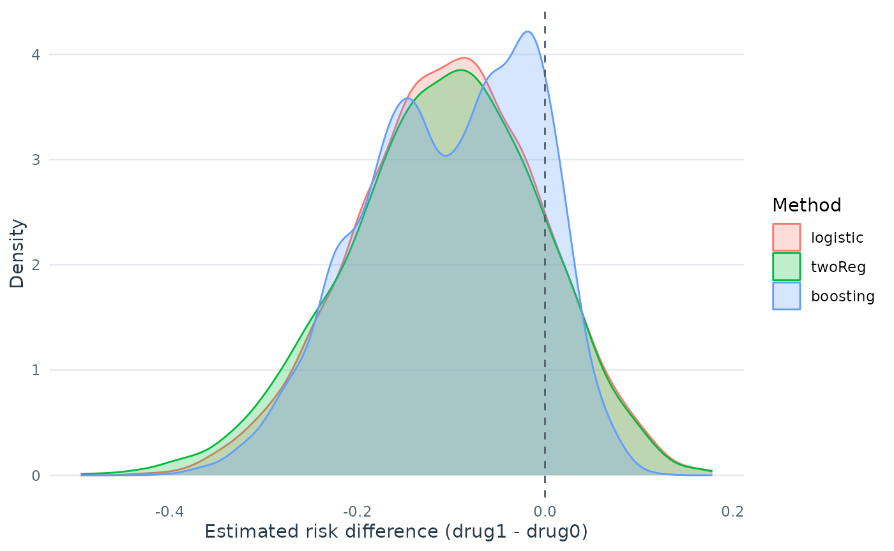
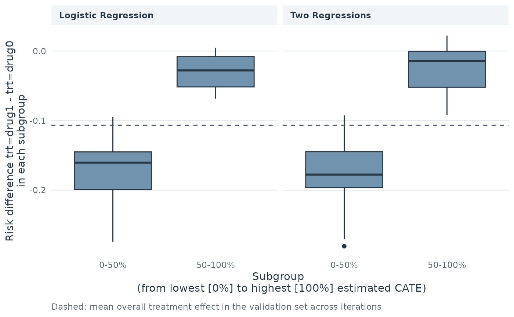

# CATE scores and validation for binary outcomes

This vignette fits and internally validates conditional treatment-effect
scores for binary outcomes. The [companion ATE
example](https://smartdata-analysis-and-statistics.github.io/precmed/articles/Binary-examples.md)
estimates the population-average effect using the same data. Score
fitting and validation are distinct; estimated subgroups from the
fitting sample are not independent validation.

## Prepare the data

``` r

library(precmed)
binaryExample <- simulate_binary(n = 4000, seed = 2026,
                                 followup = 1, threshold = 0)
outcome_formula <- y ~ age + female + previous_treatment + previous_cost +
  previous_number_relapses
ps_formula <- trt ~ age + previous_treatment
```

The binary outcome indicates at least one relapse within one year;
treatment assignment depends on age and previous treatment. The scores
describe treatment differences in relapse risk. The data are synthetic
and the simulation parameters are illustrative.

## Estimate CATE scores

CATE scores estimate the difference in relapse probability for patients
with different baseline covariates. The `logistic` method fits one
logistic model with treatment-covariate interactions; `twoReg`
cross-fits separate logistic outcome models and a treatment model, then
projects augmented outcomes for each arm onto the outcome-model design.
The difference is a doubly robust linear projection of the risk
difference if either the treatment model or both outcome models are
correct, subject to identification, positivity and truncation. It need
not lie between -1 and 1. The `boosting` method fits a Bernoulli
gradient boosting model in each treatment arm and subtracts the
predicted relapse probabilities. Five-fold cross-validation selects the
number of trees in each arm; `tree.depth` and `n.trees.boosting` control
the fitted trees. These scores are estimated on the training data; the
subgroup ATEs shown by
[`catefit()`](https://smartdata-analysis-and-statistics.github.io/precmed/reference/catefit.md)
use the doubly robust estimator and the same data used to build the
scores, so they may be optimistic. Chapter 17, “Introduction to methods
for personalizing medicine,” discusses treatment effect heterogeneity
and CATE prediction (Hoogland et al. 2026).

``` r

fit_cate <- catefit(
  response = "binary", data = binaryExample,
  score.method = c("logistic", "twoReg", "boosting"),
  cate.model = outcome_formula, ps.model = ps_formula,
  higher.y = FALSE, prop.cutoff = c(0.5, 0.75, 1), seed = 999,
  n.trees.boosting = 100, n.cores = 1
)
```

## Inspect CATE scores and subgroup estimates

The fitted scores estimate differences in relapse probability for
patients with different baseline covariates. Use
[`predict()`](https://rdrr.io/r/stats/predict.html) to retrieve scores
for the original analysis sample; prediction for new data is not
currently supported. Below are the first 6 scores from the
two-regression method.

``` r

scores <- predict(fit_cate, method = "twoReg")
head(scores)
#>             1             2             3             4             5 
#> -1.642382e-01  6.177954e-02 -5.741223e-02  5.561457e-05 -1.572941e-01 
#>             6 
#>  1.046504e-01
```

Use [`plot()`](https://rdrr.io/r/graphics/plot.default.html) to compare
fitted score distributions. Scores are on the risk difference scale,
with zero indicating no difference in relapse probability.

``` r

plot(fit_cate, type = "density")
```



Differences between the score distributions can reflect model
flexibility, estimation noise or overfitting. The plot alone cannot
establish that treatment effects differ or that scores will perform well
in new patients.

Use [`coef()`](https://rdrr.io/r/stats/coef.html) to extract the
available linear score coefficients. For `twoReg`, the coefficients
describe a linear projection of the risk difference. The logistic
model’s coefficients are on the log-odds scale, and boosting does not
have a linear score coefficient vector. Confidence intervals for binary
score coefficients are not currently available.

``` r

coef(fit_cate, method = "twoReg")
#>              (Intercept)                      age                   female 
#>              -0.16042803              -0.00747815               0.11779453 
#>  previous_treatmentdrugB  previous_treatmentdrugC            previous_cost 
#>               0.03065470               0.02705082              -0.01405964 
#> previous_number_relapses 
#>              -0.06104685
```

Use
[`subgroup_estimates()`](https://smartdata-analysis-and-statistics.github.io/precmed/reference/subgroup_estimates.md)
to inspect estimated risk differences in nested subgroups ranked by the
two-regression score. These estimates use the same data as the score
fit; the validation section below assesses the score in held-out data.
The contrast is drug 1 minus drug 0, so a negative value favors drug 1.

``` r

subgroup_estimates(fit_cate, method = "twoReg", measure = "risk_difference")
#>    prop0.5   prop0.75      prop1 
#> -0.1792806 -0.1474149 -0.1079285
```

For example, `prop0.5` is the estimated treatment effect in the half
with the lowest scores, using a sample quantile cutoff; ties can make
the subgroup larger. `higher.y = FALSE` selects lower risk differences
as favorable because relapse is an adverse event. For a desirable binary
outcome, use `higher.y = TRUE`.

## Internally validate CATE scores

[`catecv()`](https://smartdata-analysis-and-statistics.github.io/precmed/reference/catecv.md)
repeats treatment-stratified training and validation splits. It fits the
score in each training set, applies it to the corresponding validation
set, and estimates subgroup risk differences separately in each set.
Percentile cutoffs are calculated within each set without using
validation outcomes. We compare `logistic` and `twoReg` on the same
splits. The validation curves and ABC compare how the scores rank
patients by estimated treatment benefit; they do not assess calibration.
[`diagnostics()`](https://smartdata-analysis-and-statistics.github.io/precmed/reference/diagnostics.md)
reports unavailable subgroup estimates and `subgroup.support` records
arm sizes. We use 10 repeated splits and one inner cross-fitting
repetition to balance run time and illustration; more repetitions and
independent validation can give a more reliable assessment. The nested
cutoffs select the best-scoring 50% and the full set, and the mutually
exclusive groups split each set in half. These larger subgroups avoid
the rank-deficient fits observed with smaller groups in this example;
check support and model fit when choosing cutoffs for other data.

``` r

fit_cv <- catecv(
  response = "binary", data = binaryExample, score.method = c("logistic", "twoReg"),
  cate.model = outcome_formula, ps.model = ps_formula, higher.y = FALSE,
  prop.cutoff = c(0.5, 1), prop.multi = c(0, 0.5, 1),
  cv.n = 10, B = 1, seed = 102
)
plot(fit_cv, show.abc = FALSE)
```


``` r

boxplot(fit_cv)
```



``` r

abc(fit_cv)
#>                 cv1        cv2        cv3         cv4        cv5        cv6
#> logistic 0.02997601 0.01402678 0.03633474 0.004732452 0.01140305 0.01547006
#> twoReg   0.02638229 0.01288020 0.03879525 0.007680507 0.01207716 0.01261662
#>                 cv7        cv8        cv9       cv10
#> logistic 0.01857408 0.01841614 0.02342370 0.01266026
#> twoReg   0.01806718 0.01906034 0.02641335 0.01410169
abc(fit_cv, combine = "mean")
#>   logistic     twoReg 
#> 0.01850173 0.01880746
```

The plotted curves use the two requested subgroup proportions.
[`abc()`](https://smartdata-analysis-and-statistics.github.io/precmed/reference/abc.md)
uses 100 proportions between 0.5 and 1 in each validation iteration, so
its values summarize a finer curve; the plot omits its separate, coarser
ABC annotation.

In this example, the mean validation ABC is 0.0185 for `logistic` and
0.0188 for `twoReg`. These similar values suggest comparable ranking
performance in these splits. The ABC varies across iterations, and this
comparison does not establish that the methods are equivalent in this
population or in other data.

Compare the validation curves and subgroup estimates with the training
results, accounting for variation across splits. Lower scores indicate
greater predicted benefit in this example. These summaries assess
ranking; they do not by themselves establish calibration, clinical
usefulness, or a statistically significant difference between subgroup
effects. Chapter 19 discusses broader validation (Thao et al. 2026), and
Chapter 20 discusses responder diagnostics and treatment-rule
interpretation (Jiang et al. 2026).

## Related vignettes

- [Population-average treatment effects for binary
  outcomes](https://smartdata-analysis-and-statistics.github.io/precmed/articles/Binary-examples.md)
- [Customizing CATE models and
  validation](https://smartdata-analysis-and-statistics.github.io/precmed/articles/Additional-examples.md)
- [Methods for developing and validating CATE
  scores](https://smartdata-analysis-and-statistics.github.io/precmed/articles/Theoretical-details.md)

## References

Hoogland, Jeroen, Thomas P. A. Debray, Guillaume Desachy, and Tri-Long
Nguyen. 2026. “Introduction to Methods for Personalizing Medicine.”
Chap. 17 in *Comparative Effectiveness and Personalized Medicine
Research Using Real-World Data*, edited by Thomas P. A. Debray, Tri-Long
Nguyen, and Robert W. Platt. Chapman & Hall/CRC.
<https://doi.org/10.1201/9781003300809-17>.

Jiang, Xiaotong, Gabrielle Simoneau, Fabio Pellegrini, Changyu Shen,
Carl de Moor, and Lu Tian. 2026. “Visualization and Interpretation of
Individualized Treatment Rule Results.” Chap. 20 in *Comparative
Effectiveness and Personalized Medicine Research Using Real-World Data*,
edited by Thomas P. A. Debray, Tri-Long Nguyen, and Robert W. Platt.
Chapman & Hall/CRC. <https://doi.org/10.1201/9781003300809-20>.

Thao, Le Thi Phuong, Orestis Efthimiou, Tibor V. Varga, Jeroen Hoogland,
and Thomas P. A. Debray. 2026. “Validation of Prediction Models for
Patient Outcomes and Individualized Treatment Effect.” Chap. 19 in
*Comparative Effectiveness and Personalized Medicine Research Using
Real-World Data*, edited by Thomas P. A. Debray, Tri-Long Nguyen, and
Robert W. Platt. Chapman & Hall/CRC.
<https://doi.org/10.1201/9781003300809-19>.
