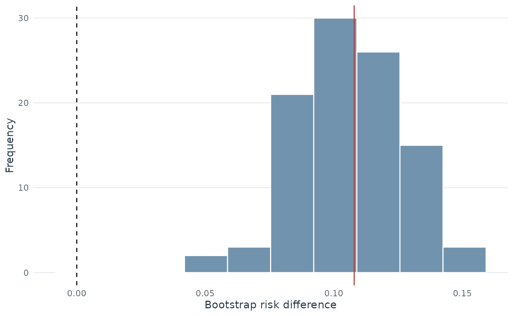
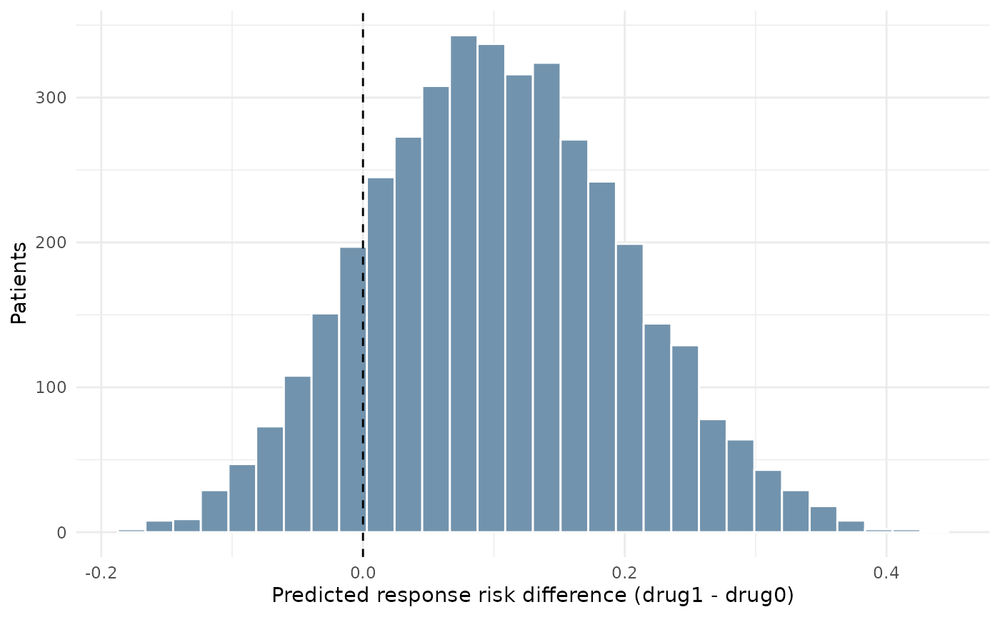
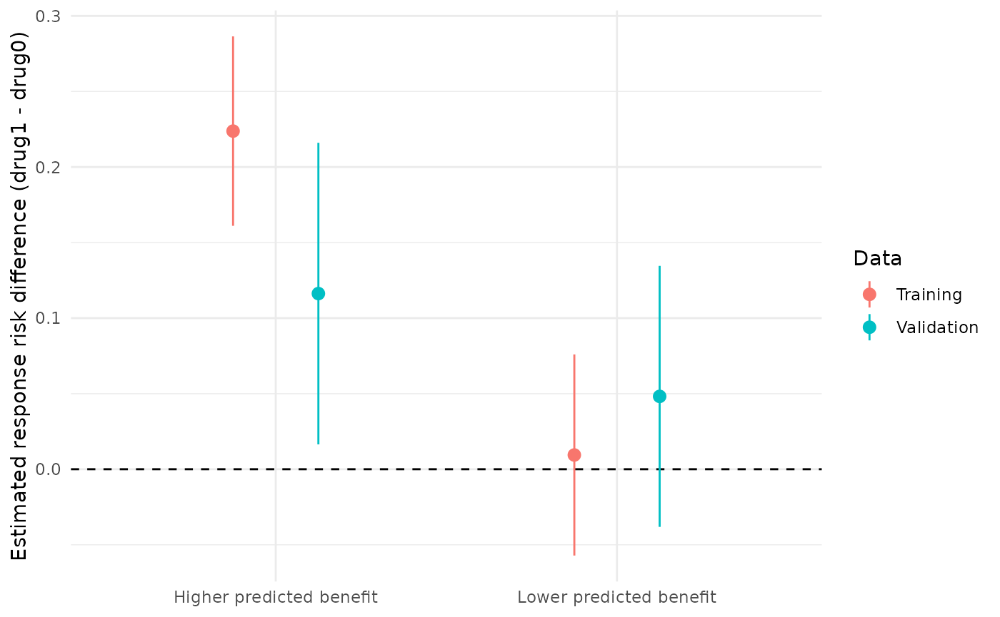

# Estimating and validating treatment effects for binary outcomes

This vignette follows a treatment-effect analysis from a simple
comparison to an adjusted average treatment effect (ATE), conditional
average treatment effect (CATE) scores, and validation in held-out data.
The data are entirely synthetic. For an introduction to individualized
treatment effect prediction with binary endpoints in randomized trials,
see Hoogland et al. (2021). See the [count
example](https://smartdata-analysis-and-statistics.github.io/precmed/articles/Count-examples.md)
for the corresponding analysis of relapse rates and repeated
cross-validation.

## Load required packages

``` r

library(precmed)
library(ggplot2)
```

## Example data

We simulate counts of relapses during one year using the same
data-generating model as
[`simulate_count()`](https://smartdata-analysis-and-statistics.github.io/precmed/reference/simulate_count.md).
A patient is a responder (`y = 1`) if they have no relapses; otherwise
`y = 0`. The underlying count is retained in `relapse_count`. Everyone
has the same follow-up, and response is fully observed. Set `threshold`
to a larger integer to define response as at most that many relapses, or
change `followup` to study another fixed horizon.

``` r

binaryExample <- simulate_binary(n = 4000, seed = 2026,
                                 followup = 1, threshold = 0)
head(binaryExample)
#>           age female previous_treatment previous_cost previous_number_symptoms
#> 1   4.6853017      0              drugB   -0.04071778                        0
#> 2  -9.7172169      1              drugB   -0.07763572                      >=2
#> 3   1.2531430      1              drugA    0.38461438                        0
#> 4  -0.7627391      1              drugB   -0.45026280                        0
#> 5  -5.9997565      0              drugC    0.55030741                        1
#> 6 -22.6448013      1              drugB   -0.59281629                        1
#>   previous_number_relapses   trt y years relapse_count
#> 1                        0 drug1 0     1             1
#> 2                        0 drug0 0     1             1
#> 3                        0 drug1 0     1             1
#> 4                        0 drug1 1     1             0
#> 5                        1 drug1 0     1             2
#> 6                        1 drug0 1     1             0
table(binaryExample$trt, binaryExample$y)
#>        
#>            0    1
#>   drug0  855 1003
#>   drug1  869 1273
prop.table(table(binaryExample$trt, binaryExample$y), margin = 1)
#>        
#>                 0         1
#>   drug0 0.4601722 0.5398278
#>   drug1 0.4056956 0.5943044
```

Treatment is assigned using age and previous treatment, so the treatment
groups need not be comparable without adjustment. Age is centered at 48
years and previous cost is centered at 13,824 USD and divided by 20,172
USD. The simulation coefficients are illustrative and are not clinical
estimates. Unlike a count rate ratio, the response risk difference
depends on the selected threshold and follow-up period.

## Estimate the average treatment effect

For the estimators and their assumptions, see [Methods for estimating
average treatment
effects](https://smartdata-analysis-and-statistics.github.io/precmed/articles/ATE-theory.md).

### Unadjusted treatment comparison

We first compare the observed response proportions under drug1 and
drug0.

``` r

response_rates <- with(binaryExample, tapply(y, trt, mean))
response_rates
#>     drug0     drug1 
#> 0.5398278 0.5943044
```

The unadjusted risk difference for drug1 versus drug0 is calculated by
subtracting the response proportion for drug0 from that for drug1. A
positive value means a higher observed response proportion under drug1.
Here, the unadjusted risk difference is 0.054. This means the observed
proportion of patients who remained relapse-free was 5.4 percentage
points higher in the drug1 group than in the drug0 group; equivalently,
the proportion experiencing at least one relapse was that much lower.
This unadjusted comparison may reflect baseline differences between the
groups rather than a genuine treatment effect.

The 95% confidence interval is 0.024 to 0.085, based on a normal
approximation for two independent proportions.

### Covariate-adjusted treatment comparison

Treatment assignment may differ according to baseline characteristics.
We fit a multivariable binomial model adjusting for age, sex, previous
treatment, previous medical cost, and previous relapses, as in the count
example. The identity link estimates the risk difference directly (Naimi
and Whitcomb 2020).

``` r

adjusted <- glm(
  y ~ trt + age + female + previous_treatment + previous_cost +
    previous_number_relapses,
  data = binaryExample, family = binomial(link = "identity")
)
summary(adjusted)
#> 
#> Call:
#> glm(formula = y ~ trt + age + female + previous_treatment + previous_cost + 
#>     previous_number_relapses, family = binomial(link = "identity"), 
#>     data = binaryExample)
#> 
#> Coefficients:
#>                            Estimate Std. Error z value Pr(>|z|)    
#> (Intercept)               0.5703967  0.0204141  27.941  < 2e-16 ***
#> trtdrug1                  0.0973253  0.0170384   5.712 1.12e-08 ***
#> age                      -0.0056606  0.0009682  -5.846 5.02e-09 ***
#> female                   -0.0535246  0.0171345  -3.124  0.00179 ** 
#> previous_treatmentdrugB  -0.0131217  0.0176378  -0.744  0.45690    
#> previous_treatmentdrugC   0.0326664  0.0205354   1.591  0.11167    
#> previous_cost            -0.0398499  0.0163037  -2.444  0.01452 *  
#> previous_number_relapses -0.0228496  0.0087874  -2.600  0.00932 ** 
#> ---
#> Signif. codes:  0 '***' 0.001 '**' 0.01 '*' 0.05 '.' 0.1 ' ' 1
#> 
#> (Dispersion parameter for binomial family taken to be 1)
#> 
#>     Null deviance: 5468.8  on 3999  degrees of freedom
#> Residual deviance: 5397.6  on 3992  degrees of freedom
#> AIC: 5413.6
#> 
#> Number of Fisher Scoring iterations: 3
```

The adjusted risk difference for drug1 versus drug0 is captured by the
coefficient for `trtdrug1` and estimated as 0.097 (95% CI: 0.064 to
0.131). The interval is a model-based Wald interval. The model assumes
that the risk difference is the same at every covariate value; under
this assumption, the coefficient is also the risk difference averaged
over the study population. A causal interpretation requires, among other
assumptions, a correctly specified outcome model, no unmeasured
confounding, and adequate treatment overlap.

### Population-level treatment comparison using `atefit()`

`atefit(response = "binary")` estimates the difference in response
probability under drug1 and drug0. Positive values favor drug1 because
response is desirable. The estimator combines a logistic outcome model
and a treatment model (the propensity-score model), which estimates the
probability of receiving treatment 1 given the covariates. Under the
usual identification and regularity assumptions, the estimator is
consistent if either model is correctly specified. Causal interpretation
also requires well-defined treatments, no unmeasured confounding, and
adequate treatment overlap. Bootstrap samples provide uncertainty
estimates. These synthetic counts do not in general imply an exactly
logistic response model; the treatment model is correctly specified by
construction in this example. Chapter 5, “Understanding and defining
causal effects,” discusses marginal and conditional causal effects
(Nguyen et al. 2026).

The outcome formula excludes treatment:
[`atefit()`](https://smartdata-analysis-and-statistics.github.io/precmed/reference/atefit.md)
adds treatment and, by default, its interactions with the outcome
covariates. `ps.model` includes the treatment on the left. Treatment
labels are ordered as drug0 and drug1. There is no follow-up offset for
this fixed-horizon binary outcome.

``` r

outcome_formula <- y ~ age + female + previous_treatment + previous_cost +
  previous_number_relapses
ps_formula <- trt ~ age + previous_treatment
output_atefit <- atefit(
  response = "binary", data = binaryExample,
  cate.model = outcome_formula, ps.model = ps_formula,
  n.boot = 100, seed = 999
)
output_atefit
#> Average treatment effect (risk difference):
#> 
#>                  estimate        SE   CI.lower  CI.upper       pvalue
#> risk.difference 0.1079285 0.0196987 0.06931972 0.1465372 4.278253e-08
#> 
#> Estimated risks:
#> 
#>    estimate
#> 1 0.6052451
#> 2 0.4973167
coef(output_atefit)
#> risk.difference 
#>       0.1079285
confint(output_atefit)
#>                      2.5 %    97.5 %
#> risk.difference 0.06931972 0.1465372
plot(output_atefit)
```



`risk0` and `risk1` are the estimated marginal response probabilities;
`risk.difference` is drug1 minus drug0. The plot shows the bootstrap
risk differences, the full-sample estimate in red and the null value
zero as a dashed line. This example uses only 100 bootstrap replicates
to keep the vignette fast; use more for an analysis. If a bootstrap
model fails, the package reports unavailable inference rather than
silently dropping it. Augmented estimates of risk are not constrained to
lie within 0 and 1.

### Compare risk differences

All three estimates compare drug1 with drug0 on the same absolute
probability scale. The unadjusted comparison describes the observed
treatment groups. The identity-link binomial estimate uses the outcome
model alone, whereas
[`atefit()`](https://smartdata-analysis-and-statistics.github.io/precmed/reference/atefit.md)
adds a propensity-score correction. Differences between the adjusted
estimates can reflect their different models and assumptions. The
unadjusted interval is based on the two-proportion normal standard
error. The binomial model uses a model-based Wald interval;
[`atefit()`](https://smartdata-analysis-and-statistics.github.io/precmed/reference/atefit.md)
uses a Wald interval based on its bootstrap standard error.

| Estimation method | Interpretation | Risk difference | 95% CI |
|:---|:---|---:|:---|
| Unadjusted observed proportions | Unadjusted observed group difference | 0.054 | 0.024 to 0.085 |
| Adjusted binomial identity-link model | Conditional; also marginal under the constant-difference model | 0.097 | 0.064 to 0.131 |
| Doubly robust atefit() | Marginal population-average difference | 0.108 | 0.069 to 0.147 |

The unadjusted difference compares the observed treatment groups; it is
not necessarily a causal marginal effect. The binomial model’s
coefficient is conditional on the included covariates and, because it
assumes the same risk difference for every patient, equals its
model-implied marginal difference.
[`atefit()`](https://smartdata-analysis-and-statistics.github.io/precmed/reference/atefit.md)
targets the population-average difference without requiring a constant
conditional risk difference. Causal interpretations require the
assumptions described above.

A risk difference of 0.10 corresponds to 10 percentage points more
responders under drug1. The intervals describe uncertainty around each
estimate; they do not test whether the methods differ from one another.

## Estimate CATE scores

CATE scores estimate the difference in response probability for patients
with different baseline covariates. The `logistic` method fits one
logistic model with treatment-covariate interactions; `twoReg` fits
separate logistic models in each arm. With the same covariates and a
full set of interactions, these are equivalent parameterizations and
should give the same fitted scores up to numerical tolerance. The
`boosting` method instead fits a Bernoulli gradient boosting model in
each treatment arm and subtracts the predicted response probabilities.
Five-fold cross-validation selects the number of trees in each arm;
`tree.depth` and `n.trees.boosting` control the fitted trees. These
scores are model-based; the subgroup ATEs shown by
[`catefit()`](https://smartdata-analysis-and-statistics.github.io/precmed/reference/catefit.md)
use the doubly robust estimator and the same data used to build the
scores, so they may be optimistic. Chapter 17, “Introduction to methods
for personalizing medicine,” discusses treatment effect heterogeneity
and CATE prediction (Hoogland et al. 2026).

``` r

output_catefit <- catefit(
  response = "binary", data = binaryExample,
  score.method = c("logistic", "twoReg", "boosting"),
  cate.model = outcome_formula, ps.model = ps_formula,
  higher.y = TRUE, prop.cutoff = c(0.5, 0.75, 1), seed = 999,
  n.trees.boosting = 100, plot.gbmperf = FALSE, n.cores = 1
)
output_catefit
#> Estimated ATE in the nested subgroups:
#> 
#>             prop0.5  prop0.75     prop1
#> boosting 0.2284609 0.1651624 0.1079285
#> twoReg   0.1885092 0.1455664 0.1079285
#> logistic 0.1885092 0.1455664 0.1079285
#> 
#> NULL
head(output_catefit$score.twoReg)
#>             1             2             3             4             5 
#>  0.1494940561 -0.0684159431  0.0643461646  0.0001343911  0.1432787574 
#>             6 
#> -0.1195886110
output_catefit$ate.twoReg
#>   prop0.5  prop0.75     prop1 
#> 0.1885092 0.1455664 0.1079285
output_catefit$ate.boosting
#>   prop0.5  prop0.75     prop1 
#> 0.2284609 0.1651624 0.1079285
```

For example, `prop0.5` is the estimated ATE in the half with the highest
scores, using a sample quantile cutoff; ties can make the subgroup
larger. `higher.y = TRUE` selects higher risk differences as favorable.
If the binary outcome instead represents an adverse event, use
`higher.y = FALSE`.

### Visualize the distribution of CATE scores

``` r

ggplot(data.frame(score = output_catefit$score.twoReg), aes(x = score)) +
  geom_histogram(bins = 30, fill = "#7293AD", color = "white") +
  geom_vline(xintercept = 0, linetype = 2) +
  labs(x = "Predicted response risk difference (drug1 - drug0)",
       y = "Patients") + theme_minimal()
```



## Internally validate CATE scores

We illustrate validation with a single held-out split. We fit the
two-regression score only in the training set, choose its median cutoff
in that set, and apply the same fitted models and cutoff to the
validation set. No validation outcomes enter score fitting or cutoff
selection. A single split can be unstable; repeated cross-validation or
an independent external dataset provides stronger evidence. Chapter 19,
“Validation of prediction models for patient outcomes and individualized
treatment effect,” discusses discrimination, calibration and decision
accuracy, which require additional assessments beyond this subgroup
comparison (Thao et al. 2026).

``` r

set.seed(101)
train_id <- sample(seq_len(nrow(binaryExample)), size = floor(0.7 * nrow(binaryExample)))
train <- binaryExample[train_id, ]
valid <- binaryExample[-train_id, ]
train_fit <- catefit(
  response = "binary", data = train, score.method = "twoReg",
  cate.model = outcome_formula, ps.model = ps_formula,
  higher.y = TRUE, prop.cutoff = 1
)
```

The current binary
[`catefit()`](https://smartdata-analysis-and-statistics.github.io/precmed/reference/catefit.md)
interface does not yet provide a prediction method for new data. To
apply its two-regression score, refit the same two logistic models on
the training data using [`glm()`](https://rdrr.io/r/stats/glm.html) and
predict both potential response probabilities in each set. The equality
check verifies that these training predictions reproduce the package
score.

``` r

fit0 <- glm(outcome_formula, data = train, subset = trt == "drug0",
            family = binomial())
fit1 <- glm(outcome_formula, data = train, subset = trt == "drug1",
            family = binomial())
score_train <- predict(fit1, newdata = train, type = "response") -
  predict(fit0, newdata = train, type = "response")
score_valid <- predict(fit1, newdata = valid, type = "response") -
  predict(fit0, newdata = valid, type = "response")
stopifnot(isTRUE(all.equal(unname(score_train),
                           unname(train_fit$score.twoReg), tolerance = 1e-6)))
cutoff <- unname(quantile(score_train, 0.5))
train$subgroup <- ifelse(score_train >= cutoff, "Higher predicted benefit", "Lower predicted benefit")
valid$subgroup <- ifelse(score_valid >= cutoff, "Higher predicted benefit", "Lower predicted benefit")
table(train$subgroup, train$trt)
#>                           
#>                            drug0 drug1
#>   Higher predicted benefit   443   957
#>   Lower predicted benefit    829   571
table(valid$subgroup, valid$trt)
#>                           
#>                            drug0 drug1
#>   Higher predicted benefit   207   358
#>   Lower predicted benefit    379   256
```

### Compare treatment effects across responder subgroups

Estimate a doubly robust risk difference separately in each subgroup and
each split. The validation estimates are independent of score
development, but subgroup estimates still depend on adequate overlap and
on the outcome or treatment model within each subgroup. Small subgroups,
missing treatment arms, or rank-deficient fits can make estimates
unavailable. Confidence intervals below use each subgroup’s bootstrap
standard error and do not account for uncertainty in training the score
or selecting its cutoff.

``` r

# Author: Thomas Debray <tdebray@fromdatatowisdom.com>
subgroup_effects <- function(data, split) {
  groups <- c("Lower predicted benefit", "Higher predicted benefit")
  do.call(rbind, lapply(seq_along(groups), function(i) {
    fit <- atefit("binary", data[data$subgroup == groups[i], ],
                  cate.model = outcome_formula, ps.model = ps_formula,
                  n.boot = 50, seed = 200 + i)
    data.frame(split = split, subgroup = groups[i],
               n = sum(data$subgroup == groups[i]),
               estimate = fit$risk.difference$estimate,
               lower = fit$risk.difference$CI.lower,
               upper = fit$risk.difference$CI.upper)
  }))
}
comparison <- rbind(subgroup_effects(train, "Training"),
                    subgroup_effects(valid, "Validation"))
comparison
#>        split                 subgroup    n    estimate       lower      upper
#> 1   Training  Lower predicted benefit 1400 0.009431206 -0.05711395 0.07597636
#> 2   Training Higher predicted benefit 1400 0.223775132  0.16109858 0.28645169
#> 3 Validation  Lower predicted benefit  635 0.048215004 -0.03814598 0.13457599
#> 4 Validation Higher predicted benefit  565 0.116244507  0.01644873 0.21604029
```

``` r

ggplot(comparison, aes(x = subgroup, y = estimate, color = split)) +
  geom_hline(yintercept = 0, linetype = 2) +
  geom_pointrange(aes(ymin = lower, ymax = upper),
                  position = position_dodge(width = 0.5)) +
  labs(x = NULL, y = "Estimated response risk difference (drug1 - drug0)",
       color = "Data") + theme_minimal()
```



Compare the higher- and lower-score subgroup estimates in the validation
set, including their uncertainty, rather than judging the score solely
by the training results. This illustrative comparison does not by itself
establish that the difference between subgroup effects is statistically
significant. Chapter 20, “Visualization and interpretation of
individualized treatment rule results,” discusses responder diagnostics
and treatment-rule interpretation (Jiang et al. 2026).

## Other `precmed` vignettes in this series

- [Estimating and validating treatment effects for count
  outcomes](https://smartdata-analysis-and-statistics.github.io/precmed/articles/Count-examples.md)
- [Estimating and validating treatment effects for survival
  outcomes](https://smartdata-analysis-and-statistics.github.io/precmed/articles/Survival-examples.md)
- [Customizing CATE models and
  validation](https://smartdata-analysis-and-statistics.github.io/precmed/articles/Additional-examples.md)
- [Methods for estimating average treatment
  effects](https://smartdata-analysis-and-statistics.github.io/precmed/articles/ATE-theory.md)
- [Methods for developing and validating CATE
  scores](https://smartdata-analysis-and-statistics.github.io/precmed/articles/Theoretical-details.md)

## References

Hoogland, Jeroen, Thomas P. A. Debray, Guillaume Desachy, and Tri-Long
Nguyen. 2026. “Introduction to Methods for Personalizing Medicine.”
Chap. 17 in *Comparative Effectiveness and Personalized Medicine
Research Using Real-World Data*, edited by Thomas P. A. Debray, Tri-Long
Nguyen, and Robert W. Platt. Chapman & Hall/CRC.
<https://doi.org/10.1201/9781003300809-17>.

Hoogland, Jeroen, Joanna IntHout, Michail Belias, et al. 2021. “A
Tutorial on Individualized Treatment Effect Prediction from Randomized
Trials with a Binary Endpoint.” *Statistics in Medicine* 40 (26):
5961–81. <https://doi.org/10.1002/sim.9154>.

Jiang, Xiaotong, Gabrielle Simoneau, Fabio Pellegrini, Changyu Shen,
Carl de Moor, and Lu Tian. 2026. “Visualization and Interpretation of
Individualized Treatment Rule Results.” Chap. 20 in *Comparative
Effectiveness and Personalized Medicine Research Using Real-World Data*,
edited by Thomas P. A. Debray, Tri-Long Nguyen, and Robert W. Platt.
Chapman & Hall/CRC. <https://doi.org/10.1201/9781003300809-20>.

Naimi, Ashley I., and Brian W. Whitcomb. 2020. “Estimating Risk Ratios
and Risk Differences Using Regression.” *American Journal of
Epidemiology* 189 (6): 508–10. <https://doi.org/10.1093/aje/kwaa044>.

Nguyen, Tri-Long, Jessica L. Rohmann, Tat Thang Vo, Robert W. Platt, and
Thomas P. A. Debray. 2026. “Understanding and Defining Causal Effects.”
Chap. 5 in *Comparative Effectiveness and Personalized Medicine Research
Using Real-World Data*, edited by Thomas P. A. Debray, Tri-Long Nguyen,
and Robert W. Platt. Chapman & Hall/CRC.
<https://doi.org/10.1201/9781003300809-5>.

Thao, Le Thi Phuong, Orestis Efthimiou, Tibor V. Varga, Jeroen Hoogland,
and Thomas P. A. Debray. 2026. “Validation of Prediction Models for
Patient Outcomes and Individualized Treatment Effect.” Chap. 19 in
*Comparative Effectiveness and Personalized Medicine Research Using
Real-World Data*, edited by Thomas P. A. Debray, Tri-Long Nguyen, and
Robert W. Platt. Chapman & Hall/CRC.
<https://doi.org/10.1201/9781003300809-19>.
