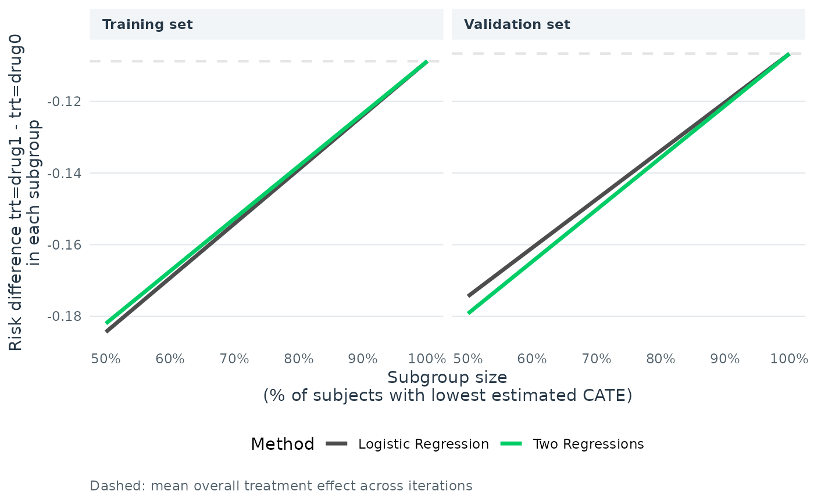

# Estimating and validating treatment effects for binary outcomes

This vignette follows a treatment-effect analysis from a simple
comparison to an adjusted average treatment effect (ATE), conditional
average treatment effect (CATE) scores, and validation in held-out data.
The data are entirely synthetic. For an introduction to individualized
treatment effect prediction with binary endpoints in randomized trials,
see Hoogland et al. (2021). See the [count
example](https://smartdata-analysis-and-statistics.github.io/precmed/articles/Count-examples.md)
for the corresponding analysis of relapse rates and repeated
cross-validation.

## Load required packages

``` r

library(precmed)
```

## Example data

We consider a simulated dataset of patients with multiple sclerosis
(MS), in which `relapse_count` represents the number of relapses
observed during one year of follow-up. The outcome of interest is
binary: `y = 1` if a patient has at least one relapse and `y = 0`
otherwise. Relapse counts are generated using the same model as
[`simulate_count()`](https://smartdata-analysis-and-statistics.github.io/precmed/reference/simulate_count.md).
Everyone has the same follow-up, and the outcome is fully observed. The
`followup` argument is measured in years: `followup = 1` means one year
for every patient, while `followup = 0.5` means six months. Set
`threshold` to a larger integer to define an event as more than that
many relapses, or change `followup` to study another fixed horizon.

``` r

binaryExample <- simulate_binary(n = 4000, seed = 2026,
                                 followup = 1, threshold = 0)
head(binaryExample)
#>           age female previous_treatment previous_cost previous_number_symptoms
#> 1   4.6853017      0              drugB   -0.04071778                        0
#> 2  -9.7172169      1              drugB   -0.07763572                      >=2
#> 3   1.2531430      1              drugA    0.38461438                        0
#> 4  -0.7627391      1              drugB   -0.45026280                        0
#> 5  -5.9997565      0              drugC    0.55030741                        1
#> 6 -22.6448013      1              drugB   -0.59281629                        1
#>   previous_number_relapses   trt y years relapse_count
#> 1                        0 drug1 1     1             1
#> 2                        0 drug0 1     1             1
#> 3                        0 drug1 1     1             1
#> 4                        0 drug1 0     1             0
#> 5                        1 drug1 1     1             2
#> 6                        1 drug0 0     1             0
table(binaryExample$trt, binaryExample$y)
#>        
#>            0    1
#>   drug0 1003  855
#>   drug1 1273  869
prop.table(table(binaryExample$trt, binaryExample$y), margin = 1)
#>        
#>                 0         1
#>   drug0 0.5398278 0.4601722
#>   drug1 0.5943044 0.4056956
```

Treatment is assigned using age and previous treatment, so the treatment
groups need not be comparable without adjustment. Age is centered at 48
years and previous cost is centered at 13,824 USD and divided by 20,172
USD. The simulation coefficients are illustrative and are not clinical
estimates. Unlike a count rate ratio, the relapse risk difference
depends on the selected threshold and follow-up period.

## Estimate the average treatment effect

For the estimators and their assumptions, see [Methods for estimating
average treatment
effects](https://smartdata-analysis-and-statistics.github.io/precmed/articles/ATE-theory.md).

### Unadjusted treatment comparison

We first compare the observed relapse proportions under drug1 and drug0.

``` r

relapse_risks <- with(binaryExample, tapply(y, trt, mean))
relapse_risks
#>     drug0     drug1 
#> 0.4601722 0.4056956
```

The unadjusted risk difference for drug1 versus drug0 is calculated by
subtracting the relapse proportion for drug0 from that for drug1. A
negative value means a lower observed relapse proportion under drug1.
Here, the unadjusted risk difference is -0.054, or -5.4 percentage
points for drug1 minus drug0. This unadjusted comparison may reflect
baseline differences between the groups rather than a genuine treatment
effect.

The 95% confidence interval is -0.085 to -0.024, based on a normal
approximation for two independent proportions.

### Covariate-adjusted treatment comparison

Treatment assignment may differ according to baseline characteristics.
We fit a multivariable binomial model adjusting for age, sex, previous
treatment, previous medical cost, and previous relapses, as in the count
example. The identity link estimates the risk difference directly (Naimi
and Whitcomb 2020).

``` r

adjusted <- glm(
  y ~ trt + age + female + previous_treatment + previous_cost +
    previous_number_relapses,
  data = binaryExample, family = binomial(link = "identity")
)
summary(adjusted)
#> 
#> Call:
#> glm(formula = y ~ trt + age + female + previous_treatment + previous_cost + 
#>     previous_number_relapses, family = binomial(link = "identity"), 
#>     data = binaryExample)
#> 
#> Coefficients:
#>                            Estimate Std. Error z value Pr(>|z|)    
#> (Intercept)               0.4296033  0.0204141  21.044  < 2e-16 ***
#> trtdrug1                 -0.0973253  0.0170384  -5.712 1.12e-08 ***
#> age                       0.0056606  0.0009682   5.846 5.02e-09 ***
#> female                    0.0535246  0.0171345   3.124  0.00179 ** 
#> previous_treatmentdrugB   0.0131217  0.0176378   0.744  0.45690    
#> previous_treatmentdrugC  -0.0326664  0.0205354  -1.591  0.11167    
#> previous_cost             0.0398499  0.0163037   2.444  0.01452 *  
#> previous_number_relapses  0.0228496  0.0087874   2.600  0.00932 ** 
#> ---
#> Signif. codes:  0 '***' 0.001 '**' 0.01 '*' 0.05 '.' 0.1 ' ' 1
#> 
#> (Dispersion parameter for binomial family taken to be 1)
#> 
#>     Null deviance: 5468.8  on 3999  degrees of freedom
#> Residual deviance: 5397.6  on 3992  degrees of freedom
#> AIC: 5413.6
#> 
#> Number of Fisher Scoring iterations: 3
```

The adjusted risk difference for drug1 versus drug0 is captured by the
coefficient for `trtdrug1` and estimated as -0.097 (95% CI: -0.131 to
-0.064). The interval is a model-based Wald interval. The model assumes
that the risk difference is the same at every covariate value; under
this assumption, the coefficient is also the risk difference averaged
over the study population. A causal interpretation requires, among other
assumptions, a correctly specified outcome model, no unmeasured
confounding, and adequate treatment overlap.

### Population-level treatment comparison using `atefit()`

`atefit(response = "binary")` estimates the difference in relapse
probability under drug1 and drug0. Negative values favor drug1 because
relapse is an adverse outcome. The estimator combines a logistic outcome
model and a treatment model (the propensity-score model), which
estimates the probability of receiving treatment 1 given the covariates.
Under the usual identification and regularity assumptions, the estimator
is consistent if either model is correctly specified. Causal
interpretation also requires well-defined treatments, no unmeasured
confounding, and adequate treatment overlap. Bootstrap samples provide
uncertainty estimates. These synthetic counts do not in general imply an
exactly logistic outcome model; the treatment model is correctly
specified by construction in this example. Chapter 5, “Understanding and
defining causal effects,” discusses marginal and conditional causal
effects (Nguyen et al. 2026).

The outcome formula excludes treatment:
[`atefit()`](https://smartdata-analysis-and-statistics.github.io/precmed/reference/atefit.md)
adds treatment and, by default, its interactions with the outcome
covariates. `ps.model` includes the treatment on the left. Treatment
labels are ordered as drug0 and drug1. There is no follow-up offset for
this fixed-horizon binary outcome.

``` r

outcome_formula <- y ~ age + female + previous_treatment + previous_cost +
  previous_number_relapses
ps_formula <- trt ~ age + previous_treatment
fit_ate <- atefit(
  response = "binary", data = binaryExample,
  cate.model = outcome_formula, ps.model = ps_formula,
  n.boot = 100, seed = 999
)
fit_ate
#> Average treatment effect (risk difference):
#> 
#>                   estimate        SE   CI.lower    CI.upper       pvalue
#> risk.difference -0.1079285 0.0196987 -0.1465372 -0.06931972 4.278253e-08
#> 
#> Estimated risks:
#> 
#>    estimate
#> 1 0.3947549
#> 2 0.5026833
```

Use [`coef()`](https://rdrr.io/r/stats/coef.html) and
[`confint()`](https://rdrr.io/r/stats/confint.html) to extract the risk
difference and its confidence interval:

``` r

coef(fit_ate)
#> risk.difference 
#>      -0.1079285
confint(fit_ate)
#>                      2.5 %      97.5 %
#> risk.difference -0.1465372 -0.06931972
```

The output reports estimated population-average relapse risks of 0.395
under drug1 and 0.503 under drug0, shown in that order. Their difference
(drug1 minus drug0) is -0.108, or -10.8 percentage points. A negative
difference favors drug1. The output also reports the bootstrap standard
error, a 95% Wald confidence interval of -0.147 to -0.069, and a
two-sided Wald p-value for the risk difference. The causal
interpretation depends on the assumptions described above.

A causal interpretation of this estimate relies on several assumptions,
including consistency and the stable unit treatment value assumption,
conditional exchangeability, and positivity; Chapter 5 discusses these
assumptions (Nguyen et al. 2026). Positivity requires that both
treatments are possible at each relevant combination of covariates in
the target population. The following diagnostics summarize estimated
propensity-score overlap and treatment-weight variability in the
analysis sample. They can help investigate potential practical
positivity problems, but cannot establish that the positivity assumption
holds. The table reports propensity scores before truncation and inverse
treatment weights after truncation. The outside-range count is the
number of patients whose estimated score falls outside the observed
range in the other treatment group; its percentage is within the
patient’s own treatment group:

``` r

diagnostics(fit_ate, type = "propensity")
```

| Diagnostic                         | drug0            | drug1            |
|:-----------------------------------|:-----------------|:-----------------|
| Patients, n                        | 1858             | 2142             |
| Propensity score, median (min-max) | 0.43 (0.04-0.91) | 0.64 (0.05-0.91) |
| Outside other group’s range, n (%) | 3 (0.2%)         | 0 (0.0%)         |
| Truncated below / above, n         | 0 / 0            | 0 / 0            |
| Treatment weight, median (max)     | 1.76 (11.31)     | 1.56 (20.71)     |
| Effective sample size              | 1397             | 1611             |

In this example, 3 patients receiving drug0 and 0 receiving drug1 have
estimated scores outside the observed range in the other group. The
effective sample sizes are 1397 and 1611, respectively. The effective
sample size summarizes how concentrated the treatment weights are within
each group: smaller values indicate that fewer patients carry a larger
share of the total weight, which can reduce precision. These summaries
depend on the fitted treatment model and do not establish positivity,
covariate balance, conditional exchangeability, or the absence of
unmeasured confounding. Use `layout = "arms"` for unrounded numeric
results.

Use [`plot()`](https://rdrr.io/r/graphics/plot.default.html) to inspect
the bootstrap estimates:

``` r

plot(fit_ate, metrics = c("risk0", "risk1", "risk_difference"))
```


The plot shows bootstrap relapse risks for drug0 (`risk0`) and drug1
(`risk1`), followed by their risk difference. Red lines mark the
full-sample estimates; the dashed line marks zero in the risk-difference
panel. This example uses only 100 bootstrap replicates to keep the
vignette fast; use more for an analysis. If a bootstrap model fails, the
package reports unavailable inference rather than silently dropping it.
Augmented estimates of risk are not constrained to lie within 0 and 1.

### Compare risk differences

All three estimates compare drug1 with drug0 on the same absolute
probability scale. The unadjusted comparison describes the observed
treatment groups. The identity-link binomial estimate uses the outcome
model alone, whereas
[`atefit()`](https://smartdata-analysis-and-statistics.github.io/precmed/reference/atefit.md)
adds a propensity-score correction. Differences between the adjusted
estimates can reflect their different models and assumptions. The
unadjusted interval is based on the two-proportion normal standard
error. The binomial model uses a model-based Wald interval;
[`atefit()`](https://smartdata-analysis-and-statistics.github.io/precmed/reference/atefit.md)
uses a Wald interval based on its bootstrap standard error.

| Estimation method | Interpretation | Risk difference | 95% CI |
|:---|:---|---:|:---|
| Unadjusted observed proportions | Unadjusted observed group difference | -0.054 | -0.085 to -0.024 |
| Adjusted binomial identity-link model | Conditional; also marginal under the constant-difference model | -0.097 | -0.131 to -0.064 |
| Doubly robust atefit() | Marginal population-average difference | -0.108 | -0.147 to -0.069 |

The unadjusted difference compares the observed treatment groups; it is
not necessarily a causal marginal effect. The binomial model’s
coefficient is conditional on the included covariates and, because it
assumes the same risk difference for every patient, equals its
model-implied marginal difference.
[`atefit()`](https://smartdata-analysis-and-statistics.github.io/precmed/reference/atefit.md)
targets the population-average difference without requiring a constant
conditional risk difference. Causal interpretations require the
assumptions described above.

A risk difference of -0.10 corresponds to 10 percentage points fewer
patients with a relapse under drug1. The intervals describe uncertainty
around each estimate; they do not test whether the methods differ from
one another.

## Estimate CATE scores

CATE scores estimate the difference in relapse probability for patients
with different baseline covariates. The `logistic` method fits one
logistic model with treatment-covariate interactions; `twoReg`
cross-fits separate logistic outcome models and a treatment model, then
projects augmented outcomes for each arm onto the outcome-model design.
The difference is a doubly robust linear projection of the risk
difference if either the treatment model or both outcome models are
correct, subject to identification, positivity and truncation. It need
not lie between -1 and 1. The `boosting` method fits a Bernoulli
gradient boosting model in each treatment arm and subtracts the
predicted relapse probabilities. Five-fold cross-validation selects the
number of trees in each arm; `tree.depth` and `n.trees.boosting` control
the fitted trees. These scores are estimated on the training data; the
subgroup ATEs shown by
[`catefit()`](https://smartdata-analysis-and-statistics.github.io/precmed/reference/catefit.md)
use the doubly robust estimator and the same data used to build the
scores, so they may be optimistic. Chapter 17, “Introduction to methods
for personalizing medicine,” discusses treatment effect heterogeneity
and CATE prediction (Hoogland et al. 2026).

``` r

fit_cate <- catefit(
  response = "binary", data = binaryExample,
  score.method = c("logistic", "twoReg", "boosting"),
  cate.model = outcome_formula, ps.model = ps_formula,
  higher.y = FALSE, prop.cutoff = c(0.5, 0.75, 1), seed = 999,
  n.trees.boosting = 100, plot.gbmperf = FALSE, n.cores = 1
)
```

## Inspect CATE scores and subgroup estimates

The fitted scores estimate differences in relapse probability for
patients with different baseline covariates. Use
[`predict()`](https://rdrr.io/r/stats/predict.html) to retrieve scores
for the original analysis sample; prediction for new data is not
currently supported. Below are the first 6 scores from the
two-regression method.

``` r

scores <- predict(fit_cate, method = "twoReg")
head(scores)
#>             1             2             3             4             5 
#> -1.642382e-01  6.177954e-02 -5.741223e-02  5.561457e-05 -1.572941e-01 
#>             6 
#>  1.046504e-01
```

Use [`plot()`](https://rdrr.io/r/graphics/plot.default.html) to compare
fitted score distributions. Scores are on the risk difference scale,
with zero indicating no difference in relapse probability.

``` r

plot(fit_cate, type = "density")
```


Differences between the score distributions can reflect model
flexibility, estimation noise or overfitting. The plot alone cannot
establish that treatment effects differ or that scores will perform well
in new patients.

Use [`coef()`](https://rdrr.io/r/stats/coef.html) to extract the
available linear score coefficients. For `twoReg`, the coefficients
describe a linear projection of the risk difference. The logistic
model’s coefficients are on the log-odds scale, and boosting does not
have a linear score coefficient vector. Confidence intervals for binary
score coefficients are not currently available.

``` r

coef(fit_cate, method = "twoReg")
#>              (Intercept)                      age                   female 
#>              -0.16042803              -0.00747815               0.11779453 
#>  previous_treatmentdrugB  previous_treatmentdrugC            previous_cost 
#>               0.03065470               0.02705082              -0.01405964 
#> previous_number_relapses 
#>              -0.06104685
```

Use
[`subgroup_estimates()`](https://smartdata-analysis-and-statistics.github.io/precmed/reference/subgroup_estimates.md)
to inspect estimated risk differences in nested subgroups ranked by the
two-regression score. These estimates use the same data as the score
fit; the validation section below assesses the score in held-out data.
The contrast is drug 1 minus drug 0, so a negative value favors drug 1.

``` r

subgroup_estimates(fit_cate, method = "twoReg", measure = "risk_difference")
#>    prop0.5   prop0.75      prop1 
#> -0.1792806 -0.1474149 -0.1079285
```

For example, `prop0.5` is the estimated treatment effect in the half
with the lowest scores, using a sample quantile cutoff; ties can make
the subgroup larger. `higher.y = FALSE` selects lower risk differences
as favorable because relapse is an adverse event. For a desirable binary
outcome, use `higher.y = TRUE`.

## Internally validate CATE scores

[`catecv()`](https://smartdata-analysis-and-statistics.github.io/precmed/reference/catecv.md)
repeats treatment-stratified training and validation splits. It fits the
score in each training set, applies it to the corresponding validation
set, and estimates subgroup risk differences separately in each set.
Percentile cutoffs are calculated within each set without using
validation outcomes. We compare `logistic` and `twoReg` on the same
splits. The validation curves and ABC compare how the scores rank
patients by estimated treatment benefit; they do not assess calibration.
[`diagnostics()`](https://smartdata-analysis-and-statistics.github.io/precmed/reference/diagnostics.md)
reports unavailable subgroup estimates and `subgroup.support` records
arm sizes. We use 10 repeated splits and one inner cross-fitting
repetition to balance run time and illustration; more repetitions and
independent validation can give a more reliable assessment. The nested
cutoffs select the best-scoring 50% and the full set, and the mutually
exclusive groups split each set in half. These larger subgroups avoid
the rank-deficient fits observed with smaller groups in this example;
check support and model fit when choosing cutoffs for other data.

``` r

fit_cv <- catecv(
  response = "binary", data = binaryExample, score.method = c("logistic", "twoReg"),
  cate.model = outcome_formula, ps.model = ps_formula, higher.y = FALSE,
  prop.cutoff = c(0.5, 1), prop.multi = c(0, 0.5, 1),
  cv.n = 10, B = 1, seed = 102
)
plot(fit_cv, show.abc = FALSE)
```



``` r

boxplot(fit_cv)
```


``` r

abc(fit_cv)
#>                 cv1        cv2        cv3         cv4        cv5        cv6
#> logistic 0.02997601 0.01402678 0.03633474 0.004732452 0.01140305 0.01547006
#> twoReg   0.02638229 0.01288020 0.03879525 0.007680507 0.01207716 0.01261662
#>                 cv7        cv8        cv9       cv10
#> logistic 0.01857408 0.01841614 0.02342370 0.01266026
#> twoReg   0.01806718 0.01906034 0.02641335 0.01410169
abc(fit_cv, combine = "mean")
#>   logistic     twoReg 
#> 0.01850173 0.01880746
```

The plotted curves use the two requested subgroup proportions.
[`abc()`](https://smartdata-analysis-and-statistics.github.io/precmed/reference/abc.md)
uses 100 proportions between 0.5 and 1 in each validation iteration, so
its values summarize a finer curve; the plot omits its separate, coarser
ABC annotation.

In this example, the mean validation ABC is 0.0185 for `logistic` and
0.0188 for `twoReg`. These similar values suggest comparable ranking
performance in these splits. The ABC varies across iterations, and this
comparison does not establish that the methods are equivalent in this
population or in other data.

Compare the validation curves and subgroup estimates with the training
results, accounting for variation across splits. Lower scores indicate
greater predicted benefit in this example. These summaries assess
ranking; they do not by themselves establish calibration, clinical
usefulness, or a statistically significant difference between subgroup
effects. Chapter 19 discusses broader validation (Thao et al. 2026), and
Chapter 20 discusses responder diagnostics and treatment-rule
interpretation (Jiang et al. 2026).

## Other `precmed` vignettes in this series

- [Understanding doubly robust
  methods](https://smartdata-analysis-and-statistics.github.io/precmed/articles/doubly-robust.md)
- [Estimating and validating treatment effects for count
  outcomes](https://smartdata-analysis-and-statistics.github.io/precmed/articles/Count-examples.md)
- [Estimating and validating treatment effects for survival
  outcomes](https://smartdata-analysis-and-statistics.github.io/precmed/articles/Survival-examples.md)
- [Customizing CATE models and
  validation](https://smartdata-analysis-and-statistics.github.io/precmed/articles/Additional-examples.md)
- [Methods for estimating average treatment
  effects](https://smartdata-analysis-and-statistics.github.io/precmed/articles/ATE-theory.md)
- [Methods for developing and validating CATE
  scores](https://smartdata-analysis-and-statistics.github.io/precmed/articles/Theoretical-details.md)

## References

Hoogland, Jeroen, Thomas P. A. Debray, Guillaume Desachy, and Tri-Long
Nguyen. 2026. “Introduction to Methods for Personalizing Medicine.”
Chap. 17 in *Comparative Effectiveness and Personalized Medicine
Research Using Real-World Data*, edited by Thomas P. A. Debray, Tri-Long
Nguyen, and Robert W. Platt. Chapman & Hall/CRC.
<https://doi.org/10.1201/9781003300809-17>.

Hoogland, Jeroen, Joanna IntHout, Michail Belias, et al. 2021. “A
Tutorial on Individualized Treatment Effect Prediction from Randomized
Trials with a Binary Endpoint.” *Statistics in Medicine* 40 (26):
5961–81. <https://doi.org/10.1002/sim.9154>.

Jiang, Xiaotong, Gabrielle Simoneau, Fabio Pellegrini, Changyu Shen,
Carl de Moor, and Lu Tian. 2026. “Visualization and Interpretation of
Individualized Treatment Rule Results.” Chap. 20 in *Comparative
Effectiveness and Personalized Medicine Research Using Real-World Data*,
edited by Thomas P. A. Debray, Tri-Long Nguyen, and Robert W. Platt.
Chapman & Hall/CRC. <https://doi.org/10.1201/9781003300809-20>.

Naimi, Ashley I., and Brian W. Whitcomb. 2020. “Estimating Risk Ratios
and Risk Differences Using Regression.” *American Journal of
Epidemiology* 189 (6): 508–10. <https://doi.org/10.1093/aje/kwaa044>.

Nguyen, Tri-Long, Jessica L. Rohmann, Tat Thang Vo, Robert W. Platt, and
Thomas P. A. Debray. 2026. “Understanding and Defining Causal Effects.”
Chap. 5 in *Comparative Effectiveness and Personalized Medicine Research
Using Real-World Data*, edited by Thomas P. A. Debray, Tri-Long Nguyen,
and Robert W. Platt. Chapman & Hall/CRC.
<https://doi.org/10.1201/9781003300809-5>.

Thao, Le Thi Phuong, Orestis Efthimiou, Tibor V. Varga, Jeroen Hoogland,
and Thomas P. A. Debray. 2026. “Validation of Prediction Models for
Patient Outcomes and Individualized Treatment Effect.” Chap. 19 in
*Comparative Effectiveness and Personalized Medicine Research Using
Real-World Data*, edited by Thomas P. A. Debray, Tri-Long Nguyen, and
Robert W. Platt. Chapman & Hall/CRC.
<https://doi.org/10.1201/9781003300809-19>.
