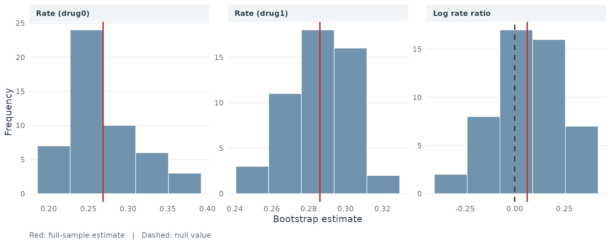

# Average treatment effects for count outcomes

[](https://cran.r-project.org/package=precmed)
[](https://cran.r-project.org/package=precmed)

This vignette estimates population-average treatment effects for count
outcomes using simulated multiple sclerosis data. The [count CATE
example](https://smartdata-analysis-and-statistics.github.io/precmed/articles/Count-CATE.md)
develops and validates conditional treatment-effect scores.

## Load required packages

``` r

library(precmed)
library(dplyr)
library(ggplot2)
```

## Example data

We consider a simulated dataset that is based on real-world claims data
from patients with multiple sclerosis. The dataset `countExample`
includes 4,000 patients.

Alternatively, `simulate_count(n = 4000, seed = 1)` generates a fully
synthetic dataset with the same analysis variables. Its treatment
assignment, rate ratio, treatment interactions, follow-up and count
dispersion can be varied; see
[`?simulate_count`](https://smartdata-analysis-and-statistics.github.io/precmed/reference/simulate_count.md).
The simulator uses illustrative assumptions and does not reconstruct the
claims data or the packaged example.

The simulated dataset contains the following baseline covariates,
summarized overall and by treatment group.

[TABLE]

The outcome variable `y` records the number of relapses during
follow-up. The variable `years` records follow-up time in years and
supplies the exposure time for the rate-model offset. The treatment
variable `trt` identifies drug0 or drug1.

For convenience, `age` is centered at 48 years and `previous_cost` is
centered at 13,824 USD and divided by 20,172 USD.

For the estimators and their assumptions, see [Methods for estimating
average treatment
effects](https://smartdata-analysis-and-statistics.github.io/precmed/articles/ATE-theory.md).

## Unadjusted treatment comparison

We first compare relapse rates between treatment groups using a Poisson
model with treatment as the only predictor. The log follow-up time is
included as an offset to account for differences in exposure. This
unadjusted association does not account for differences in patient
characteristics.

``` r

output_poisson <- glm(y ~ trt + offset(log(years)),
                      data = countExample, family = poisson())
summary(output_poisson)
#> 
#> Call:
#> glm(formula = y ~ trt + offset(log(years)), family = poisson(), 
#>     data = countExample)
#> 
#> Coefficients:
#>             Estimate Std. Error z value Pr(>|z|)    
#> (Intercept) -1.32370    0.05538 -23.900   <2e-16 ***
#> trtdrug1     0.07293    0.06346   1.149     0.25    
#> ---
#> Signif. codes:  0 '***' 0.001 '**' 0.01 '*' 0.05 '.' 0.1 ' ' 1
#> 
#> (Dispersion parameter for poisson family taken to be 1)
#> 
#>     Null deviance: 3294.4  on 3999  degrees of freedom
#> Residual deviance: 3293.1  on 3998  degrees of freedom
#> AIC: 5350.4
#> 
#> Number of Fisher Scoring iterations: 6
```

The estimated rate ratio for drug 1 versus drug 0 is 1.08. A ratio below
1 corresponds to a lower relapse rate under drug 1. This association
does not by itself establish a causal treatment effect.

## Covariate-adjusted treatment comparison

Treatment assignment may differ according to baseline characteristics.
To account for measured differences, we fit a Poisson model that adjusts
for age, sex, previous treatment, previous medical cost and previous
relapses, while retaining the follow-up offset.

``` r

output_poisson_adjusted <- glm(
  y ~ trt + age + female + previous_treatment + previous_cost +
    previous_number_relapses + offset(log(years)),
  data = countExample, family = poisson()
)
summary(output_poisson_adjusted)
#> 
#> Call:
#> glm(formula = y ~ trt + age + female + previous_treatment + previous_cost + 
#>     previous_number_relapses + offset(log(years)), family = poisson(), 
#>     data = countExample)
#> 
#> Coefficients:
#>                           Estimate Std. Error z value Pr(>|z|)    
#> (Intercept)              -2.119915   0.093376 -22.703  < 2e-16 ***
#> trtdrug1                  0.074697   0.063503   1.176   0.2395    
#> age                      -0.015082   0.002723  -5.540 3.03e-08 ***
#> female                    0.483290   0.072830   6.636 3.23e-11 ***
#> previous_treatmentdrugB   0.828678   0.078981  10.492  < 2e-16 ***
#> previous_treatmentdrugC   0.404501   0.060730   6.661 2.73e-11 ***
#> previous_cost            -0.070031   0.031698  -2.209   0.0272 *  
#> previous_number_relapses  0.189551   0.035005   5.415 6.13e-08 ***
#> ---
#> Signif. codes:  0 '***' 0.001 '**' 0.01 '*' 0.05 '.' 0.1 ' ' 1
#> 
#> (Dispersion parameter for poisson family taken to be 1)
#> 
#>     Null deviance: 3294.4  on 3999  degrees of freedom
#> Residual deviance: 3071.2  on 3992  degrees of freedom
#> AIC: 5140.5
#> 
#> Number of Fisher Scoring iterations: 6
```

The adjusted rate ratio is 1.08, compared with 1.08 in the unadjusted
model. The adjusted ratio is conditional on the included covariates and
does not necessarily represent a causal average treatment effect. A
causal interpretation requires, among other assumptions, adequate
treatment overlap and no unmeasured confounding.

## Population-average treatment effects using `atefit()`

We now use
[`atefit()`](https://smartdata-analysis-and-statistics.github.io/precmed/reference/atefit.md)
to estimate a population-level rate ratio, combining outcome and
treatment models. The treatment model estimates the propensity score,
the probability of receiving treatment 1 given the covariates. The rate
ratio estimator is doubly robust, meaning that the estimator is
consistent if the treatment model (argument `ps.model`) or the outcome
model (argument `outcome_model`) or both are correctly specified, under
the required assumptions. The function also provides standard errors,
confidence intervals and p-values based on bootstrap.

In this example, the rate ratio compares the relapse rate under drug 1
with that under drug 0; a rate ratio below 1 favors drug 1. A causal
interpretation requires appropriate assumptions, including no unmeasured
confounding, adequate overlap in treatment assignment, and well-defined
treatments. Chapter 5 introduces marginal and conditional treatment
effects (Nguyen et al. 2026).

The mandatory arguments for
[`atefit()`](https://smartdata-analysis-and-statistics.github.io/precmed/reference/atefit.md)
are:

- `response`: “count” in this example because we use have data with a
  count outcome (e.g., number of relapses))

- `data`: the name of the data set. (countExample)

- `outcome_model`: A formula describing the outcome model to be fitted.
  The outcome must appear on the left-hand side. In the example, we
  choose to specify to outcome model as a linear combination of the
  following covariates: age, sex, previous treatment, medical costs in
  the year prior to treatment initiation, and number of relapses in the
  year prior to treatment initiation. Non-linear or interaction terms
  could also be included. The outcome model has the offset `log(years)`
  to account for the varying exposure times across patients. Note that
  the treatment variable is not supplied in `outcome_model` since this
  is an outcome model.

&nbsp;

- `ps.model`: A formula describing the treatment model to be fitted. The
  treatment must appear on the left-hand side and the covariates (age
  and previous treatment in this example) on the right-hand side. The
  variable `trt` must be supplied as a numeric variable taking only 2
  values, 1 for active treatment and 0 for control or comparator. If it
  is not the case, the function will stop with error if `trt` takes more
  than 2 distinct values or will automatically transform `trt` into a
  numeric variable. In this example, `trt` (a factor variable taking
  values “drug0” and “drug1”) was transformed and an informational
  message is shown (see output below):
  `Variable trt was recoded to 0/1 with drug0->0 and drug1->1`. If the
  data are from a RCT, it suffices to specify `ps.model` = trt ~ 1. The
  treatment model is used to estimate overall and subgroup average
  treatment effects. It is also used to fit the doubly robust
  two-regression and contrast-regression CATE scores; other scoring
  methods need not use it to construct their scores.

Let’s calculate the ATE for the effect of treatment on y and build an
outcome model that contains all variables and a treatment model with
`age` and `previous_treatment`.

``` r

fit_ate <- atefit(
  response = "count",
  data = countExample,
  outcome_model = y ~ age + female + previous_treatment +
    previous_cost + previous_number_relapses + offset(log(years)),
  outcome_method = "poisson",
  ps.model = trt ~ age + previous_treatment,
  n.boot = 100,
  seed = 999,
  verbose = 0
)
#> Variable trt was recoded to 0/1 with drug0->0 and drug1->1.
```

When `verbose` = 1, the function outputs a progress bar in the console.

``` r

fit_ate
#> Average treatment effect:
#> 
#>                  estimate        SE   CI.lower  CI.upper   pvalue
#> log.rate.ratio 0.06311746 0.1549953 -0.2406677 0.3669026 0.683845
#> 
#> Estimated event rates:
#> 
#>        estimate
#> rate1 0.2860635
#> rate0 0.2685660
#> Variable trt was recoded to 0/1 with drug0->0 and drug1->1.
```

### Diagnostics

A causal interpretation also requires assumptions including consistency,
conditional exchangeability and positivity; Chapter 5 discusses these
assumptions (Nguyen et al. 2026). Positivity requires that both
treatments are possible at each relevant combination of covariates in
the target population. The following diagnostics summarize estimated
propensity-score overlap and treatment-weight variability in the
analysis sample. They can help investigate potential practical
positivity problems, but cannot establish that positivity holds:

``` r

diagnostics(fit_ate, type = "propensity")
```

| Diagnostic                         | drug0            | drug1            |
|:-----------------------------------|:-----------------|:-----------------|
| Patients, n                        | 998              | 3002             |
| Propensity score, median (min-max) | 0.75 (0.74-0.76) | 0.75 (0.74-0.76) |
| Outside other group’s range, n (%) | 2 (0.2%)         | 0 (0.0%)         |
| Truncated below / above, n         | 0 / 0            | 0 / 0            |
| Treatment weight, median (max)     | 3.97 (4.21)      | 1.34 (1.36)      |
| Effective sample size              | 997              | 3002             |

Propensity score summaries use the estimated probabilities before
truncation. The count of patients outside the other treatment’s
propensity score range uses the observed range in the other treatment
group. Treatment weights use the truncated scores; the effective sample
size summarizes their variability. Percentages are within each treatment
group. Use `layout = "arms"` for unrounded numeric results. These
diagnostics do not establish covariate balance or exclude unmeasured
confounding.

The output of
[`atefit()`](https://smartdata-analysis-and-statistics.github.io/precmed/reference/atefit.md)
shows the point estimate, standard error (“SE”), lower (“CI.lower”) and
upper (“CI.upper”) bound of the 95% confidence interval, and the p-value
(“pvalue”) for the log rate ratio (`$log.rate.ratio`) as well as the
point estimate for the rate in the 2 treatment groups (`$rate0` and
`$rate1`). For example, the log rate ratio of 0.06 and the 95%
confidence interval of (-0.24, 0.37) are displayed in the output. Use
[`coef()`](https://rdrr.io/r/stats/coef.html) and
[`confint()`](https://rdrr.io/r/stats/confint.html) to extract the log
rate ratio and its confidence interval, then exponentiate them to obtain
the rate ratio and its interval. The default confidence level is 95%;
specify `level`, for example `level = 0.90`, to request a different
level. Intervals use the bootstrap standard error already stored in the
fitted object:

``` r

rate_ratio <- unname(exp(coef(fit_ate)))
rate_ratio
#> [1] 1.065152
rate_ratio_ci <- exp(confint(fit_ate, level = 0.95))
rate_ratio_ci
#>                    2.5 %   97.5 %
#> log.rate.ratio 0.7861028 1.443257
```

The rate ratio of 1.07 along with the 95% confidence interval of (0.79,
1.44) indicate a higher estimated relapse rate under drug 1 than drug 0.
However, the confidence interval includes 1, so there is insufficient
evidence of a treatment difference, consistent with the p-value of 0.68
in the output (`$log.rate.ratio$pvalue`).

We can plot the distribution of bootstrap estimates using
`plot(fit_ate)`; by default it displays estimates of the rate for each
treatment and the log rate ratio. The `metrics` argument selects and
orders these panels. Solid red lines mark the full-sample estimates, and
the dashed black line marks the null value of 0 in the log-ratio panel
(a rate ratio of 1). Set `null.value` to another value on the log scale,
or to `NULL` or `NA` to omit the reference line.

``` r

plot(fit_ate, metrics = c("rate0", "rate1", "log_rate_ratio"))
```



### Alternative outcome model

In the calculations above, we used a Poisson outcome model. To assess
how the outcome-model choice influences the estimated population-average
rate ratio, we can instead fit a negative binomial outcome model with
`outcome_method = "negbin"`. The treatment model, exposure offset and
doubly robust estimator remain the same. Dispersion is estimated
separately in each treatment arm, and the outcome and treatment models
are refitted in each bootstrap sample.

``` r

fit_ate_negbin <- atefit(
  response = "count",
  data = countExample,
  outcome_model = y ~ age + female + previous_treatment +
    previous_cost + previous_number_relapses + offset(log(years)),
  outcome_method = "negbin",
  ps.model = trt ~ age + previous_treatment,
  n.boot = 100,
  seed = 999,
  verbose = 0
)
#> Variable trt was recoded to 0/1 with drug0->0 and drug1->1.
#> Warning in theta.ml(Y, mu, sum(w), w, limit = control$maxit, trace =
#> control$trace > : estimate truncated at zero
#> Warning in theta.ml(Y, mu, sum(w), w, limit = control$maxit, trace =
#> control$trace > : iteration limit reached
#> Warning: 1 bootstrap replicate(s) failed or had undefined estimates; inference
#> for affected measures is unavailable. Reasons by measure: rate0: missing value
#> where TRUE/FALSE needed (1); rate1: missing value where TRUE/FALSE needed (1);
#> log.rate.ratio: missing value where TRUE/FALSE needed (1). See
#> bootstrap.diagnostics for replicate details.
```

The table below compares the ATE estimated using a Poisson and a
negative binomial outcome model. The estimates can differ because the
outcome models are fitted differently; neither comparison establishes
which model is correct. The intervals use the bootstrap standard errors,
based on 100 replicates.

|                   | Rate ratio | 95% CI lower | 95% CI upper |
|:------------------|-----------:|-------------:|-------------:|
| Poisson           |      1.065 |        0.786 |        1.443 |
| Negative binomial |      1.066 |           NA |           NA |

## Related vignettes

- [CATE scores and validation for count
  outcomes](https://smartdata-analysis-and-statistics.github.io/precmed/articles/Count-CATE.md)
- [Methods for estimating average treatment
  effects](https://smartdata-analysis-and-statistics.github.io/precmed/articles/ATE-theory.md)
- [Understanding doubly robust
  methods](https://smartdata-analysis-and-statistics.github.io/precmed/articles/doubly-robust.md)

## References

Nguyen, Tri-Long, Jessica L. Rohmann, Tat Thang Vo, Robert W. Platt, and
Thomas P. A. Debray. 2026. “Understanding and Defining Causal Effects.”
Chap. 5 in *Comparative Effectiveness and Personalized Medicine Research
Using Real-World Data*, edited by Thomas P. A. Debray, Tri-Long Nguyen,
and Robert W. Platt. Chapman & Hall/CRC.
<https://doi.org/10.1201/9781003300809-5>.
