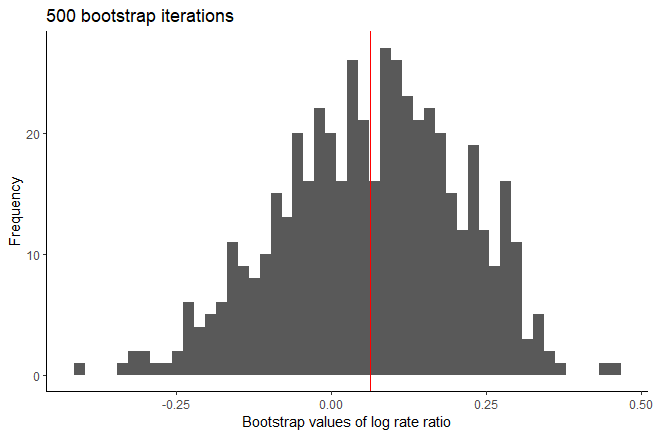
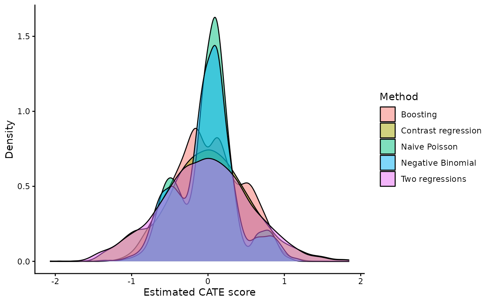
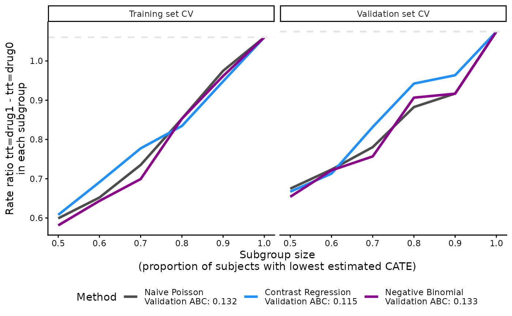
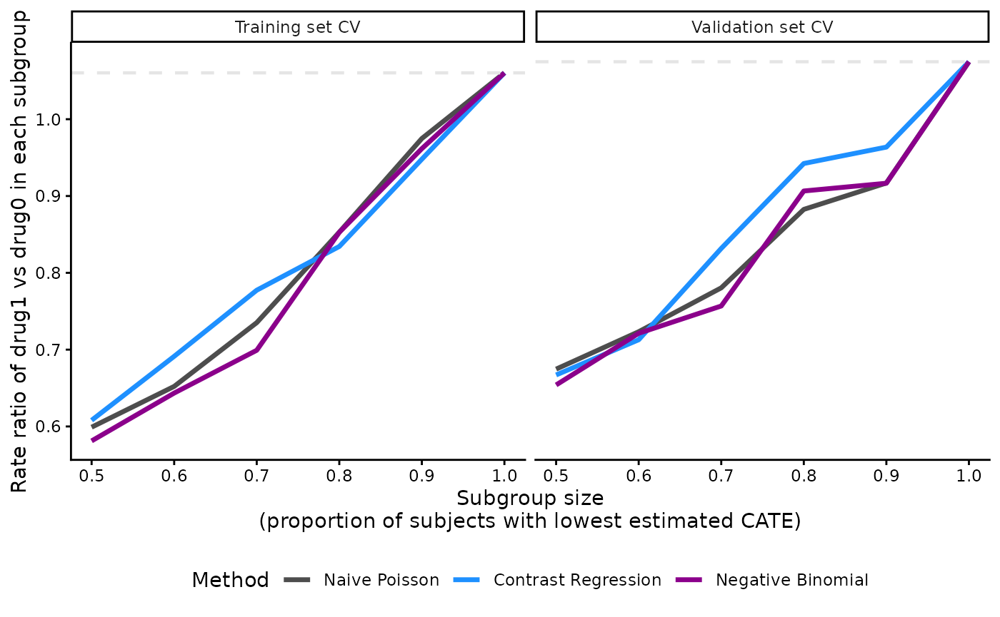
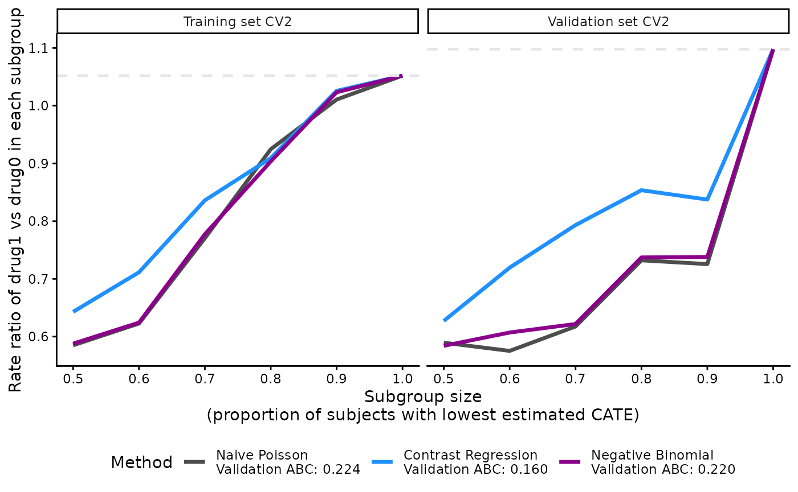
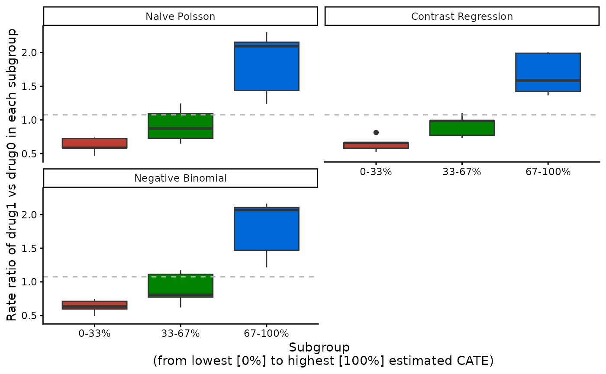

# Estimating and validating treatment effects for count outcomes

[](https://cran.r-project.org/package=precmed)
[](https://cran.r-project.org/package=precmed)

This vignette demonstrates how to use `precmed` to estimate average and
conditional average treatment effects (ATEs and CATEs) for count
outcomes. Using simulated multiple sclerosis data, we model relapse
rates, compare CATE scoring methods through internal validation, and
interpret treatment effects in responder subgroups.

For background on CATE prediction and model development, see Chapter 17,
“Introduction to methods for personalizing medicine” (Hoogland et al.
2026). Chapter 20, “Visualization and interpretation of individualized
treatment rule results”, provides practical guidance on interpreting
treatment rules and responder diagnostics, including examples using
`precmed` (Jiang et al. 2026).

## Load required packages

``` r

library(precmed)
library(dplyr)
library(ggplot2)
```

## Example data

We consider a simulated dataset that is based on real-world claims data
from patients with multiple sclerosis. The dataset `countExample`
includes 4,000 patients with information on the following 9 variables.

[TABLE]

------------------------------------------------------------------------

Most variables are baseline patient characteristics like age, gender,
and previous treatment.

- We will use `y` as the count outcome variable, which is the number of
  relapses during follow-up.

- We will use `years` as the offset variable, which is number of years
  during follow-up.

- We will use `trt` as the treatment variable, which has 2 drugs (drug0
  and drug1).

To avoid multicollinearity issues, the continuous variable `age` was
centered at 48 years old and the medical costs in the year prior to
treatment initiation `previous_cost` was centered at 13,824 USD and
scaled with standard deviation 20,172 USD.

The first six records of the final dataset `countExample` are shown
below:

| age | female | previous_treatment | previous_cost | previous_number_symptoms | previous_number_relapses | trt | y | years |
|---:|---:|:---|---:|:---|---:|:---|---:|---:|
| -21.21875 | 0 | drugA | 0.4507466 | 1 | 0 | drug1 | 0 | 0.2847365 |
| -2.21875 | 1 | drugA | -0.1943336 | 1 | 0 | drug0 | 0 | 0.6105407 |
| -10.21875 | 1 | drugA | -0.5336635 | 1 | 1 | drug0 | 0 | 2.6529774 |
| 6.78125 | 0 | drugA | -0.3370594 | 1 | 1 | drug1 | 0 | 0.0383299 |
| 4.78125 | 1 | drugC | -0.2710085 | 1 | 0 | drug1 | 1 | 2.2696783 |
| -11.21875 | 0 | drugC | 0.1602817 | 1 | 0 | drug0 | 0 | 0.3668720 |

## Estimate the average treatment effect

First, one might be interested in the effect of the drug (trt) on the
number of relapses during follow-up (y). Lets test this using simple
regression.

``` r

output_lm <- lm(y ~ trt, countExample)
output_lm
#> 
#> Call:
#> lm(formula = y ~ trt, data = countExample)
#> 
#> Coefficients:
#> (Intercept)     trtdrug1  
#>     0.32665      0.02045
```

We see from the simple linear model that drug 1 scores 0.02 points
higher compared to drug 0. This indicates that drug 0 is superior to
drug 1 because lower outcomes are preferred (number of relapses).

Now we want to estimate the Average Treatment Effect (ATE) and correct
for several covariates like age and previous treatment because they
might influence the relation between treatment and outcome. The
[`atefit()`](https://smartdata-analysis-and-statistics.github.io/precmed/reference/atefit.md)
function allows estimating the ATE in terms of rate ratio. The rate
ratio estimator is doubly robust, meaning that the estimator is
consistent if the propensity score (PS) model (argument `ps.model`) or
the outcome model (argument `cate.model`) or both are correctly
specified. The function also provides standard error, confidence
intervals, and p-values based on bootstrap.

In this example, the rate ratio compares the relapse rate under drug 1
with that under drug 0; a rate ratio below 1 favors drug 1. A causal
interpretation requires appropriate assumptions, including no unmeasured
confounding, adequate overlap in treatment assignment, and well-defined
treatments. Chapter 17 discusses identification of conditional treatment
effects in randomized and non-randomized data (Hoogland et al. 2026).

The mandatory arguments for
[`atefit()`](https://smartdata-analysis-and-statistics.github.io/precmed/reference/atefit.md)
are:

- `response`: “count” in this example because we use have data with a
  count outcome (e.g., number of relapses))

- `data`: the name of the data set. (countExample)

- `cate.model`: A formula describing the outcome model to be fitted. The
  outcome must appear on the left-hand side. In the example, we choose
  to specify to outcome model as a linear combination of the following
  covariates: age, sex, previous treatment, medical costs in the year
  prior to treatment initiation, and number of relapses in the year
  prior to treatment initiation. Non-linear or interaction terms could
  also be included. The outcome model has the offset `log(years)` to
  account for the varying exposure times across patients. Note that the
  treatment variable is not supplied in `cate.model` since this is an
  outcome model.

&nbsp;

- `ps.model`: A formula describing the propensity score (PS) model to be
  fitted. The treatment must appear on the left-hand side and the
  covariates (age and previous treatment in this example) on the
  right-hand side. The variable `trt` must be supplied as a numeric
  variable taking only 2 values, 1 for active treatment and 0 for
  control or comparator. If it is not the case, the function will stop
  with error if `trt` takes more than 2 distinct values or will
  automatically transform `trt` into a numeric variable. In this
  example, `trt` (a factor variable taking values “drug0” and “drug1”)
  was transformed and a warning message was left to the user (see output
  below): `Variable trt was recoded to 0/1 with drug0->0 and drug1->1`.
  If the data are from a RCT, it suffices to specify `ps.model` = trt
  ~ 1. Note that the PS model is only used in the estimation of the 2
  doubly robust methods (two and contrast regressions).

Let’s calculate the ATE for the effect of treatment on y and build an
outcome model that contains all variables and a PS model with `age` and
`previous_treatment`.

``` r

output_atefit <- atefit(
  response = "count",
  data = countExample,
  cate.model = y ~ age + female + previous_treatment +
    previous_cost + previous_number_relapses + offset(log(years)),
  ps.model = trt ~ age + previous_treatment,
  n.boot = 50, 
  seed = 999,
  verbose = 0
)
#> Warning in data.preproc(fun = "drinf", cate.model = cate.model, ps.model = ps.model, : Variable trt was recoded to 0/1 with drug0->0 and drug1->1.
```

When `verbose` = 1, the function outputs a progress bar in the console.

``` r

output_atefit
#> Average treatment effect:
#> 
#>                  estimate        SE   CI.lower  CI.upper    pvalue
#> log.rate.ratio 0.06311746 0.1624482 -0.2552752 0.3815101 0.6976173
#> 
#> Estimated event rates:
#> 
#>        estimate
#> rate1 0.2860635
#> rate0 0.2685660
#> Warning in print.atefit(x): Variable trt was recoded to 0/1 with drug0->0 and drug1->1.
```

The output of
[`atefit()`](https://smartdata-analysis-and-statistics.github.io/precmed/reference/atefit.md)
shows the point estimate, standard error (“SE”), lower (“CI.lower”) and
upper (“CI.upper”) bound of the 95% confidence interval, and the p-value
(“pvalue”) for the log rate ratio (`$log.rate.ratio`) as well as the
point estimate for the rate in the 2 treatment groups (`$rate0` and
`$rate1`). For example, the log rate ratio of 0.06 and the 95%
confidence interval of (-0.26, 0.38) are displayed in the output. Use
[`coef()`](https://rdrr.io/r/stats/coef.html) and
[`confint()`](https://rdrr.io/r/stats/confint.html) to extract the log
rate ratio and its confidence interval, then exponentiate them to obtain
the rate ratio and its interval. The default confidence level is 95%;
specify `level`, for example `level = 0.90`, to request a different
level. Intervals use the bootstrap standard error already stored in the
fitted object:

``` r

rate.ratio <- exp(coef(output_atefit))
rate.ratio
#> log.rate.ratio 
#>       1.065152
CI.rate.ratio <- exp(confint(output_atefit, level = 0.95))
CI.rate.ratio
#>                    2.5 %   97.5 %
#> log.rate.ratio 0.7747033 1.464495
```

The rate ratio of 1.07 along with the 95% confidence interval of (0.77,
1.46) indicate a higher estimated relapse rate under drug 1 than drug 0.
However, the confidence interval includes 1, so there is insufficient
evidence of a treatment difference, consistent with the p-value of 0.7
in the output (`$log.rate.ratio$pvalue`).

Using `plot(output_atefit)`, a histograms is generated of the point
estimates across the `n.boot` bootstrap iterations for the log rate
ratio. A red vertical line is added to each histogram with the mean of
the bootstrap estimates.



Histograms of bootstrap log rate ratio estimators after 500 bootstrap
iterations.

## Estimate CATE scores

Now we have calculated the ATE we know the effect of both treatments on
average, but this effect might not be the same for all patients. Thus,
it might be worthwhile to check if there are subgroups that respond
differently to the treatments. We can calculate the Conditional Average
Treatment Effect (CATE) score which calculates the ATE for different
subgroups in the data. If no internal validation is needed (we get back
to that later), we can use the
[`catefit()`](https://smartdata-analysis-and-statistics.github.io/precmed/reference/catefit.md)
function to a model directly to the entire data set to estimate the CATE
score. For the
[`catefit()`](https://smartdata-analysis-and-statistics.github.io/precmed/reference/catefit.md)
function we have to define the `score.method`. This arguments specifies
the precision medicine (PM) method to be used to calculate the CATE
scores. There are a total of 5 scoring methods implemented:

- `poisson` fits a Poisson model separately by treatment group.

- `boosting` uses gradient boosted regression models (GBM) separately by
  treatment group.

- `twoReg` implements the doubly robust two regressions estimator in
  (Yadlowsky et al. 2021).

- `contrastReg` implements the doubly robust contrast regression
  estimator from (Yadlowsky et al. 2021).

- `negBin` fits negative binomial regressions by treatment group. This
  method is recommended if there is overdispersion in the data.

When we have selected a PS method that fits the data (or multiple
methods), we can run the
[`catefit()`](https://smartdata-analysis-and-statistics.github.io/precmed/reference/catefit.md)
function with the same variables as the
[`atefit()`](https://smartdata-analysis-and-statistics.github.io/precmed/reference/atefit.md)
function.

The score represents an estimated conditional log rate ratio:
exponentiating it gives the estimated rate ratio for patients with those
covariates. Lower scores therefore indicate greater estimated benefit
from drug 1 in this example. Chapter 17 describes treatment effect
heterogeneity and methods for CATE prediction (Hoogland et al. 2026).
Because
[`catefit()`](https://smartdata-analysis-and-statistics.github.io/precmed/reference/catefit.md)
fits the scores using the full dataset, its results do not on their own
establish performance in new patients.

The mandatory arguments are: `response`, `data`, `score.method`,
`cate.model`, and `ps.model`. The user can also specify the
non-mandatory arguments to fit with the data and problem at hand. Please
see the [Function
description](https://smartdata-analysis-and-statistics.github.io/precmed/reference/catefitcount.html)
section for details.

If you run into errors or warnings with your data, it might be helpful
to go over the descriptions to see if you need to alter the default
values. We set `n.cores = 1` to run boosting with one thread. `precmed`
translates this argument to the GBM3 parallel settings; one thread is
also the fallback when neither `n.cores` nor `par.details` is supplied
and the `gbm.parallel` option is unset.

``` r

t0 <- Sys.time()
output_catefit <- catefit(
  response = "count",
  data = countExample,
  score.method = c(
    "poisson", "boosting", "twoReg", "contrastReg", "negBin"
  ),
  cate.model = y ~ age + female + previous_treatment +
    previous_cost + previous_number_relapses + offset(log(years)),
  ps.model = trt ~ age + previous_treatment,
  initial.predictor.method = "poisson",
  higher.y = FALSE, 
  seed = 999,
  n.cores = 1
)
#> Warning in data.preproc(fun = "catefit", cate.model = cate.model, ps.model = ps.model, : Variable trt was recoded to 0/1 with drug0->0 and drug1->1.
t1 <- Sys.time()
t1 - t0
#> Time difference of 5.252095 secs
```

Each method specified in `score.method` has the following sets of
results in
[`catefit()`](https://smartdata-analysis-and-statistics.github.io/precmed/reference/catefit.md):

1.  `score` contains the log-transformed estimated CATE scores for each
    subject. CATE score is a linear combination of the variables
    specified in the `cate.model` argument. Same as the outcome, lower
    CATE scores are more desirable if `higher.y` = FALSE and vice versa.
    Each subject has one CATE score so the length of this output is
    4,000 for our toy example. Below we show the CATE scores estimated
    with contrast regression for the first 6 subjects in the data.

``` r

length(output_catefit$score.contrastReg)
#> [1] 4000
head(output_catefit$score.contrastReg)
#> [1]  0.1497829  0.2624196  0.5864289 -0.8024851 -0.1907681 -0.4049082
```

2.  `coefficients` contains the estimated coefficients of the CATE score
    for each scoring method. It is a data frame of the covariates
    (including intercept) as rows and scoring methods as columns. In our
    toy example, there are 5 covariates in the `cate.model` (including a
    categorical variable with 3 distinct factors) so there are 7 rows of
    estimated coefficients within each column. Since contrast regression
    is one of the scoring methods specified in the example, we see that
    contrast regression has an additional column with the standard
    errors of the estimated coefficients. Boosting does not estimate
    coefficients (it directly predicts the score) so there is no
    coefficient result for this method.

``` r

output_catefit$coefficients
#>                              poisson      twoReg contrastReg SE_contrastReg
#> (Intercept)              -0.58185218 -0.57230335 -0.59733948     0.37239529
#> age                      -0.01117701 -0.04006858 -0.03579484     0.01382861
#> female                    0.58829733  0.73791026  0.77499335     0.36588639
#> previous_treatmentdrugB   0.73724361  0.64116126  0.74877593     0.35907273
#> previous_treatmentdrugC   0.15545985 -0.25808471 -0.20473293     0.26470389
#> previous_cost            -0.13035642 -0.08457179 -0.02750876     0.15712507
#> previous_number_relapses -0.05339112  0.06117043  0.02831604     0.16882933
#>                               negBin
#> (Intercept)              -0.59232437
#> age                      -0.01410487
#> female                    0.59602219
#> previous_treatmentdrugB   0.76032497
#> previous_treatmentdrugC   0.13262969
#> previous_cost            -0.13952096
#> previous_number_relapses -0.05034136
```

We can define the estimated CATE scores for contrast regression like
shown below. The user can use this information to study the influence of
each covariate.
``` math
 
\begin{aligned}
\widehat{CATE} = -0.60 & - 0.04 \times \text{age} \\
& + 0.77 \times \text{female (vs male)} \\ 
& + 0.75 \times \text{previous treatment drug B (vs drug A)} \\
& - 0.21 \times \text{previous treatment drug C (vs drug A)} \\
& - 0.02 \times \text{previous medical costs} \\
& + 0.04 \times \text{previous number of relapses} 
\end{aligned} 
```

3.  `ate` contains estimated ATEs in each nested subgroup of high
    responders to drug 1 defined by `prop.cutoff`. The subgroups are
    defined based on the estimated CATE scores with the specified
    scoring method. In this example, we show the estimated ATEs of
    subgroups identified by CATE scores of contrast regression. For
    example, the estimated ATE for the subgroup of subjects constructed
    based on the 50% (“prop0.5”) lowest CATE scores estimated from
    contrast regression is 0.62.

``` r

output_catefit$ate.contrastReg
#>   prop0.5   prop0.6   prop0.7   prop0.8   prop0.9     prop1 
#> 0.6191191 0.6630810 0.7910504 0.8432274 0.9372587 1.0640579
```

### Visualize the distribution of CATE scores

The distribution shows how much the estimated scores vary across
patients and methods. Variation in predictions alone does not establish
that treatment effects truly differ; validation is needed to assess
whether the scores distinguish responder groups. Chapter 20 discusses
score distributions alongside validation curves (Jiang et al. 2026).

You are encouraged to summarize and visualize the outputs in whichever
way that fits a particular situation outside the package’s functions.
For example, it is possible to plot the densities of all CATE scores
with [`ggplot()`](https://ggplot2.tidyverse.org/reference/ggplot.html).
There are some subjects with extremely low CATE scores but most of the
samples fall between -1 and 1 with triple modes at around -0.5, 0, and
0.8.

``` r

dataplot <- data.frame(
  score = factor(rep(
    c("Boosting", "Naive Poisson", "Two regressions", "Contrast regression",
      "Negative Binomial"),
    each = length(output_catefit$score.boosting)
  )),
  value = c(
    output_catefit$score.boosting, output_catefit$score.poisson,
    output_catefit$score.twoReg, output_catefit$score.contrastReg,
    output_catefit$score.negBin
  )
)

ggplot(dataplot, aes(x = value, fill = score)) +
  geom_density(alpha = 0.5) +
  theme_classic() + 
  labs(x = "Estimated CATE score", y = "Density", fill = "Method")
```



## Internally validate CATE scores

For broader guidance on validation strategies and the assessment of
discrimination, calibration, and decision accuracy, see Chapter 19,
“Validation of prediction models for patient outcomes and individualized
treatment effect” (Thao et al. 2026).

In each iteration, the models are fitted in a training set and their
scores are evaluated in a separate validation set. For example, the 50%
of validation patients with the lowest predicted scores form a
high-responder subgroup, and its estimated treatment effect can be
compared with the overall effect. Repeating the split shows how results
vary across iterations. Selecting the best method using these same
validation results can make its reported performance optimistic; an
independent evaluation is useful for assessing the selected method.

The
[`catecv()`](https://smartdata-analysis-and-statistics.github.io/precmed/reference/catecv.md)
function provides the same estimation as the
[`catefit()`](https://smartdata-analysis-and-statistics.github.io/precmed/reference/catefit.md)
but via cross-validation (CV). With the
[`catecv()`](https://smartdata-analysis-and-statistics.github.io/precmed/reference/catecv.md)
function internal CV is applied to reduce optimism in choosing the CATE
estimation method that captures the most treatment effect heterogeneity.
The CV is applied by repeating the following steps `cv.n` times:

- Split the data into a training and validation set according to
  `train.prop` argument. The training and validation sets must be
  balanced with respect to covariate distributions and doubly robust
  rate ratio estimates (see `error.max` argument).

- Estimate the CATE score in the training set with the specified scoring
  method.

- Predict the CATE score in the validation set using the scoring model
  fitted from the training set.

- Build nested subgroups of treatment responders in the training and
  validation sets, separately, and estimate the ATE within each nested
  subgroup. For each element i of `prop.cutoff` argument (e.g.,
  `prop.cutoff[i] = 0.6`), take the following steps:

  - Identify high responders as observations with the 60% (i.e.,
    `prop.cutoff[i]x100%`) highest (if `higher.y = TRUE`) or lowest (if
    `higher.y = FALSE`) estimated CATE scores.

  - Estimate the ATE in the subgroup of high responders using a doubly
    robust estimator.

  - Conversely, identify low responders as observations with the 40%
    (i.e., `1 - prop.cutoff[i]x100%`) lowest (if `higher.y = TRUE`) or
    highest (if `higher.y = FALSE`) estimated CATE scores.

  - Estimate the ATE in the subgroup of low responders using a doubly
    robust estimator.

- If `abc = TRUE`, calculate the area between the ATE and the series of
  ATEs in nested subgroups of high responders in the validation set.
  (for more information about the abc score, see [Validation curves and
  the ABC
  statistics](https://smartdata-analysis-and-statistics.github.io/precmed/articles/Theoretical-details.md))

- Build mutually exclusive subgroups of treatment responders in the
  training and validation sets, separately, and estimate the ATE within
  each subgroup. Mutually exclusive subgroups are built by splitting the
  estimated CATE scores according to prop.multi.

Oke, so now we can use the
[`catecv()`](https://smartdata-analysis-and-statistics.github.io/precmed/reference/catecv.md)
function to run internal validation to compare the different scoring
methods. The mandatory arguments are similar to
[`atefit()`](https://smartdata-analysis-and-statistics.github.io/precmed/reference/atefit.md)
and
[`catefit()`](https://smartdata-analysis-and-statistics.github.io/precmed/reference/catefit.md):
The mandatory arguments are: `response`, `data`, `score.method`,
`cate.model`, and `ps.model`. For this toy example we selected
`poisson`, `contrastReg` and `negBin` to limit run time.

We also specified the following non-mandatory arguments to fit with the
data and problem at hand: `initial.predictor.method`, `higher.y`,
`cv.n`, `seed`, `plot.gbmperf` and `verbose`.

- `initial.predictor.method` specifies how predictions of the outcome
  are estimated in two regressions and contrast regression. Flexible
  models can be used such as GBM (“boosting”) or generalized additive
  models (“gam”). Both methods are computationally intensive so we
  choose “poisson” to obtain predictions from a Poisson regression,
  which reduces the computational time at the expense of stricter
  parametric assumptions and less flexibility.

- `higher.y` was set to FALSE because lower number of relapses are more
  desirable in our example. Hence, we are telling the function that
  subgroups of high responders to drug1 vs drug0 should have lower
  number of relapses (see section [Validation curves and the ABC
  statistics](https://smartdata-analysis-and-statistics.github.io/precmed/articles/Theoretical-details.md)
  for illustration). In other situation, higher outcomes may be more
  favorable, for example, walking more steps in a study on physical
  activity. It is important for this argument to match with the `y`
  outcome because it will affect how the subgroups are defined by the
  CATE scores and the performance metrics.

- We perform 5 CV iterations by specifying `cv.n` = 5. Typically, more
  CV iterations are desirable although associated with longer
  computational times.

- We set a random seed `seed` = 999 to reproduce the results.

- We avoid generating the boosting performance plots by specifying
  `plot.gbmperf` = FALSE.

- When `verbose` = 1, progress messages are printed in the R console but
  errors and warnings are not printed. The current CV iteration is
  printed, followed by the steps of the CV procedure (splitting the
  data, training the models, validating the models) and warnings or
  errors that have occurred during the steps (none in this example). A
  timestamp and a progress bar are also displayed upon completion of a
  CV iteration. If `contrastReg` was selected as one of the methods in
  `score.method`, an additional line of output message will indicate
  whether the algorithm has converged.

There are many other non-mandatory arguments that
[`catecv()`](https://smartdata-analysis-and-statistics.github.io/precmed/reference/catecv.md)
can accept. Please see the [Customizing CATE models and
validation](https://smartdata-analysis-and-statistics.github.io/precmed/articles/Additional-examples.md)
vignette for more examples and the [Function
description](https://smartdata-analysis-and-statistics.github.io/precmed/reference/catecvcount.html)
section for details. If you run into errors or warnings with your data,
it might be helpful to go over the descriptions to see if you need to
alter the default values. In this toy example, we keep the default
values of the remaining arguments.

``` r

output_catecv <- catecv(
  response = "count",
  data = countExample,
  score.method = c("poisson", "contrastReg", "negBin"),
  cate.model = y ~ age + female + previous_treatment +
    previous_cost + previous_number_relapses + offset(log(years)),
  ps.model = trt ~ age + previous_treatment, 
  initial.predictor.method = "poisson",
  higher.y = FALSE,
  cv.n = 5, 
  seed = 999,
  plot.gbmperf = FALSE,
  verbose = 1
)
#> Warning in data.preproc(fun = "crossv", cate.model = cate.model, ps.model = ps.model, : Variable trt was recoded to 0/1 with drug0->0 and drug1->1.
#>   |                                                                              |                                                                      |   0%
#> cv = 1 
#>   splitting the data..
#>   training..
#>   validating..
#>   convergence TRUE 
#>    Sat Nov 14 14:50:45 2026 
#>   |                                                                              |==============                                                        |  20%
#> cv = 2 
#>   splitting the data..
#>   training..
#>   validating..
#>   convergence TRUE 
#>    Sat Nov 14 14:50:48 2026 
#>   |                                                                              |============================                                          |  40%
#> cv = 3 
#>   splitting the data..
#>   training..
#>   validating..
#>   convergence TRUE 
#>    Sat Nov 14 14:50:54 2026 
#>   |                                                                              |==========================================                            |  60%
#> cv = 4 
#>   splitting the data..
#>   training..
#>   validating..
#>   convergence TRUE 
#>    Sat Nov 14 14:51:00 2026 
#>   |                                                                              |========================================================              |  80%
#> cv = 5 
#>   splitting the data..
#>   training..
#>   validating..
#>   convergence TRUE 
#>    Sat Nov 14 14:51:06 2026 
#>   |                                                                              |======================================================================| 100%
#> Total runtime : 28.22 secs
```

The output of
[`catecv()`](https://smartdata-analysis-and-statistics.github.io/precmed/reference/catecv.md)
is an object of class “precmed” and here we named it `output_catecv`. It
carries the relevant information to use in the next step of the workflow
which selects the method (among those specified in the argument
`score.method`) capturing the highest level of treatment effect
heterogeneity. The output, which is described below, will be used in the
functions
[`abc()`](https://smartdata-analysis-and-statistics.github.io/precmed/reference/abc.md),
[`plot()`](https://rdrr.io/r/graphics/plot.default.html) and
[`boxplot()`](https://rdrr.io/r/graphics/boxplot.html).

For each method specified in the argument `score.method`, the following
3 groups of outputs are generated: `high`, `low` and `group`. We use the
results from `contrastReg` as an example.

**1. ATEs in nested subgroups of high responders**

This output stores the ATEs - the ratio of annualized relapse rate
between drug1 vs drug0 in this example - in nested subgroups of patients
of high responders to drug 1 in the training (`$ate.est.train.high.cv`)
and validation (`$ate.est.valid.high.cv`) sets across all CV iterations.
For count outcomes, when `higher.y` = TRUE, higher CATE scores
correspond to high responders to drug1. When `higher.y` = FALSE, lower
CATE scores correspond to high responders to drug1. Note that this is
different for survival outcomes. The direction of CATE scores depends on
both `higher.y` and outcome type.

``` r

output_catecv$ate.contrastReg$ate.est.train.high.cv
#>               cv1       cv2       cv3       cv4       cv5
#> prop0.5 0.5896053 0.6428854 0.5744973 0.6406698 0.5924975
#> prop0.6 0.6744447 0.7114461 0.6589297 0.6930484 0.7186517
#> prop0.7 0.7383527 0.8360698 0.7806273 0.7779180 0.7539283
#> prop0.8 0.8034239 0.9092085 0.8208183 0.8263584 0.8117300
#> prop0.9 0.9041969 1.0257463 0.9595834 0.9049020 0.9452626
#> prop1   1.0599740 1.0520675 1.0577453 1.0641114 1.0677619
output_catecv$ate.contrastReg$ate.est.valid.high.cv
#>               cv1       cv2       cv3       cv4       cv5
#> prop0.5 0.7448829 0.6271739 0.8552290 0.5565145 0.5514821
#> prop0.6 0.7325445 0.7194496 0.8308576 0.5906053 0.6909427
#> prop0.7 0.9166009 0.7932235 0.8468713 0.8076085 0.7944857
#> prop0.8 1.1280003 0.8535919 0.9563156 0.9041068 0.8696296
#> prop0.9 1.1300157 0.8374393 0.9452552 0.9264986 0.9791587
#> prop1   1.0812603 1.0978549 1.0531927 1.0726353 1.0689638
```

The output is a matrix with columns corresponding to the CV iterations,
labeled from 1 to `cv.n`, and rows corresponding to nested subgroups.
The nested subgroups of patients are defined by the argument
`prop.cutoff`. Here, we use the default `seq(0.5, 1, length = 6)` which
defines 6 nested subgroups with the 50%, 60%, 70%, 80%, 90% and 100%
lowest (highest if `higher.y` = TRUE) CATE scores estimated by contrast
regression. The rows in the output are labeled to reflect the
user-specified proportions used to build the subgroups.

For example, in the training set and in the first CV iterations (first
column labeled “cv1”), the subgroup defined with the 50% lowest CATE
scores (first row labeled “prop0.5”) has an estimated RR of 0.59. In
contrast, the subgroup defined with all patients (last row labeled
“prop1”) has an estimated RR of 1.06.

**2. ATEs in nested subgroups of low responders**

This output stores the ATEs in nested subgroups of *low responders* to
drug1 in the training (`$ate.est.train.low.cv`) and validation
(`$ate.est.valid.low.cv`) sets across all CV iterations. For count
outcomes, when `higher.y` = TRUE, lower CATE scores correspond to low
responders to drug1. When `higher.y` = FALSE, higher CATE scores
correspond to low responders to drug1. Again, this is different for
survival outcomes. The direction of CATE scores depends on both
`higher.y` and outcome type.

``` r

output_catecv$ate.contrastReg$ate.est.train.low.cv
#>              cv1      cv2      cv3      cv4      cv5
#> prop0.5 1.619590 1.556901 1.657101 1.542445 1.623386
#> prop0.4 1.710009 1.575580 1.727388 1.608509 1.594635
#> prop0.3 1.850595 1.542156 1.629855 1.648721 1.737306
#> prop0.2 1.919854 1.573453 1.961972 1.853781 2.122016
#> prop0.1 2.077797 1.254235 1.522567 2.118723 2.074404
```

The outputs are also matrices with columns corresponding to the CV
iterations and rows corresponding to nested subgroups.

The output for the low responders brings additional information to the
user. It gives the ATEs in the complement of each nested subgroup of
high responders. For example, the complement of the subgroup of high
responders defined as patients with the 60% lowest (highest if
`higher.y` = TRUE) estimated CATE scores is the subgroup low responders
defined as patients with the 40% highest (lowest if `higher.y` = TRUE)
estimated CATE scores, labeled as “prop0.4”. In the training set and in
the first CV iterations, the estimated RR is 0.674 in the 60% high
responders to drug 1 and 1.71 in the 40% low responders.

**3. ATEs in mutually exclusive subgroups**

This output stores the ATEs in mutually exclusive multi-category
subgroups of patients in the training (`$ate.est.train.group.cv`) and
validation (`$ate.est.valid.group.cv`) sets across all CV iterations.

``` r

output_catecv$ate.contrastReg$ate.est.train.group.cv
#>                cv1      cv2       cv3       cv4      cv5
#> prop0.33 1.8635694 1.497846 1.7138028 1.6908566 1.649720
#> prop0.67 1.0699029 1.489476 1.0511935 1.1809557 1.111132
#> prop1    0.4831034 0.470482 0.4764857 0.4816721 0.535003
output_catecv$ate.contrastReg$ate.est.valid.group.cv
#>                cv1       cv2       cv3       cv4       cv5
#> prop0.33 1.4220392 2.0022062 1.3647971 1.5853124 1.9901237
#> prop0.67 0.7328152 0.7720613 1.1046447 0.9853931 0.9878052
#> prop1    0.8122051 0.6583514 0.6605675 0.5232875 0.5790997
```

The output is a matrix with columns corresponding to the CV iterations
and rows corresponding to the mutually exclusive subgroups. The previous
2 outputs only focus on binary subgroups (high or low responders). Here,
the mutually exclusive subgroups can be more than 2 and are defined by
the argument `prop.multi`. We use the default `c(0, 1/3, 2/3, 1)` which
defines 3 subgroups of patients with the 33% lowest, 33% middle and 33%
highest estimated CATE scores when `higher.y` = FALSE (as in this
example), or with the 33% highest, 33% middle and 33% lowest estimated
CATE scores when `higher.y` = TRUE. Taking the first column as an
example, the first CV iteration calculated 1.864 as the RR for the
subgroup with the 33% lowest estimated CATE scores, 1.07 as the RR for
subgroup with the 33% middle estimated CATE scores, and 0.483 as the RR
for subgroup with the 33% highest estimated CATE scores.

## Compare scoring methods using the ABC statistic

The ABC statistics is calculated by
[`abc()`](https://smartdata-analysis-and-statistics.github.io/precmed/reference/abc.md)
for each scoring method specified in
[`catecv()`](https://smartdata-analysis-and-statistics.github.io/precmed/reference/catecv.md)
and for each of the `cv.n` CV iterations using the output object
`output_catecv` from
[`catecv()`](https://smartdata-analysis-and-statistics.github.io/precmed/reference/catecv.md).

Each validation curve summarizes estimated treatment effects in nested
high-responder groups, from a smaller group with more favorable scores
to the entire validation set. The ABC summarizes the area between that
curve and the overall ATE reference line; a higher value indicates
greater separation in the expected direction for this example. Chapter
20 describes this responder diagnostic and its interpretation (Jiang et
al. 2026). See the [Validation curves and the ABC
statistics](https://smartdata-analysis-and-statistics.github.io/precmed/articles/Theoretical-details.md)
section for a detailed illustration of the relationship between
`higher.y`, `abc`, and the validation curves.

``` r

output_abc <- abc(output_catecv)
output_abc
#>                    cv1       cv2        cv3        cv4       cv5
#> poisson     0.13758995 0.2236276 0.06938081 0.09647510 0.1304204
#> contrastReg 0.07311255 0.1602017 0.06894946 0.14832787 0.1310745
#> negBin      0.14517127 0.2203584 0.08899030 0.09382214 0.1395976
```

The output is a matrix with columns corresponding to the CV iterations
and rows corresponding to the scoring methods specified in
`score.method`. For example, in CV iteration 1, negative binomial
(“negBin”) has an ABC of 0.145, which is the highest in this CV
iteration, meaning that negative binomial offers the best performance in
the first CV iteration. The user can combine the ABC for each method
across iterations:

``` r

average_abc <- apply(output_abc, 1, mean)
average_abc
#>     poisson contrastReg      negBin 
#>   0.1314988   0.1163332   0.1375879
```

In this example, negative binomial also offers the best overall
performance because it has the highest average ABC, followed closely by
Poisson.

## Assess responder discrimination with validation curves

Chapter 20 discusses validation curves, ABC statistics, and their
interpretation as responder diagnostics (Jiang et al. 2026). These
summaries assess how well a score ranks patients by treatment benefit;
they do not, by themselves, establish calibration of the predicted CATEs
or the clinical value of a treatment rule (Thao et al. 2026).

The ATEs of nested subgroups of high responders to drug1 (e.g.,
`output_catecv$ate.contrastReg$ate.est.train.high.cv` and
`output_catecv$ate.contrastReg$ate.est.valid.high.cv` for contrast
regression) can be visualized as a side-by-side line plot, with training
results on the left and validation results on the right. The x-axis is
determined by `prop.cutoff` and the y-axis is the estimated ATEs
averaged over `cv.n` CV iterations as specified by `cv.i` = NULL. The
estimated ATE is expressed as a RR of drug1 versus drug0 for our toy
example. By default, the function retrieves the name of the treatment
variable (`trt`) and the original labels (`drug0` and `drug1`) to
specify a meaningful y-axis label. Otherwise, it is possible to
customize the y-axis label via the `ylab`, for example, by using
`Rate ratio of drug1 vs drug0 in each subgroup`.

Steeper slopes indicate more treatment effect heterogeneity between
drug1 and drug0. Because `higher.y` = FALSE in this example, the slopes
should be increasing from left (`prop.cutoff` = 0.5) to right
(`prop.cutoff` = 1) if treatment effect heterogeneity is present. The
method that has the steepest slope in the validation results would be
selected because it captures the most treatment effect heterogeneity
while generalizing well to unseen data.

``` r

plot(output_catecv)
```



For this toy example, the methods are performing well in the training
data as per the steep, increasing slopes on the left plot. The generally
increasing curves in the validation data (right plot) are consistent
with the scores ranking patients by treatment benefit in this example,
although they do not alone establish generalizability or calibration.
The dashed gray line is the ATE in the entire data set, which is why all
lines merge to this reference line when subgroup size is 100% of the
data (`prop.cutoff` = 1). For more explanation on the validation curves,
see the [Function
description](https://smartdata-analysis-and-statistics.github.io/precmed/reference/plot.precmed.html)
section.

The plot’s legend includes the ABC statistics in the validation set. The
user can choose to mute the ABC annotations by specifying `show.abc` =
FALSE.

``` r

plot(output_catecv, 
     show.abc = FALSE, 
     ylab = c("Rate ratio of drug1 vs drug0 in each subgroup"))
```



The user can choose to plot the validation curves of only one CV
iteration instead of the average of all CV iterations. In the following
example, we plot the validation curves of the second CV iteration by
specifying `cv.i` = 2 and in grayscale by specifying `grayscale` = TRUE.

``` r

plot(output_catecv, 
     cv.i = 2, 
     grayscale = TRUE, 
     ylab = c("Rate ratio of drug1 vs drug0 in each subgroup"))
```



Same as
[`abc()`](https://smartdata-analysis-and-statistics.github.io/precmed/reference/abc.md),
the user can also choose to use the median (instead of mean \[default\])
of the ATEs across CV iterations by specifying the argument `combine` =
“median” in [`plot()`](https://rdrr.io/r/graphics/plot.default.html).

## Compare treatment effects across responder subgroups

Unlike the nested groups in the validation curves, these groups are
mutually exclusive: each patient belongs to one score-based group in a
given validation iteration. Each box summarizes the variation in that
group’s estimated treatment effect across iterations. Chapter 20
compares these complementary responder diagnostics (Jiang et al. 2026).

The ATEs of multi-category subgroups that are mutually exclusive can be
visualized as box plots, with one box plot for each scoring method. Only
validation results are visualized here. The x-axis is determined by
`prop.multi` and the y-axis is the estimated ATEs in each subgroup. We
specify the `ylab` argument accordingly. The subgroups correspond to
each row of the `ate.est.valid.group.cv` result in `output_catecv`, so
in this example the subgroups are patient with the 33% lowest (0-33%),
middle 33% (33-66%), and highest 33% (66-100%) estimated CATE scores.
The box plot shows the distribution of the ATEs over all `cv.n` CV
iterations, instead of a summary statistics like mean or median in
[`plot()`](https://rdrr.io/r/graphics/plot.default.html).

``` r

boxplot(output_catecv,
        ylab = "Rate ratio of drug1 vs drug0 in each subgroup")
```



The box plots compare estimated rate ratios across mutually exclusive
score-based subgroups. Read them alongside the validation curves and ABC
statistics to assess how each scoring method separates patients by
treatment benefit and how estimates vary across CV iterations. Note that
the y-axis can have different scales for different scoring methods.

  
  

> Although we provided 3 different metrics to summarize and visualize
> the
> [`catecv()`](https://smartdata-analysis-and-statistics.github.io/precmed/reference/catecv.md)
> outputs, the user is encouraged to choose their own way of data
> wrangling that fits to their particular situation.

  
  

## Other `precmed` vignettes in this series

[1. Estimating and validating treatment effects for count
outcomes](https://smartdata-analysis-and-statistics.github.io/precmed/articles/Count-examples.md)  
[2. Estimating and validating treatment effects for survival
outcomes](https://smartdata-analysis-and-statistics.github.io/precmed/articles/Survival-examples.md)  
[3. Customizing CATE models and
validation](https://smartdata-analysis-and-statistics.github.io/precmed/articles/Additional-examples.md)  
[4. Methods for estimating and validating treatment
effects](https://smartdata-analysis-and-statistics.github.io/precmed/articles/Theoretical-details.md)

## References

Hoogland, Jeroen, Thomas P. A. Debray, Guillaume Desachy, and Tri-Long
Nguyen. 2026. “Introduction to Methods for Personalizing Medicine.”
Chap. 17 in *Comparative Effectiveness and Personalized Medicine
Research Using Real-World Data*, edited by Thomas P. A. Debray, Tri-Long
Nguyen, and Robert W. Platt. Chapman & Hall/CRC.
<https://doi.org/10.1201/9781003300809-17>.

Jiang, Xiaotong, Gabrielle Simoneau, Fabio Pellegrini, Changyu Shen,
Carl de Moor, and Lu Tian. 2026. “Visualization and Interpretation of
Individualized Treatment Rule Results.” Chap. 20 in *Comparative
Effectiveness and Personalized Medicine Research Using Real-World Data*,
edited by Thomas P. A. Debray, Tri-Long Nguyen, and Robert W. Platt.
Chapman & Hall/CRC. <https://doi.org/10.1201/9781003300809-20>.

Thao, Le Thi Phuong, Orestis Efthimiou, Tibor V. Varga, Jeroen Hoogland,
and Thomas P. A. Debray. 2026. “Validation of Prediction Models for
Patient Outcomes and Individualized Treatment Effect.” Chap. 19 in
*Comparative Effectiveness and Personalized Medicine Research Using
Real-World Data*, edited by Thomas P. A. Debray, Tri-Long Nguyen, and
Robert W. Platt. Chapman & Hall/CRC.
<https://doi.org/10.1201/9781003300809-19>.

Yadlowsky, Steve, Fabio Pellegrini, Federica Lionetto, Stefan Braune,
and Lu Tian. 2021. “Estimation and Validation of Ratio-Based Conditional
Average Treatment Effects Using Observational Data.” *Journal of the
American Statistical Association* 116 (533): 335–52.
<https://doi.org/10.1080/01621459.2020.1772080>.
