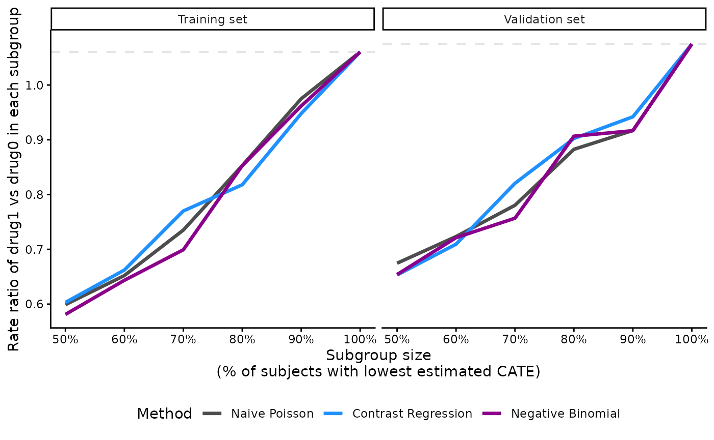
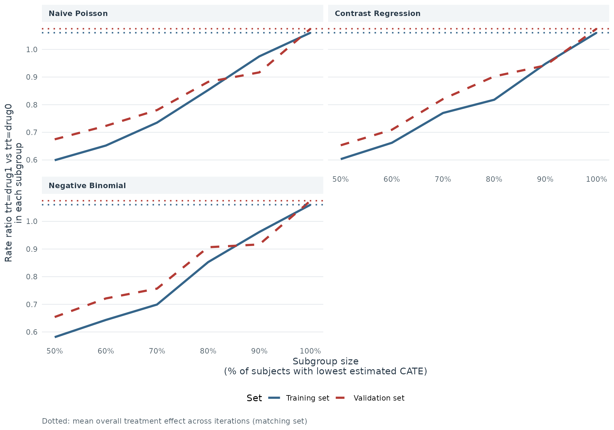

# Estimating and validating treatment effects for count outcomes

[](https://cran.r-project.org/package=precmed)
[](https://cran.r-project.org/package=precmed)

This vignette demonstrates how to use `precmed` to estimate average and
conditional average treatment effects (ATEs and CATEs) for count
outcomes. Using simulated multiple sclerosis data, we model relapse
rates, compare CATE scoring methods through internal validation, and
interpret treatment effects in responder subgroups.

For background on CATE prediction and model development, see Chapter 17,
“Introduction to methods for personalizing medicine” (Hoogland et al.
2026). Chapter 20, “Visualization and interpretation of individualized
treatment rule results”, provides practical guidance on interpreting
treatment rules and responder diagnostics, including examples using
`precmed` (Jiang et al. 2026).

## Load required packages

``` r

library(precmed)
library(dplyr)
library(ggplot2)
```

## Example data

We consider a simulated dataset that is based on real-world claims data
from patients with multiple sclerosis. The dataset `countExample`
includes 4,000 patients.

Alternatively, `simulate_count(n = 4000, seed = 1)` generates a fully
synthetic dataset with the same analysis variables. Its treatment
assignment, rate ratio, treatment interactions, follow-up and count
dispersion can be varied; see
[`?simulate_count`](https://smartdata-analysis-and-statistics.github.io/precmed/reference/simulate_count.md).
The simulator uses illustrative assumptions and does not reconstruct the
claims data or the packaged example.

The simulated dataset contains the following baseline covariates,
summarized overall and by treatment group.

[TABLE]

The outcome variable `y` records the number of relapses during
follow-up. The variable `years` records follow-up time in years and
supplies the exposure time for the rate-model offset. The treatment
variable `trt` identifies drug0 or drug1.

For convenience, `age` is centered at 48 years and `previous_cost` is
centered at 13,824 USD and divided by 20,172 USD.

## Estimate the average treatment effect

For the estimators and their assumptions, see [Methods for estimating
average treatment
effects](https://smartdata-analysis-and-statistics.github.io/precmed/articles/ATE-theory.md).

### Unadjusted treatment comparison

We first compare relapse rates between treatment groups using a Poisson
model with treatment as the only predictor. The log follow-up time is
included as an offset to account for differences in exposure. This
unadjusted association does not account for differences in patient
characteristics.

``` r

output_poisson <- glm(y ~ trt + offset(log(years)),
                      data = countExample, family = poisson())
summary(output_poisson)
#> 
#> Call:
#> glm(formula = y ~ trt + offset(log(years)), family = poisson(), 
#>     data = countExample)
#> 
#> Coefficients:
#>             Estimate Std. Error z value Pr(>|z|)    
#> (Intercept) -1.32370    0.05538 -23.900   <2e-16 ***
#> trtdrug1     0.07293    0.06346   1.149     0.25    
#> ---
#> Signif. codes:  0 '***' 0.001 '**' 0.01 '*' 0.05 '.' 0.1 ' ' 1
#> 
#> (Dispersion parameter for poisson family taken to be 1)
#> 
#>     Null deviance: 3294.4  on 3999  degrees of freedom
#> Residual deviance: 3293.1  on 3998  degrees of freedom
#> AIC: 5350.4
#> 
#> Number of Fisher Scoring iterations: 6
```

The estimated rate ratio for drug 1 versus drug 0 is 1.08. A ratio below
1 corresponds to a lower relapse rate under drug 1. This association
does not by itself establish a causal treatment effect.

### Covariate-adjusted treatment comparison

Treatment assignment may differ according to baseline characteristics.
To account for measured differences, we fit a Poisson model that adjusts
for age, sex, previous treatment, previous medical cost and previous
relapses, while retaining the follow-up offset.

``` r

output_poisson_adjusted <- glm(
  y ~ trt + age + female + previous_treatment + previous_cost +
    previous_number_relapses + offset(log(years)),
  data = countExample, family = poisson()
)
summary(output_poisson_adjusted)
#> 
#> Call:
#> glm(formula = y ~ trt + age + female + previous_treatment + previous_cost + 
#>     previous_number_relapses + offset(log(years)), family = poisson(), 
#>     data = countExample)
#> 
#> Coefficients:
#>                           Estimate Std. Error z value Pr(>|z|)    
#> (Intercept)              -2.119915   0.093376 -22.703  < 2e-16 ***
#> trtdrug1                  0.074697   0.063503   1.176   0.2395    
#> age                      -0.015082   0.002723  -5.540 3.03e-08 ***
#> female                    0.483290   0.072830   6.636 3.23e-11 ***
#> previous_treatmentdrugB   0.828678   0.078981  10.492  < 2e-16 ***
#> previous_treatmentdrugC   0.404501   0.060730   6.661 2.73e-11 ***
#> previous_cost            -0.070031   0.031698  -2.209   0.0272 *  
#> previous_number_relapses  0.189551   0.035005   5.415 6.13e-08 ***
#> ---
#> Signif. codes:  0 '***' 0.001 '**' 0.01 '*' 0.05 '.' 0.1 ' ' 1
#> 
#> (Dispersion parameter for poisson family taken to be 1)
#> 
#>     Null deviance: 3294.4  on 3999  degrees of freedom
#> Residual deviance: 3071.2  on 3992  degrees of freedom
#> AIC: 5140.5
#> 
#> Number of Fisher Scoring iterations: 6
```

The adjusted rate ratio is 1.08, compared with 1.08 in the unadjusted
model. The adjusted ratio is conditional on the included covariates and
does not necessarily represent a causal average treatment effect. A
causal interpretation requires, among other assumptions, adequate
treatment overlap and no unmeasured confounding.

### Population-level treatment comparison using `atefit()`

We now use
[`atefit()`](https://smartdata-analysis-and-statistics.github.io/precmed/reference/atefit.md)
to estimate a population-level rate ratio, combining outcome and
treatment models. The treatment model estimates the propensity score,
the probability of receiving treatment 1 given the covariates. The rate
ratio estimator is doubly robust, meaning that the estimator is
consistent if the treatment model (argument `ps.model`) or the outcome
model (argument `cate.model`) or both are correctly specified, under the
required assumptions. The function also provides standard errors,
confidence intervals and p-values based on bootstrap.

In this example, the rate ratio compares the relapse rate under drug 1
with that under drug 0; a rate ratio below 1 favors drug 1. A causal
interpretation requires appropriate assumptions, including no unmeasured
confounding, adequate overlap in treatment assignment, and well-defined
treatments. Chapter 5 introduces marginal and conditional treatment
effects (Nguyen et al. 2026).

The mandatory arguments for
[`atefit()`](https://smartdata-analysis-and-statistics.github.io/precmed/reference/atefit.md)
are:

- `response`: “count” in this example because we use have data with a
  count outcome (e.g., number of relapses))

- `data`: the name of the data set. (countExample)

- `cate.model`: A formula describing the outcome model to be fitted. The
  outcome must appear on the left-hand side. In the example, we choose
  to specify to outcome model as a linear combination of the following
  covariates: age, sex, previous treatment, medical costs in the year
  prior to treatment initiation, and number of relapses in the year
  prior to treatment initiation. Non-linear or interaction terms could
  also be included. The outcome model has the offset `log(years)` to
  account for the varying exposure times across patients. Note that the
  treatment variable is not supplied in `cate.model` since this is an
  outcome model.

&nbsp;

- `ps.model`: A formula describing the treatment model to be fitted. The
  treatment must appear on the left-hand side and the covariates (age
  and previous treatment in this example) on the right-hand side. The
  variable `trt` must be supplied as a numeric variable taking only 2
  values, 1 for active treatment and 0 for control or comparator. If it
  is not the case, the function will stop with error if `trt` takes more
  than 2 distinct values or will automatically transform `trt` into a
  numeric variable. In this example, `trt` (a factor variable taking
  values “drug0” and “drug1”) was transformed and an informational
  message is shown (see output below):
  `Variable trt was recoded to 0/1 with drug0->0 and drug1->1`. If the
  data are from a RCT, it suffices to specify `ps.model` = trt ~ 1. The
  treatment model is used to estimate overall and subgroup average
  treatment effects. It is also used to fit the doubly robust
  two-regression and contrast-regression CATE scores; other scoring
  methods need not use it to construct their scores.

Let’s calculate the ATE for the effect of treatment on y and build an
outcome model that contains all variables and a treatment model with
`age` and `previous_treatment`.

``` r

fit_ate <- atefit(
  response = "count",
  data = countExample,
  cate.model = y ~ age + female + previous_treatment +
    previous_cost + previous_number_relapses + offset(log(years)),
  ps.model = trt ~ age + previous_treatment,
  n.boot = 50, 
  seed = 999,
  verbose = 0
)
#> Variable trt was recoded to 0/1 with drug0->0 and drug1->1.
```

When `verbose` = 1, the function outputs a progress bar in the console.

``` r

fit_ate
#> Average treatment effect:
#> 
#>                  estimate        SE   CI.lower  CI.upper    pvalue
#> log.rate.ratio 0.06311746 0.1624482 -0.2552752 0.3815101 0.6976173
#> 
#> Estimated event rates:
#> 
#>        estimate
#> rate1 0.2860635
#> rate0 0.2685660
#> Variable trt was recoded to 0/1 with drug0->0 and drug1->1.
```

A causal interpretation also requires assumptions including consistency,
conditional exchangeability and positivity; Chapter 5 discusses these
assumptions (Nguyen et al. 2026). Positivity requires that both
treatments are possible at each relevant combination of covariates in
the target population. The following diagnostics summarize estimated
propensity-score overlap and treatment-weight variability in the
analysis sample. They can help investigate potential practical
positivity problems, but cannot establish that positivity holds:

``` r

diagnostics(fit_ate, type = "propensity")
```

| Diagnostic                         | drug0            | drug1            |
|:-----------------------------------|:-----------------|:-----------------|
| Patients, n                        | 998              | 3002             |
| Propensity score, median (min-max) | 0.75 (0.74-0.76) | 0.75 (0.74-0.76) |
| Outside other group’s range, n (%) | 2 (0.2%)         | 0 (0.0%)         |
| Truncated below / above, n         | 0 / 0            | 0 / 0            |
| Treatment weight, median (max)     | 3.97 (4.21)      | 1.34 (1.36)      |
| Effective sample size              | 997              | 3002             |

Propensity score summaries use the estimated probabilities before
truncation. The count of patients outside the other treatment’s
propensity score range uses the observed range in the other treatment
group. Treatment weights use the truncated scores; the effective sample
size summarizes their variability. Percentages are within each treatment
group. Use `layout = "arms"` for unrounded numeric results. These
diagnostics do not establish covariate balance or exclude unmeasured
confounding.

The output of
[`atefit()`](https://smartdata-analysis-and-statistics.github.io/precmed/reference/atefit.md)
shows the point estimate, standard error (“SE”), lower (“CI.lower”) and
upper (“CI.upper”) bound of the 95% confidence interval, and the p-value
(“pvalue”) for the log rate ratio (`$log.rate.ratio`) as well as the
point estimate for the rate in the 2 treatment groups (`$rate0` and
`$rate1`). For example, the log rate ratio of 0.06 and the 95%
confidence interval of (-0.26, 0.38) are displayed in the output. Use
[`coef()`](https://rdrr.io/r/stats/coef.html) and
[`confint()`](https://rdrr.io/r/stats/confint.html) to extract the log
rate ratio and its confidence interval, then exponentiate them to obtain
the rate ratio and its interval. The default confidence level is 95%;
specify `level`, for example `level = 0.90`, to request a different
level. Intervals use the bootstrap standard error already stored in the
fitted object:

``` r

rate_ratio <- unname(exp(coef(fit_ate)))
rate_ratio
#> [1] 1.065152
rate_ratio_ci <- exp(confint(fit_ate, level = 0.95))
rate_ratio_ci
#>                    2.5 %   97.5 %
#> log.rate.ratio 0.7747033 1.464495
```

The rate ratio of 1.07 along with the 95% confidence interval of (0.77,
1.46) indicate a higher estimated relapse rate under drug 1 than drug 0.
However, the confidence interval includes 1, so there is insufficient
evidence of a treatment difference, consistent with the p-value of 0.7
in the output (`$log.rate.ratio$pvalue`).

`plot(fit_ate)` displays all available metrics by default: the bootstrap
estimates of the rate for each treatment and the log rate ratio. The
`metrics` argument selects and orders these panels. Solid red lines mark
the full-sample estimates, and the dashed black line marks the null
value of 0 in the log-ratio panel (a rate ratio of 1). Set `null.value`
to another value on the log scale, or to `NULL` or `NA` to omit the null
line.

``` r

plot(fit_ate, metrics = c("rate0", "rate1", "log_rate_ratio"))
```


Bootstrap estimates of the treatment-specific rates and log rate ratio.

## Estimate CATE scores

Now we have calculated the ATE we know the effect of both treatments on
average, but this effect might not be the same for all patients. Thus,
it might be worthwhile to check if there are subgroups that respond
differently to the treatments. We can fit a conditional average
treatment effect (CATE) score to rank patients by estimated treatment
effect. The
[`catefit()`](https://smartdata-analysis-and-statistics.github.io/precmed/reference/catefit.md)
function fits scores on the full dataset and estimates treatment effects
in score-defined subgroups; internal validation is discussed below. For
the
[`catefit()`](https://smartdata-analysis-and-statistics.github.io/precmed/reference/catefit.md)
function we have to define the `score.method`. This arguments specifies
the precision medicine (PM) method to be used to calculate the CATE
scores. There are a total of 5 scoring methods implemented:

- `poisson` fits a Poisson model separately by treatment group.

- `boosting` uses gradient boosted regression models (GBM) separately by
  treatment group.

- `twoReg` implements the doubly robust two regressions estimator in
  (Yadlowsky et al. 2021).

- `contrastReg` implements the doubly robust contrast regression
  estimator from (Yadlowsky et al. 2021).

- `negBin` fits negative binomial regressions by treatment group. This
  method is recommended if there is overdispersion in the data.

When we have selected a PS method that fits the data (or multiple
methods), we can run the
[`catefit()`](https://smartdata-analysis-and-statistics.github.io/precmed/reference/catefit.md)
function with the same variables as the
[`atefit()`](https://smartdata-analysis-and-statistics.github.io/precmed/reference/atefit.md)
function.

The score represents an estimated conditional log rate ratio:
exponentiating it gives the estimated rate ratio for patients with those
covariates. Lower scores therefore indicate greater estimated benefit
from drug 1 in this example. Chapter 17 describes treatment effect
heterogeneity and methods for CATE prediction (Hoogland et al. 2026).
Because
[`catefit()`](https://smartdata-analysis-and-statistics.github.io/precmed/reference/catefit.md)
fits the scores using the full dataset, its results do not on their own
establish performance in new patients.

The mandatory arguments are: `response`, `data`, `score.method`,
`cate.model`, and `ps.model`. The user can also specify the
non-mandatory arguments to fit with the data and problem at hand. Please
see the [Function
description](https://smartdata-analysis-and-statistics.github.io/precmed/reference/catefitcount.html)
section for details.

If you run into errors or warnings with your data, it might be helpful
to go over the descriptions to see if you need to alter the default
values. We set `n.cores = 1` to run boosting with one thread. `precmed`
translates this argument to the GBM3 parallel settings; one thread is
also the fallback when neither `n.cores` nor `par.details` is supplied
and the `gbm.parallel` option is unset.

``` r

fit_cate <- catefit(
  response = "count",
  data = countExample,
  score.method = c(
    "poisson", "boosting", "twoReg", "contrastReg", "negBin"
  ),
  cate.model = y ~ age + female + previous_treatment +
    previous_cost + previous_number_relapses + offset(log(years)),
  ps.model = trt ~ age + previous_treatment,
  initial.predictor.method = "poisson",
  higher.y = FALSE, 
  seed = 999,
  n.cores = 1
)
#> Variable trt was recoded to 0/1 with drug0->0 and drug1->1.
```

## Inspect CATE scores and subgroup estimates

The fitted object contains scores, available score coefficients, and
estimated treatment effects in score-defined subgroups. These are
results from the fitting sample, not an assessment of performance in new
patients.

The fitted scores estimate conditional log rate ratios. The relationship
between covariates and the score depends on the scoring method. Here,
lower scores indicate greater estimated benefit from drug 1 because
fewer relapses are desirable. Use
[`predict()`](https://rdrr.io/r/stats/predict.html) to retrieve scores
for the original analysis sample; prediction for new data is not
currently supported. Below are the contrast-regression scores for the
first 6 patients.

``` r

scores <- predict(fit_cate, method = "contrastReg")
head(scores)
#> [1]  0.1223985  0.2463684  0.5284533 -0.8525778 -0.1547064 -0.3700220
```

Use [`plot()`](https://rdrr.io/r/graphics/plot.default.html) to compare
the fitted score distributions across methods. Scores are on the log
rate-ratio scale, with zero indicating a rate ratio of 1.

``` r

plot(fit_cate, type = "density")
```


Differences in the score distributions can reflect model flexibility,
estimation noise or overfitting. The plot alone cannot distinguish these
explanations. Internal validation assesses whether the scores
distinguish subgroups in patients not used to fit them. Chapter 20
discusses score distributions alongside validation curves (Jiang et al.
2026).

Use [`coef()`](https://rdrr.io/r/stats/coef.html) to extract available
score coefficients and
[`confint()`](https://rdrr.io/r/stats/confint.html) to obtain confidence
intervals for contrast-regression coefficients. Boosting scores do not
have linear coefficients. The coefficients describe the fitted log
rate-ratio score and are not themselves a validation of that score.

``` r

coef(fit_cate, method = "contrastReg")
#>              (Intercept)                      age                   female 
#>              -0.60435660              -0.03586527               0.75637775 
#>  previous_treatmentdrugB  previous_treatmentdrugC            previous_cost 
#>               0.78891625              -0.15584596              -0.07600948 
#> previous_number_relapses 
#>              -0.03062952
confint(fit_cate, method = "contrastReg")
#>                                 2.5%        97.5%
#> (Intercept)              -1.31191969  0.103206478
#> age                      -0.06174761 -0.009982927
#> female                    0.06291976  1.449835753
#> previous_treatmentdrugB   0.15975848  1.418074015
#> previous_treatmentdrugC  -0.62636705  0.314675140
#> previous_cost            -0.31212467  0.160105703
#> previous_number_relapses -0.29703725  0.235778207
```

Use
[`subgroup_estimates()`](https://smartdata-analysis-and-statistics.github.io/precmed/reference/subgroup_estimates.md)
to inspect estimated rate ratios for nested subgroups ranked by the
contrast-regression score. These estimates use the same data as the
score fit; the validation section below assesses the score in held-out
data.

``` r

subgroup_estimates(fit_cate, method = "contrastReg", measure = "rate_ratio")
#>   prop0.5   prop0.6   prop0.7   prop0.8   prop0.9     prop1 
#> 0.5802533 0.6538656 0.7709702 0.8185615 0.9570745 1.0640579
```

## Internally validate CATE scores

### How internal validation works

For broader guidance on validation strategies and the assessment of
discrimination, calibration, and decision accuracy, see Chapter 19,
“Validation of prediction models for patient outcomes and individualized
treatment effect” (Thao et al. 2026).

In each iteration, the models are fitted in a training set and their
scores are evaluated in a separate validation set. For example, the 50%
of validation patients with the lowest predicted scores form a
high-responder subgroup, and its estimated treatment effect can be
compared with the overall effect. Repeating the split shows how results
vary across iterations. Selecting the best method using these same
validation results can make its reported performance optimistic; an
independent evaluation is useful for assessing the selected method.

The
[`catecv()`](https://smartdata-analysis-and-statistics.github.io/precmed/reference/catecv.md)
function provides the same estimation as the
[`catefit()`](https://smartdata-analysis-and-statistics.github.io/precmed/reference/catefit.md)
but via cross-validation (CV). With the
[`catecv()`](https://smartdata-analysis-and-statistics.github.io/precmed/reference/catecv.md)
function internal CV is applied to reduce optimism in choosing the CATE
estimation method that captures the most treatment effect heterogeneity.
The CV is applied by repeating the following steps `cv.n` times:

- Split the data into a training and validation set according to
  `train.prop` argument. The training and validation sets must be
  balanced with respect to covariate distributions and doubly robust
  rate ratio estimates (see `error.max` argument).

- Estimate the CATE score in the training set with the specified scoring
  method.

- Predict the CATE score in the validation set using the scoring model
  fitted from the training set.

- Build nested subgroups of treatment responders in the training and
  validation sets, separately, and estimate the ATE within each nested
  subgroup. For each element i of `prop.cutoff` argument (e.g.,
  `prop.cutoff[i] = 0.6`), take the following steps:

  - Identify high responders as observations with the 60% (i.e.,
    `prop.cutoff[i]x100%`) highest (if `higher.y = TRUE`) or lowest (if
    `higher.y = FALSE`) estimated CATE scores.

  - Estimate the ATE in the subgroup of high responders using a doubly
    robust estimator.

  - Conversely, identify low responders as observations with the 40%
    (i.e., `1 - prop.cutoff[i]x100%`) lowest (if `higher.y = TRUE`) or
    highest (if `higher.y = FALSE`) estimated CATE scores.

  - Estimate the ATE in the subgroup of low responders using a doubly
    robust estimator.

- If `abc = TRUE`, calculate the area between the ATE and the series of
  ATEs in nested subgroups of high responders in the validation set.
  (for more information about the abc score, see [Validation curves and
  the ABC
  statistics](https://smartdata-analysis-and-statistics.github.io/precmed/articles/Theoretical-details.md))

- Build mutually exclusive subgroups of treatment responders in the
  training and validation sets, separately, and estimate the ATE within
  each subgroup. Mutually exclusive subgroups are built by splitting the
  estimated CATE scores according to prop.multi.

### Run internal validation

Now we can use the
[`catecv()`](https://smartdata-analysis-and-statistics.github.io/precmed/reference/catecv.md)
function to run internal validation to compare the different scoring
methods. The mandatory arguments are similar to
[`atefit()`](https://smartdata-analysis-and-statistics.github.io/precmed/reference/atefit.md)
and
[`catefit()`](https://smartdata-analysis-and-statistics.github.io/precmed/reference/catefit.md):
The mandatory arguments are: `response`, `data`, `score.method`,
`cate.model`, and `ps.model`. For this toy example we selected
`poisson`, `contrastReg` and `negBin` to limit run time.

We also specified the following non-mandatory arguments to fit with the
data and problem at hand: `initial.predictor.method`, `higher.y`,
`cv.n`, `seed` and `plot.gbmperf`.

- `initial.predictor.method` specifies how predictions of the outcome
  are estimated in two regressions and contrast regression. Flexible
  models can be used such as GBM (“boosting”) or generalized additive
  models (“gam”). Both methods are computationally intensive so we
  choose “poisson” to obtain predictions from a Poisson regression,
  which reduces the computational time at the expense of stricter
  parametric assumptions and less flexibility.

- `higher.y` was set to FALSE because lower number of relapses are more
  desirable in our example. Hence, we are telling the function that
  subgroups of high responders to drug1 vs drug0 should have lower
  number of relapses (see section [Validation curves and the ABC
  statistics](https://smartdata-analysis-and-statistics.github.io/precmed/articles/Theoretical-details.md)
  for illustration). In other situation, higher outcomes may be more
  favorable, for example, walking more steps in a study on physical
  activity. It is important for this argument to match with the `y`
  outcome because it will affect how the subgroups are defined by the
  CATE scores and the performance metrics.

- We perform 5 CV iterations by specifying `cv.n` = 5. Typically, more
  CV iterations are desirable although associated with longer
  computational times.

- We set a random seed `seed` = 999 to reproduce the results.

- We avoid generating the boosting performance plots by specifying
  `plot.gbmperf` = FALSE.

There are many other non-mandatory arguments that
[`catecv()`](https://smartdata-analysis-and-statistics.github.io/precmed/reference/catecv.md)
can accept. Please see the [Customizing CATE models and
validation](https://smartdata-analysis-and-statistics.github.io/precmed/articles/Additional-examples.md)
vignette for more examples and the [Function
description](https://smartdata-analysis-and-statistics.github.io/precmed/reference/catecvcount.html)
section for details. If you run into errors or warnings with your data,
it might be helpful to go over the descriptions to see if you need to
alter the default values. In this toy example, we keep the default
values of the remaining arguments.

``` r

fit_cv <- catecv(
  response = "count",
  data = countExample,
  score.method = c("poisson", "contrastReg", "negBin"),
  cate.model = y ~ age + female + previous_treatment +
    previous_cost + previous_number_relapses + offset(log(years)),
  ps.model = trt ~ age + previous_treatment, 
  initial.predictor.method = "poisson",
  higher.y = FALSE,
  cv.n = 5, 
  seed = 999,
  plot.gbmperf = FALSE
)
#> Variable trt was recoded to 0/1 with drug0->0 and drug1->1.
```

### Inspect validation results

The output of
[`catecv()`](https://smartdata-analysis-and-statistics.github.io/precmed/reference/catecv.md)
is an object of class “precmed” and here we named it `fit_cv`. It
carries the relevant information to use in the next step of the workflow
which selects the method (among those specified in the argument
`score.method`) capturing the highest level of treatment effect
heterogeneity. The output, which is described below, will be used in the
functions
[`abc()`](https://smartdata-analysis-and-statistics.github.io/precmed/reference/abc.md),
[`plot()`](https://rdrr.io/r/graphics/plot.default.html) and
[`boxplot()`](https://rdrr.io/r/graphics/boxplot.html).

For each method specified in the argument `score.method`, the following
3 groups of outputs are generated: `high`, `low` and `group`. We use the
results from `contrastReg` as an example.

#### Nested subgroups of high responders

This output stores the ATEs - the ratio of annualized relapse rate
between drug1 vs drug0 in this example - in nested subgroups of patients
of high responders to drug 1 in the training (`$ate.est.train.high.cv`)
and validation (`$ate.est.valid.high.cv`) sets across all CV iterations.
For count outcomes, when `higher.y` = TRUE, higher CATE scores
correspond to high responders to drug1. When `higher.y` = FALSE, lower
CATE scores correspond to high responders to drug1. Note that this is
different for survival outcomes. The direction of CATE scores depends on
both `higher.y` and outcome type.

``` r

fit_cv$ate.contrastReg$ate.est.train.high.cv
#>               cv1       cv2       cv3       cv4       cv5
#> prop0.5 0.6125203 0.6352505 0.5639550 0.6292319 0.5745308
#> prop0.6 0.6354691 0.6965326 0.6101321 0.6748155 0.6940573
#> prop0.7 0.7451821 0.8142459 0.7558228 0.7635837 0.7714710
#> prop0.8 0.7826935 0.8677195 0.8190230 0.8538577 0.7662717
#> prop0.9 0.8857736 0.9977592 0.9484942 0.9689973 0.9385940
#> prop1   1.0599740 1.0520675 1.0577453 1.0641114 1.0677619
fit_cv$ate.contrastReg$ate.est.valid.high.cv
#>               cv1       cv2       cv3       cv4       cv5
#> prop0.5 0.7311677 0.6043823 0.7529942 0.5478392 0.6293874
#> prop0.6 0.8000372 0.7004678 0.7960390 0.5956396 0.6547416
#> prop0.7 0.9369608 0.7707901 0.8355227 0.8042829 0.7552522
#> prop0.8 1.0871104 0.8248842 0.8341719 0.9117819 0.8535701
#> prop0.9 1.0802617 0.8014013 0.9334663 0.9079556 0.9866164
#> prop1   1.0812603 1.0978549 1.0531927 1.0726353 1.0689638
```

The output is a matrix with columns corresponding to the CV iterations,
labeled from 1 to `cv.n`, and rows corresponding to nested subgroups.
The nested subgroups of patients are defined by the argument
`prop.cutoff`. Here, we use the default `seq(0.5, 1, length = 6)` which
defines 6 nested subgroups with the 50%, 60%, 70%, 80%, 90% and 100%
lowest (highest if `higher.y` = TRUE) CATE scores estimated by contrast
regression. The rows in the output are labeled to reflect the
user-specified proportions used to build the subgroups.

For example, in the training set and in the first CV iterations (first
column labeled “cv1”), the subgroup defined with the 50% lowest CATE
scores (first row labeled “prop0.5”) has an estimated RR of 0.613. In
contrast, the subgroup defined with all patients (last row labeled
“prop1”) has an estimated RR of 1.06.

#### Nested subgroups of low responders

This output stores the ATEs in nested subgroups of *low responders* to
drug1 in the training (`$ate.est.train.low.cv`) and validation
(`$ate.est.valid.low.cv`) sets across all CV iterations. For count
outcomes, when `higher.y` = TRUE, lower CATE scores correspond to low
responders to drug1. When `higher.y` = FALSE, higher CATE scores
correspond to low responders to drug1. Again, this is different for
survival outcomes. The direction of CATE scores depends on both
`higher.y` and outcome type.

``` r

fit_cv$ate.contrastReg$ate.est.train.low.cv
#>              cv1      cv2      cv3      cv4      cv5
#> prop0.5 1.620139 1.602498 1.697586 1.567210 1.711755
#> prop0.4 1.877926 1.629831 1.879557 1.629753 1.636678
#> prop0.3 1.890165 1.614336 1.757029 1.689462 1.720674
#> prop0.2 2.344703 1.867807 2.032254 1.843133 2.430757
#> prop0.1 2.259441 1.423523 1.875834 1.680824 2.318978
```

The outputs are also matrices with columns corresponding to the CV
iterations and rows corresponding to nested subgroups.

The output for the low responders brings additional information to the
user. It gives the ATEs in the complement of each nested subgroup of
high responders. For example, the complement of the subgroup of high
responders defined as patients with the 60% lowest (highest if
`higher.y` = TRUE) estimated CATE scores is the subgroup low responders
defined as patients with the 40% highest (lowest if `higher.y` = TRUE)
estimated CATE scores, labeled as “prop0.4”. In the training set and in
the first CV iterations, the estimated RR is 0.635 in the 60% high
responders to drug 1 and 1.878 in the 40% low responders.

#### Mutually exclusive subgroups

This output stores the ATEs in mutually exclusive multi-category
subgroups of patients in the training (`$ate.est.train.group.cv`) and
validation (`$ate.est.valid.group.cv`) sets across all CV iterations.

``` r

fit_cv$ate.contrastReg$ate.est.train.group.cv
#>                cv1       cv2       cv3       cv4       cv5
#> prop0.33 1.8256926 1.6013361 1.8965411 1.6739862 1.6308308
#> prop0.67 1.0603708 1.2529668 0.9926959 1.1134701 1.0786287
#> prop1    0.4956232 0.4939226 0.4729564 0.5167835 0.5607068
fit_cv$ate.contrastReg$ate.est.valid.group.cv
#>                cv1       cv2       cv3       cv4       cv5
#> prop0.33 1.2906594 1.9702555 1.4029576 1.4667778 2.1290327
#> prop0.67 1.3056454 0.8357763 0.9766351 0.9076750 0.9125326
#> prop1    0.5953497 0.6296901 0.6691813 0.6195591 0.5786599
```

The output is a matrix with columns corresponding to the CV iterations
and rows corresponding to the mutually exclusive subgroups. The previous
2 outputs only focus on binary subgroups (high or low responders). Here,
the mutually exclusive subgroups can be more than 2 and are defined by
the argument `prop.multi`. We use the default `c(0, 1/3, 2/3, 1)` which
defines 3 subgroups of patients with the 33% lowest, 33% middle and 33%
highest estimated CATE scores when `higher.y` = FALSE (as in this
example), or with the 33% highest, 33% middle and 33% lowest estimated
CATE scores when `higher.y` = TRUE. Taking the first column as an
example, the first CV iteration calculated 1.826 as the RR for the
subgroup with the 33% lowest estimated CATE scores, 1.06 as the RR for
subgroup with the 33% middle estimated CATE scores, and 0.496 as the RR
for subgroup with the 33% highest estimated CATE scores.

### Inspect errors and warnings

Subgroup estimates can be missing or unstable, for example when a
subgroup has few patients or observed events. Tied scores can also leave
a subgroup empty or change its size from the requested proportion. Use
[`diagnostics()`](https://smartdata-analysis-and-statistics.github.io/precmed/reference/diagnostics.md)
to inspect recorded subgroup errors, warnings, unavailable ABC values
and contrast-regression convergence across methods, splits and
iterations. An empty table means no such messages were recorded; it does
not establish that the models fit well.

``` r

diagnostics(fit_cv)
#> [1] method    split     iteration group     subgroup  type      measure  
#> [8] message  
#> <0 rows> (or 0-length row.names)
```

The support table records the number of patients (`n0`, `n1`) and total
observed relapses (`events0`, `events1`) in each treatment arm for each
reported subgroup. For example, inspect the first six validation-set
support records for contrast regression with:

``` r

head(subset(fit_cv$subgroup.support,
            split == "validation" & method == "contrastReg",
            select = c(iteration, group, subgroup, n0, n1, events0, events1)))
#>    iteration group subgroup  n0  n1 events0 events1
#> 57         1  high        1 250 750      78     229
#> 58         1  high      0.5 128 372      35      83
#> 59         1   low      0.5 122 378      43     146
#> 60         1  high      0.6 149 451      40     115
#> 61         1   low      0.4 101 299      38     114
#> 62         1  high      0.7 179 521      44     137
```

The contrast-regression convergence vector indicates whether at least
one cross-fitting repetition converged in each CV iteration. The
individual repetition results are available in
`fit_cv$ate.contrastReg$converge.repetitions.cv`.

## Compare scoring methods using the ABC statistic

The ABC statistics is calculated by
[`abc()`](https://smartdata-analysis-and-statistics.github.io/precmed/reference/abc.md)
for each scoring method specified in
[`catecv()`](https://smartdata-analysis-and-statistics.github.io/precmed/reference/catecv.md)
and for each of the `cv.n` CV iterations using the output object
`fit_cv` from
[`catecv()`](https://smartdata-analysis-and-statistics.github.io/precmed/reference/catecv.md).

Each validation curve summarizes estimated treatment effects in nested
high-responder groups, from a smaller group with more favorable scores
to the entire validation set. The ABC summarizes the area between that
curve and the overall ATE reference line; a higher value indicates
greater separation in the expected direction for this example. Chapter
20 describes this responder diagnostic and its interpretation (Jiang et
al. 2026). See the [Validation curves and the ABC
statistics](https://smartdata-analysis-and-statistics.github.io/precmed/articles/Theoretical-details.md)
section for a detailed illustration of the relationship between
`higher.y`, `abc`, and the validation curves.

``` r

abc(fit_cv)
#>                    cv1       cv2        cv3        cv4       cv5
#> poisson     0.13758995 0.2236276 0.06938081 0.09647510 0.1304204
#> contrastReg 0.06273854 0.1762192 0.09212742 0.15117033 0.1386554
#> negBin      0.14517127 0.2203584 0.08899030 0.09382214 0.1395976
```

The output is a matrix with columns corresponding to the CV iterations
and rows corresponding to the scoring methods specified in
`score.method`. Individual iterations can differ; summarize across
iterations to compare methods:

``` r

abc(fit_cv, combine = "mean")
#>     poisson contrastReg      negBin 
#>   0.1314988   0.1241822   0.1375879
```

In this example, negative binomial also offers the best overall
performance because it has the highest average ABC, followed closely by
Poisson.

## Assess responder discrimination with validation curves

Chapter 20 discusses validation curves, ABC statistics, and their
interpretation as responder diagnostics (Jiang et al. 2026). These
summaries assess how well a score ranks patients by treatment benefit;
they do not, by themselves, establish calibration of the predicted CATEs
or the clinical value of a treatment rule (Thao et al. 2026).

The ATEs of nested subgroups of high responders to drug1 (e.g.,
`fit_cv$ate.contrastReg$ate.est.train.high.cv` and
`fit_cv$ate.contrastReg$ate.est.valid.high.cv` for contrast regression)
can be visualized as a side-by-side line plot, with training results on
the left and validation results on the right. The x-axis is determined
by `prop.cutoff` and the y-axis is the estimated ATEs averaged over
`cv.n` CV iterations as specified by `cv.i` = NULL. The estimated ATE is
expressed as a RR of drug1 versus drug0 for our toy example. By default,
the function retrieves the name of the treatment variable (`trt`) and
the original labels (`drug0` and `drug1`) to specify a meaningful y-axis
label.

Steeper slopes indicate more treatment effect heterogeneity between
drug1 and drug0. Because `higher.y` = FALSE in this example, the slopes
should be increasing from left (`prop.cutoff` = 0.5) to right
(`prop.cutoff` = 1) if treatment effect heterogeneity is present. The
method that has the steepest slope in the validation results would be
selected because it captures the most treatment effect heterogeneity
while generalizing well to unseen data.

``` r

plot(fit_cv)
```


For this toy example, the methods are performing well in the training
data as per the steep, increasing slopes on the left plot. The generally
increasing curves in the validation data (right plot) are consistent
with the scores ranking patients by treatment benefit in this example,
although they do not alone establish generalizability or calibration.
The dashed gray line is the ATE in the entire data set, which is why all
lines merge to this reference line when subgroup size is 100% of the
data (`prop.cutoff` = 1). For more explanation on the validation curves,
see the [Function
description](https://smartdata-analysis-and-statistics.github.io/precmed/reference/plot.precmed.html)
section.

The plot’s legend includes the ABC statistics in the validation set. The
user can choose to mute the ABC annotations by specifying `show.abc` =
FALSE.

``` r

plot(fit_cv, show.abc = FALSE)
```



To compare training and validation curves directly for each scoring
method, use `layout = "method"`. Each panel shows one method, with a
solid training curve and a dashed validation curve. The dotted lines
mark the corresponding overall treatment effects.

``` r

plot(fit_cv, layout = "method", show.abc = FALSE)
```



To plot validation curves for a single CV iteration instead of the
average, specify `cv.i` (for example, `cv.i = 2` for the second
iteration). Set `grayscale = TRUE` to display the curves in grayscale.

Same as
[`abc()`](https://smartdata-analysis-and-statistics.github.io/precmed/reference/abc.md),
the user can also choose to use the median (instead of mean \[default\])
of the ATEs across CV iterations by specifying the argument `combine` =
“median” in [`plot()`](https://rdrr.io/r/graphics/plot.default.html).

## Compare treatment effects across responder subgroups

Unlike the nested groups in the validation curves, these groups are
mutually exclusive: each patient belongs to one score-based group in a
given validation iteration. Each box summarizes the variation in that
group’s estimated treatment effect across iterations. Chapter 20
compares these complementary responder diagnostics (Jiang et al. 2026).

The ATEs of multi-category subgroups that are mutually exclusive can be
visualized as box plots, with one box plot for each scoring method. Only
validation results are visualized here. The x-axis is determined by
`prop.multi` and the y-axis is the estimated ATEs in each subgroup. The
default y-axis label identifies the treatment contrast. The subgroups
correspond to each row of the `ate.est.valid.group.cv` result in
`fit_cv`, so in this example the subgroups are patient with the 33%
lowest (0-33%), middle 33% (33-66%), and highest 33% (66-100%) estimated
CATE scores. The box plot shows the distribution of the ATEs over all
`cv.n` CV iterations, instead of a summary statistics like mean or
median in [`plot()`](https://rdrr.io/r/graphics/plot.default.html).

``` r

boxplot(fit_cv)
```


The box plots compare estimated rate ratios across mutually exclusive
score-based subgroups. Read them alongside the validation curves and ABC
statistics to assess how each scoring method separates patients by
treatment benefit and how estimates vary across CV iterations. Note that
the y-axis can have different scales for different scoring methods.

  
  

> Although we provided 3 different metrics to summarize and visualize
> the
> [`catecv()`](https://smartdata-analysis-and-statistics.github.io/precmed/reference/catecv.md)
> outputs, the user is encouraged to choose their own way of data
> wrangling that fits to their particular situation.

  
  

## Other `precmed` vignettes in this series

- [Understanding doubly robust
  methods](https://smartdata-analysis-and-statistics.github.io/precmed/articles/doubly-robust.md)
- [Estimating and validating treatment effects for binary
  outcomes](https://smartdata-analysis-and-statistics.github.io/precmed/articles/Binary-examples.md)
- [Estimating and validating treatment effects for survival
  outcomes](https://smartdata-analysis-and-statistics.github.io/precmed/articles/Survival-examples.md)
- [Customizing CATE models and
  validation](https://smartdata-analysis-and-statistics.github.io/precmed/articles/Additional-examples.md)
- [Methods for estimating average treatment
  effects](https://smartdata-analysis-and-statistics.github.io/precmed/articles/ATE-theory.md)
- [Methods for developing and validating CATE
  scores](https://smartdata-analysis-and-statistics.github.io/precmed/articles/Theoretical-details.md)

## References

Hoogland, Jeroen, Thomas P. A. Debray, Guillaume Desachy, and Tri-Long
Nguyen. 2026. “Introduction to Methods for Personalizing Medicine.”
Chap. 17 in *Comparative Effectiveness and Personalized Medicine
Research Using Real-World Data*, edited by Thomas P. A. Debray, Tri-Long
Nguyen, and Robert W. Platt. Chapman & Hall/CRC.
<https://doi.org/10.1201/9781003300809-17>.

Jiang, Xiaotong, Gabrielle Simoneau, Fabio Pellegrini, Changyu Shen,
Carl de Moor, and Lu Tian. 2026. “Visualization and Interpretation of
Individualized Treatment Rule Results.” Chap. 20 in *Comparative
Effectiveness and Personalized Medicine Research Using Real-World Data*,
edited by Thomas P. A. Debray, Tri-Long Nguyen, and Robert W. Platt.
Chapman & Hall/CRC. <https://doi.org/10.1201/9781003300809-20>.

Nguyen, Tri-Long, Jessica L. Rohmann, Tat Thang Vo, Robert W. Platt, and
Thomas P. A. Debray. 2026. “Understanding and Defining Causal Effects.”
Chap. 5 in *Comparative Effectiveness and Personalized Medicine Research
Using Real-World Data*, edited by Thomas P. A. Debray, Tri-Long Nguyen,
and Robert W. Platt. Chapman & Hall/CRC.
<https://doi.org/10.1201/9781003300809-5>.

Thao, Le Thi Phuong, Orestis Efthimiou, Tibor V. Varga, Jeroen Hoogland,
and Thomas P. A. Debray. 2026. “Validation of Prediction Models for
Patient Outcomes and Individualized Treatment Effect.” Chap. 19 in
*Comparative Effectiveness and Personalized Medicine Research Using
Real-World Data*, edited by Thomas P. A. Debray, Tri-Long Nguyen, and
Robert W. Platt. Chapman & Hall/CRC.
<https://doi.org/10.1201/9781003300809-19>.

Yadlowsky, Steve, Fabio Pellegrini, Federica Lionetto, Stefan Braune,
and Lu Tian. 2021. “Estimation and Validation of Ratio-Based Conditional
Average Treatment Effects Using Observational Data.” *Journal of the
American Statistical Association* 116 (533): 335–52.
<https://doi.org/10.1080/01621459.2020.1772080>.
