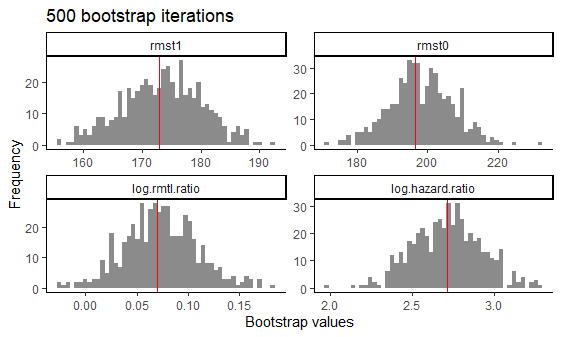
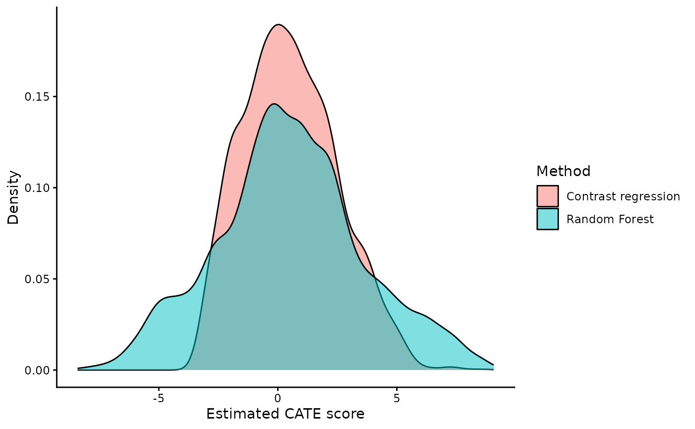
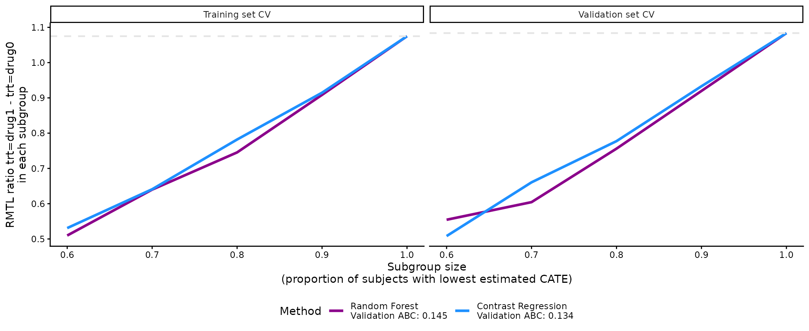
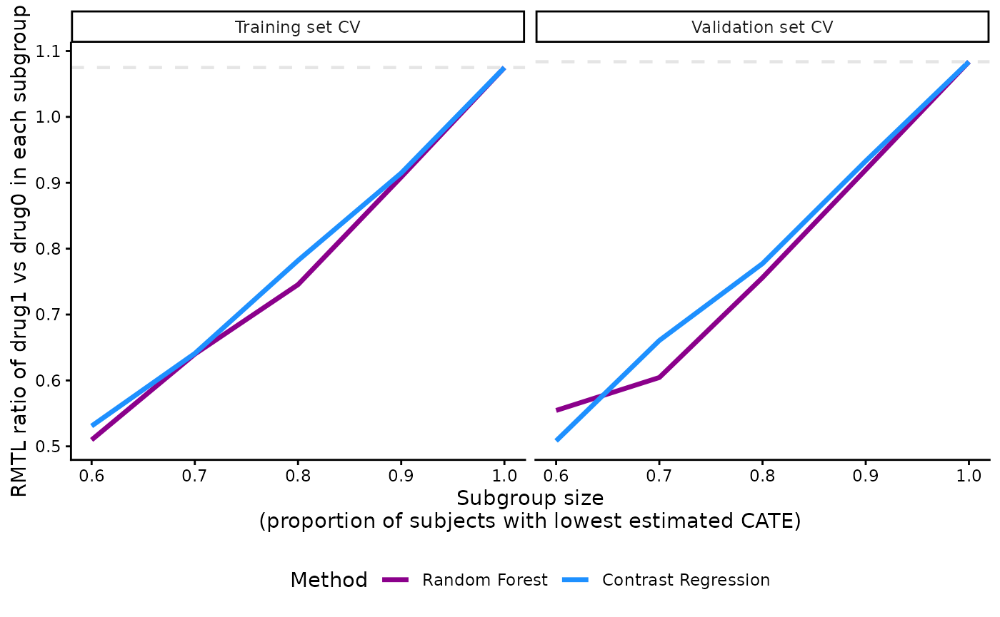
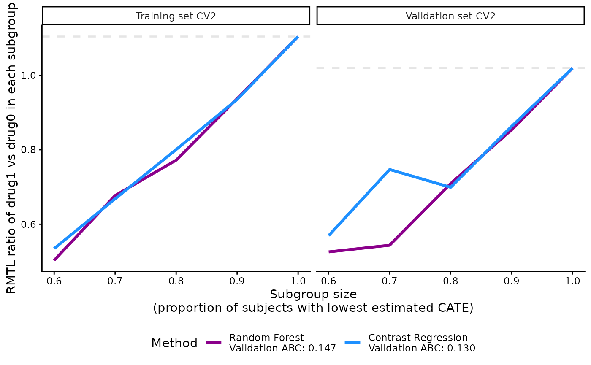
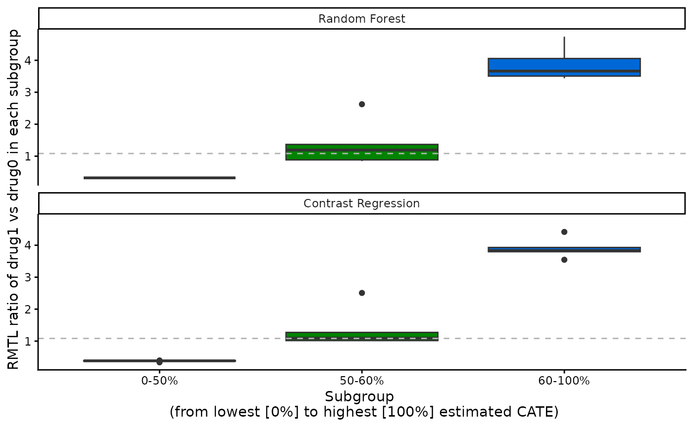

# Examples for survival outcome

[](https://cran.r-project.org/package=precmed)
[](https://cran.r-project.org/package=precmed)

# precmed: Precision Medicine in R

A doubly robust precision medicine approach to estimate and validate
conditional average treatment effects

## Examples with survival outcome of the entire workflow

### Load required packages

``` r

library(precmed)
library(dplyr)
library(ggplot2)
```

### Load data set (Example data with survival outcome)

To show the functionalities of the `precmed` package for survival
outcomes we first need data. For our examples we use simulated data that
is located in the `survivalExample` data set. The data set
`survivalExample` was simulated based on real-world claims data in
multiple sclerosis and has 4,000 observations and 9 variables.

|  | level | Overall | drug0 | drug1 |
|:---|:---|:---|:---|:---|
| Number of patients |  | 4000 | 1849 | 2151 |
| Age (mean (SD)) |  | 45.8 (9.9) | 37.3 (6.4) | 53.1 (5.5) |
| Gender (%) | male | 996 (24.9) | 456 (24.7) | 540 (25.1) |
|  | female | 3004 (75.1) | 1393 (75.3) | 1611 (74.9) |
| Previous treatment (%) | drugA | 1752 (43.8) | 819 (44.3) | 933 (43.4) |
|  | drugB | 459 (11.5) | 207 (11.2) | 252 (11.7) |
|  | drugC | 1789 (44.7) | 823 (44.5) | 966 (44.9) |
| Previous medical cost (\$) (mean (SD)) |  | 14362.0 (24265.9) | 11358.0 (14393.2) | 16944.1 (30045.6) |
| Previous number of symptoms (%) | 0 | 347 ( 8.7) | 191 (10.3) | 156 ( 7.3) |
|  | 1 | 2686 (67.2) | 1219 (65.9) | 1467 (68.2) |
|  | \>=2 | 967 (24.2) | 439 (23.7) | 528 (24.5) |
| Previous number of relapses (%) | 0 | 2612 (65.3) | 1247 (67.4) | 1365 (63.5) |
|  | 1 | 1106 (27.7) | 488 (26.4) | 618 (28.7) |
|  | 2 | 246 ( 6.2) | 99 ( 5.4) | 147 ( 6.8) |
|  | 3 | 33 ( 0.8) | 14 ( 0.8) | 19 ( 0.9) |
|  | 4 | 2 ( 0.0) | 1 ( 0.1) | 1 ( 0.0) |
|  | 5 | 1 ( 0.0) | 0 ( 0.0) | 1 ( 0.0) |
| Days until the first relapse (mean(SD)) |  | 141.6 (262.2) | 152.6 (275.5) | 132.1 (249.9) |
| Event indicator (0: censoring, 1: relapse) (%) | 0 | 3352 (83.8) | 1695 (91.7) | 1657 (77.0) |
|  | 1 | 648 (16.2) | 154 ( 8.3) | 494 (23.0) |

------------------------------------------------------------------------

Most variables are baseline patient characteristics like age, gender,
and previous treatment.

- We will use `y` as the survival outcome, which is the number of days
  until the first relapse or censoring, whichever comes first.

- We will use `d` as the event indicator, where $`1`$ represents an
  event and $`0`$ represents censoring. The censoring rate is about 84%.

- We will use `trt` as the treatment variable, which has 2 drugs (drug0
  and drug1).

To avoid multicollinearity issues, the continuous variable `age` was
centered at 48 years old and the medical costs in the year prior to
treatment initiation `previous_cost` was centered at 14,362 USD and
scaled with standard deviation 24,266 USD.

The final dataset `survivalExample` looked like this:

    #> 'data.frame':    4000 obs. of  9 variables:
    #>  $ age                     : num [1:4000, 1] -26.83 -2.83 -12.83 -20.83 6.17 ...
    #>   ..- attr(*, "scaled:center")= num 45.8
    #>  $ female                  : int  1 1 1 0 0 1 1 1 1 1 ...
    #>  $ previous_treatment      : Factor w/ 3 levels "drugA","drugB",..: 3 1 3 1 3 1 3 3 3 1 ...
    #>  $ previous_cost           : num [1:4000, 1] -0.341 -0.239 -0.171 -0.392 -0.518 ...
    #>   ..- attr(*, "scaled:center")= num 14362
    #>   ..- attr(*, "scaled:scale")= num 24266
    #>  $ previous_number_symptoms: Factor w/ 3 levels "0","1",">=2": 2 2 2 3 3 2 3 2 2 2 ...
    #>  $ previous_number_relapses: int  0 1 2 0 1 0 0 2 0 0 ...
    #>  $ trt                     : Factor w/ 2 levels "drug0","drug1": 1 1 1 1 2 1 2 2 2 2 ...
    #>  $ y                       : num  102.1 51.3 104.9 61.5 35.6 ...
    #>  $ d                       : num  0 0 0 0 0 0 0 0 0 1 ...

### Estimation of the ATE with `atefit()`

First, one might be interested in the effect of the drug (trt) on the
number of days until the first relapse or censoring (y). Lets test this
using Cox regression.

``` r

library(survival)
output_cox <- coxph(Surv(y, d) ~ trt, data = survivalExample)
summary(output_cox)
#> Call:
#> coxph(formula = Surv(y, d) ~ trt, data = survivalExample)
#> 
#>   n= 4000, number of events= 648 
#> 
#>             coef exp(coef) se(coef)     z Pr(>|z|)    
#> trtdrug1 1.11311   3.04381  0.09233 12.06   <2e-16 ***
#> ---
#> Signif. codes:  0 '***' 0.001 '**' 0.01 '*' 0.05 '.' 0.1 ' ' 1
#> 
#>          exp(coef) exp(-coef) lower .95 upper .95
#> trtdrug1     3.044     0.3285      2.54     3.648
#> 
#> Concordance= 0.639  (se = 0.009 )
#> Likelihood ratio test= 170.1  on 1 df,   p=<2e-16
#> Wald test            = 145.3  on 1 df,   p=<2e-16
#> Score (logrank) test = 160.9  on 1 df,   p=<2e-16
```

We see from the Cox regression we see that drug1 resulted in a hazard
ratio (HR) of 3.04 when compared to drug 0. This indicates that drug 0
is superior to drug 1 because drug 1 increases the risk of a relapse.

Now we want to estimate the Average Treatment Effect (ATE) and correct
for several covariates like age and previous treatment because they
might influence the relation between treatment and outcome. The
[`atefit()`](https://smartdata-analysis-and-statistics.github.io/precmed/reference/atefit.md)
function allows estimating the ATE in terms of restricted mean time lost
(RMTL) and HR (hazard ratio). The RMTL estimator is doubly robust,
meaning that the estimator is consistent if the PS model (argument
`ps.model`) or the outcome model (argument `cate.model`) or both are
correctly specified. The estimator also depends on the estimation of
Inverse Probability Censoring Weights (IPCW). The HR estimator is based
on a Cox regression model. The function also provides standard error,
confidence intervals, and p-values based on bootstrap.

The mandatory arguments for
[`atefit()`](https://smartdata-analysis-and-statistics.github.io/precmed/reference/atefit.md)
are:

- The `response` argument specifies the type of outcome in the data. For
  survival outcomes, `response` = “survival”. This informs the function
  of the necessary arguments and methods to use.

- The argument `data` indicates the data frame in which the outcome,
  treatment and covariates specified in either `cate.model` or
  `ps.model` should be fetched.

- The `score.method` argument specifies the precision medicine (PM)
  methods to be used to calculate the CATE scores. There are a total of
  5 scoring methods implemented:

  - `poisson` fits a Poisson model separately by treatment group.

  - `boosting` uses gradient boosted regression models (GBM) separately
    by treatment group.

  - `randomForest` fits a random forest model by treatment group.

  - `twoReg` implements the doubly robust two regressions estimator in
    (Yadlowsky et al. 2020).

  - `contrastReg` implements the doubly robust contrast regression
    estimator from (Yadlowsky et al. 2020).

- The argument `cate.model` specifies the CATE model as a formula, with
  the survival object from the `survival` package, `Surv(y, d)`,
  supplied on the left-hand side and the explanatory covariates supplied
  on the right-hand side. In the example below, we chose to specify to
  CATE as a linear combination of the following covariates: age, sex,
  medical costs in the year prior to treatment initiation, and number of
  relapses in the year prior to treatment initiation. Non-linear or
  interaction terms could also be included. Note that the treatment
  variable is not supplied in `cate.model` since this is an outcome
  model.

- The `ps.model` argument specifies the PS model as a formula, with the
  treatment variable `trt` on the left-hand side and the covariates (age
  and previous treatment in this example) on the right-hand side. The
  variable `trt` must be supplied as a numeric variable taking only 2
  values, “1” for active treatment and “0” for control or comparator. If
  it is not the case,
  [`catecv()`](https://smartdata-analysis-and-statistics.github.io/precmed/reference/catecv.md)
  will stop with error if `trt` takes more than 2 distinct values or
  will automatically transform `trt` into a numeric variable. In this
  example, `trt` (a factor variable taking values “drug0” and “drug1”)
  was transformed and a warning message was left to the user (see output
  below): `Variable trt was recoded to 0/1 with drug0->0 and drug1->1`.
  If the data are from a RCT, it suffices to specify `ps.model` = trt
  ~ 1. Note that the PS model is only used in the estimation of the 2
  doubly robust methods (two and contrast regressions).

- `tau0`: The truncation time for defining restricted mean time lost.
  Because our outcome `y` is skewed towards 0, we use the 95% upper
  limit.

Let’s calculate the ATE for the effect of treatment on y and build an
outcome model that contains all variables and a PS model with `age` and
`previous_treatment`.

``` r

#define tau0
tau0 <- with(survivalExample,
             min(quantile(y[trt == "drug1"], 0.95), quantile(y[trt == "drug0"], 0.95)))

#run atefit
output_atefit <- atefit(response = "survival",
                        data = survivalExample,
                        cate.model = survival::Surv(y, d) ~ age + female + previous_cost + previous_number_relapses,
                        ps.model = trt ~ age + previous_treatment,
                        tau0 = tau0)
#> Warning in data.preproc.surv(fun = "drinf", cate.model = cate.model, ps.model = ps.model, : Variable trt was recoded to 0/1 with drug0->0 and drug1->1.
```

When `verbose` = 1, the function outputs a progress bar in the console.

``` r

output_atefit
#> Average treatment effect:
#> 
#>                   estimate         SE    CI.lower  CI.upper    pvalue
#> log.rmtl.ratio   0.0701553 0.03236713 0.006716898 0.1335937 0.0301978
#> log.hazard.ratio 2.7133243 0.20813279 2.305391515 3.1212571 0.0000000
#> 
#> Estimated RMST:
#> 
#>       estimate       SE CI.lower CI.upper pvalue
#> rmst1 172.8609 6.362381 160.3909 185.3309      0
#> rmst0 196.5603 8.541616 179.8190 213.3015      0
#> Warning in print.atefit(x): Variable trt was recoded to 0/1 with drug0->0 and drug1->1.
```

The output of
[`atefit()`](https://smartdata-analysis-and-statistics.github.io/precmed/reference/atefit.md)
shows the point estimate, standard error (“SE”), lower (“CI.lower”) and
upper (“CI.upper”) bound of the 95% confidence interval, and the p-value
(“pvalue”) for 4 estimands:

- the restricted mean survival time under drug 1 (`$rmst1`)

- the restricted mean survival time under drug 0 (`$rmst0`)

- the log RMTL ratio (`$log.rmtl.ratio`), which is the log of the ratio
  of `tau0` - `$rmst1` divided by `tau0` - `$rmst0`

- the log HR (`$log.hazard.ratio`).

For example, the log RMTL ratio of 0.07 and the 95% confidence interval
of (0.01, 0.13) are displayed in the output. The RMTL ratio of along
with the 95% confidence interval suggest that drug 0 is superior to drug
1 because the ratio is significantly greater than 1. When we check the
estimated RMST, we also see that the estimated rmst1 is lower compared
to rmst0, indicating that patients that received drug0 have a longer
mean survival time compared to drug1.

The output of
[`atefit()`](https://smartdata-analysis-and-statistics.github.io/precmed/reference/atefit.md)
is expressed in terms of treatment 0 vs 1, where the RMTL and hazard
ratios are expressed as the ratio of the treatment coded as 1 over the
treatment coded as 0. If the treatment variable is not coded as 0/1 in
the data set, the function returns a warning `output_atefit$warning`
which indicates what key was used to recode the treatment variable into
a 0/1 variable.

``` r

output_atefit$warning
#> [1] "Variable trt was recoded to 0/1 with drug0->0 and drug1->1.\n"
```

Using `plot(output_atefit)`, a histograms is generated of the point
estimates across the `n.boot` bootstrap iterations for 4 estimands
(`rmst1`, `rmst0`, `log.rmtl.ratio`, `log.hazard.ratio`). A red vertical
line is added to each histogram with the mean of the bootstrap
estimates.



Histograms of bootstrap estimators for 4 estimands after 500 bootstrap

### Estimation of the CATE score with `catefit()`

Now we have calculated the ATE we know the effect of both treatments on
average, but this effect might not be the same for all patients. Thus,
it might be worthwhile to check if there are subgroups that respond
differently to the treatments. We can calculate the Conditional Average
Treatment Effect (CATE) score which calculates the ATE for different
subgroups in the data. If no internal validation is needed (we get back
to that later), we can use the
[`catefit()`](https://smartdata-analysis-and-statistics.github.io/precmed/reference/catefit.md)
function to a model directly to the entire data set to estimate the CATE
score. For the
[`catefit()`](https://smartdata-analysis-and-statistics.github.io/precmed/reference/catefit.md)
function we have to define the `score.method`. This arguments specifies
the precision medicine (PM) method to be used to calculate the CATE
scores. There are a total of 5 scoring methods implemented:

The mandatory arguments in
[`catefit()`](https://smartdata-analysis-and-statistics.github.io/precmed/reference/catefit.md)
are:

- `response`: “survival” in this example because we use have data with a
  survival outcome (e.g., number of days until the first relapse or
  censoring))

- `data`: the name of the data set. (survivalExample)

- `score.method`: argument specifies the precision medicine (PM) methods
  to be used to calculate the CATE scores. There are a total of 5
  scoring methods implemented:

  - `poisson` fits a Poisson model separately by treatment group.

  - `boosting` uses gradient boosted regression models (GBM) separately
    by treatment group.

  - `randomForest` fits a random forest model by treatment group.

  - `twoReg` implements the doubly robust two regressions estimator in
    (Yadlowsky et al. 2020).

  - `contrastReg` implements the doubly robust contrast regression
    estimator from (Yadlowsky et al. 2020).

- `cate.model`: A formula describing the outcome model to be fitted. The
  outcome must appear on the left-hand side. In the example, we choose
  to specify to outcome model as a linear combination of the following
  covariates: age, sex, medical costs in the year prior to treatment
  initiation, and number of relapses in the year prior to treatment
  initiation. Non-linear or interaction terms could also be included.
  Note that the treatment variable is not supplied in `cate.model` since
  this is an outcome model.

- `ps.model`: A formula describing the propensity score (PS) model to be
  fitted. The treatment must appear on the left-hand side and the
  covariates (age and previous treatment in this example) on the
  right-hand side. The variable `trt` must be supplied as a numeric
  variable taking only 2 values, 1 for active treatment and 0 for
  control or comparator. If it is not the case, the function will stop
  with error if `trt` takes more than 2 distinct values or will
  automatically transform `trt` into a numeric variable. In this
  example, `trt` (a factor variable taking values “drug0” and “drug1”)
  was transformed and a warning message was left to the user (see output
  below): `Variable trt was recoded to 0/1 with drug0->0 and drug1->1`.
  If the data are from a RCT, it suffices to specify `ps.model` = trt
  ~ 1. Note that the PS model is only used in the estimation of the 2
  doubly robust methods (two and contrast regressions).

We also specified the following non-mandatory arguments to fit with the
data and problem at hand: `initial.predictor.method`, `tau0`,
`higher.y`, `seed`, and `plot.gbmperf`.

- `initial.predictor.method` specifies how predictions of the outcome
  are estimated in two regressions and contrast regression. Flexible
  models can be used such as GBM (“boosting”), random forests
  (“randomForest”) or logistic regression (“logistic”). We chose
  “logistic” because it is relatively faster than boosting methods and
  random forest.

- `tau0` is the truncation time for defining restricted mean time lost
  (RMTL). Because our outcome `y` is skewed towards 0, we use the 95%
  upper limit.

- `higher.y` was set to `TRUE` because relapse is a negative event and
  longer time to first relapse is more desirable in our example. Hence,
  we are telling the function that subgroups of high responders to drug1
  vs drug0 should have later onset of the first relapse. In other
  situation, higher outcomes may be more favorable for time to a
  positive event, e.g., time to discharge or time to improved
  disability. It is important for this argument to match with the nature
  of `y` outcome because it will affect how the subgroups are defined by
  the CATE scores and the performance metrics.

- We set a random seed `seed` = 999 to reproduce the results.

- We avoided generating the boosting performance plots by specifying
  `plot.gbmperf` = FALSE.

Please see the [Function
description](https://smartdata-analysis-and-statistics.github.io/precmed/reference/catefitsurv.html)
section for details.

If you run into errors or warnings with your data, it might be helpful
to go over the descriptions to see if you need to alter the default
values. In this toy example, we keep the default values of the remaining
arguments. For this toy example we selected `randomForest` and
`contrastReg` to limit run time.

``` r

tau0 <- with(survivalExample,
             min(quantile(y[trt == "drug1"], 0.95), quantile(y[trt == "drug0"], 0.95)))

output_catefit <- catefit(response = "survival",
                          data = survivalExample,
                          score.method = c( "randomForest", "contrastReg"),
                          cate.model = survival::Surv(y, d) ~ age + female + previous_cost + previous_number_relapses,
                          ps.model = trt ~ age + previous_treatment,
                          initial.predictor.method = "logistic",
                          tau0 = tau0, 
                          higher.y = TRUE,
                          seed = 999,
                          plot.gbmperf = FALSE)
#> Warning in data.preproc.surv(fun = "catefit", cate.model = cate.model, ps.model = ps.model, : Variable trt was recoded to 0/1 with drug0->0 and drug1->1.
```

Each method specified in `score.method` has the following sets of
results in
[`catefit()`](https://smartdata-analysis-and-statistics.github.io/precmed/reference/catefit.md):

1.  `score` contains the log-transformed estimated CATE scores for each
    subject. The CATE score is a linear combination of the variables
    specified in the `cate.model` argument. Same as the outcome, lower
    CATE scores are more desirable if `higher.y` = FALSE and vice versa.
    In our example, the survival outcome is time to first relapse, which
    is a negative event, so higher values indicate later onset of the
    first relapse. Hence, we specify `higher.y` = TRUE in the example.
    Each subject has 1 CATE score so the length of this output is 4,000
    for our toy example. Below we show the CATE scores estimated with
    contrast regression for the first 6 subjects in the data.

``` r

length(output_catefit$score.contrastReg)
#> [1] 4000
head(output_catefit$score.contrastReg)
#> [1]  5.3264861  1.1651265  3.4845913  4.0150879 -0.8484891  2.4213491
```

2.  `coefficients` contains the estimated coefficients of the CATE score
    for each scoring method. It is a data frame of the covariates
    (including intercept) as rows and scoring methods as columns. In our
    toy example, there are 4 covariates in the `cate.model`, plus the
    intercept, so there are 5 rows of estimated coefficients within each
    column. Boosting method does not estimate coefficients (it directly
    predicts the score) so they do not have coefficient results here.

``` r

output_catefit$coefficients
#>                          contrastReg
#> (Intercept)                0.2528396
#> age                       -0.1911735
#> female                     0.1359737
#> previous_cost              0.5634907
#> previous_number_relapses   0.3693452
```

We can define the estimated CATE scores for contrast regression like
shown below. The user can use this information to study the influence of
each covariate.
``` math
 
\begin{aligned}
\widehat{CATE} = 0.25 & - 0.19 \times \text{age} \\
& + 0.14 \times \text{female (vs male)} \\ 
& + 0.56 \times \text{previous medical costs} \\
& + 0.37 \times \text{previous number of relapses} 
\end{aligned} 
```

3.  `ate` contains estimated ATEs by each nested subgroup of high
    responders to drug 1 defined by `prop.cutoff`. The subgroups are
    defined based on the estimated CATE scores with the specified
    scoring method. In this example, we show the estimated ATEs of
    subgroups identified by CATE scores of the contrast regression. For
    example, the estimated ATE for the subgroup of subjects constructed
    based on the 50% (“prop0.5”) lowest CATE scores estimated from the
    contrast regression is 0.41.

``` r

output_catefit$ate.contrastReg
#>   prop0.5   prop0.6   prop0.7   prop0.8   prop0.9     prop1 
#> 0.4098373 0.5114925 0.6269751 0.7801699 0.9145661 1.0726748
```

You are encouraged to summarize and visualize the outputs in whichever
way that fits their particular situation outside the package’s
functions. For example, it is possible to plot the densities of all CATE
scores with `ggplot`. There are some subjects with extremely high
estimated CATE scores but most of the samples fall between -10 and 10.

``` r

dataplot <- data.frame(score = factor(rep(c("Random Forest", "Contrast regression"), 
                                          each = length(output_catefit$score.randomForest))), 
                       value = c(output_catefit$score.randomForest,output_catefit$score.contrastReg))

dataplot %>% 
  ggplot(aes(x = value, fill = score)) + 
  geom_density(alpha = 0.5) +
  theme_classic() + 
  labs(x = "Estimated CATE score", y = "Density", fill = "Method")
#> Warning: Removed 5 rows containing non-finite outside the scale range
#> (`stat_density()`).
```



### Internal validation via `catecv()`

The
[`catecv()`](https://smartdata-analysis-and-statistics.github.io/precmed/reference/catecv.md)
function provides the same estimation as the
[`catefit()`](https://smartdata-analysis-and-statistics.github.io/precmed/reference/catefit.md)
but via cross-validation (CV). With the
[`catecv()`](https://smartdata-analysis-and-statistics.github.io/precmed/reference/catecv.md)
function internal CV is applied to reduce optimism in choosing the CATE
estimation method that captures the most treatment effect heterogeneity.
The CV is applied by repeating the following steps `cv.n` times:

- Split the data into a training and validation set according to
  `train.prop` argument. The training and validation sets must be
  balanced with respect to covariate distributions and doubly robust
  rate ratio estimates (see `error.max` argument).

- Estimate the CATE score in the training set with the specified scoring
  method.

- Predict the CATE score in the validation set using the scoring model
  fitted from the training set.

- Build nested subgroups of treatment responders in the training and
  validation sets, separately, and estimate the ATE within each nested
  subgroup. For each element i of `prop.cutoff` argument (e.g.,
  `prop.cutoff[i] = 0.6`), take the following steps:

  - Identify high responders as observations with the 60% (i.e.,
    `prop.cutoff[i]x100%`) highest (if `higher.y = TRUE`) or lowest (if
    `higher.y = FALSE`) estimated CATE scores.

  - Estimate the ATE in the subgroup of high responders using a doubly
    robust estimator.

  - Conversely, identify low responders as observations with the 40%
    (i.e., `1 - prop.cutoff[i]x100%`) lowest (if `higher.y = TRUE`) or
    highest (if `higher.y = FALSE`) estimated CATE scores.

  - Estimate the ATE in the subgroup of low responders using a doubly
    robust estimator.

- If `abc = TRUE`, calculate the area between the ATE and the series of
  ATEs in nested subgroups of high responders in the validation set.
  (for more information about the abc score, see [Validation curves and
  the ABC
  statistics](https://smartdata-analysis-and-statistics.github.io/precmed/articles/Theoretical-details.md))

- Build mutually exclusive subgroups of treatment responders in the
  training and validation sets, separately, and estimate the ATE within
  each subgroup. Mutually exclusive subgroups are built by splitting the
  estimated CATE scores according to prop.multi.

Oke, so now we can use the
[`catecv()`](https://smartdata-analysis-and-statistics.github.io/precmed/reference/catecv.md)
function to run internal validation to compare the different scoring
methods. The mandatory arguments are similar to
[`atefit()`](https://smartdata-analysis-and-statistics.github.io/precmed/reference/atefit.md)
and
[`catefit()`](https://smartdata-analysis-and-statistics.github.io/precmed/reference/catefit.md):
The mandatory arguments are: `response`, `data`, `score.method`,
`cate.model`, and `ps.model`. See above for more details on these
arguments. For this toy example we again selected `randomForest` and
`contrastReg` limit run time.

We also specified the following non-mandatory arguments to fit with the
data and problem at hand: `initial.predictor.method`, `ipcw.model`,
`verbose`, `followup.time`, `tau0`, `higher.y`, `cv.n`, `surv.min`,
`seed`, and `plot.gbmperf`.

- `initial.predictor.method` specifies how predictions of the outcome
  are estimated in two regressions and contrast regression. Flexible
  models can be used such as GBM (“boosting”), random forests
  (“randomForest”) or logistic regression (“logistic”). We chose
  “logistic” because it is relatively faster than boosting methods and
  random forest.

- `followup.time` specifies the maximum follow-up time in the data. We
  set it default as `NULL`, which indicates unknown potential censoring
  time.

- `tau0` is the truncation time for defining restricted mean time lost
  (RMTL). Because our outcome `y` is skewed towards 0, we use the 95%
  upper limit.

- `higher.y` was set to `TRUE` because relapse is a negative event and
  longer time to first relapse is more desirable in our example. Hence,
  we are telling the function that subgroups of high responders to drug1
  vs drug0 should have later onset of the first relapse. In other
  situation, higher outcomes may be more favorable for time to a
  positive event, e.g., time to discharge or time to improved
  disability. It is important for this argument to match with the nature
  of `y` outcome because it will affect how the subgroups are defined by
  the CATE scores and the performance metrics.

- `surv.min` truncates the censoring probability estimated from the IPCW
  model with a lower limit to prevent extremely small censoring
  probabilities. It is recommended to choose a small positive value
  close to 0. We chose `0.025` in the example, which corresponds to the
  default value.

- We performed 5 CV iterations by specifying `cv.n` = 5. Typically, more
  CV iterations are desirable although associated with longer
  computational times.

- We set a random seed `seed` = 999 to reproduce the results.

- We avoided generating the boosting performance plots by specifying
  `plot.gbmperf` = FALSE.

- When `verbose` = 1, progress messages are printed in the R console but
  errors and warnings are not printed. The current CV iteration is
  printed, followed by the steps of the CV procedure (splitting the
  data, training the models, validating the models). A timestamp and a
  progress bar are also displayed upon completion of a CV iteration. If
  `contrastReg` was selected as one of the methods in `score.method`, an
  additional line of output message will indicate whether the algorithm
  has converged.

There are many other non-mandatory arguments that
[`catecv()`](https://smartdata-analysis-and-statistics.github.io/precmed/reference/catecv.md)
can accept. Please see the [Additional
examples](https://smartdata-analysis-and-statistics.github.io/precmed/articles/Additional-examples.md)
vignette for more examples and the Function description [Function
description](https://smartdata-analysis-and-statistics.github.io/precmed/reference/catecvsurv.html)
for details. If you run into errors or warnings with your data, it might
be helpful to go over the descriptions to see if you need to alter the
default values. In this toy example, we keep the default values of the
remaining arguments.

``` r

tau0 <- with(survivalExample,
             min(quantile(y[trt == "drug1"], 0.95), quantile(y[trt == "drug0"], 0.95)))

output_catecv <- catecv(response = "survival",
                        data = survivalExample,
                        score.method = c("randomForest", "contrastReg"),
                        cate.model = survival::Surv(y, d) ~ age + female +
                                     previous_cost + previous_number_relapses,
                        ps.model = trt ~ age + previous_treatment,
                        initial.predictor.method = "logistic",
                        followup.time = NULL,
                        tau0 = tau0,
                        higher.y = TRUE,
                        surv.min = 0.025,
                        prop.cutoff = seq(0.6, 1, length = 5),
                        prop.multi = c(0, 0.5, 0.6, 1),
                        cv.n = 5,
                        seed = 999,
                        plot.gbmperf = FALSE,
                        verbose = 1)
#> Warning in data.preproc.surv(fun = "crossv", cate.model = cate.model, ps.model = ps.model, : Variable trt was recoded to 0/1 with drug0->0 and drug1->1.
#>   |                                                                              |                                                                      |   0%
#> cv = 1 
#>   splitting the data..
#>   training..
#>   validating..
#>   Contrast regression converged.
#>    Fri Nov 13 12:38:06 2026 
#>   |                                                                              |==============                                                        |  20%
#> cv = 2 
#>   splitting the data..
#>   training..
#>   validating..
#>   Contrast regression converged.
#>    Fri Nov 13 12:38:15 2026 
#>   |                                                                              |============================                                          |  40%
#> cv = 3 
#>   splitting the data..
#>   training..
#>   validating..
#>   Contrast regression converged.
#>    Fri Nov 13 12:38:24 2026 
#>   |                                                                              |==========================================                            |  60%
#> cv = 4 
#>   splitting the data..
#>   training..
#>   validating..
#>   Contrast regression converged.
#>    Fri Nov 13 12:38:33 2026 
#>   |                                                                              |========================================================              |  80%
#> cv = 5 
#>   splitting the data..
#>   training..
#>   validating..
#>   Contrast regression converged.
#>    Fri Nov 13 12:38:41 2026 
#>   |                                                                              |======================================================================| 100%
#> Total runtime : 44.5 secs
```

The output of
[`catecv()`](https://smartdata-analysis-and-statistics.github.io/precmed/reference/catecv.md)
is an object of class “precmed” and here we named it `output_catecv`. It
carries the relevant information to use in the next step of the workflow
which selects the method (among those specified in the argument
`score.method`) capturing the highest level of treatment effect
heterogeneity. The output, which is described below, will be used in the
functions
[`abc()`](https://smartdata-analysis-and-statistics.github.io/precmed/reference/abc.md),
[`plot()`](https://rdrr.io/r/graphics/plot.default.html) and
[`boxplot()`](https://rdrr.io/r/graphics/boxplot.html).

For each method specified in the argument `score.method`, the following
3 groups of outputs are generated: `high`, `low` and `group`. We use the
results from `randomForest` as an example.

**1. ATEs in nested subgroups of high responders**

This output stores the ATEs - the ratio of RMTL between drug1 vs drug0
in this example - in nested subgroups of patients of high responders to
drug 1 in the training (`$ate.est.train.high.cv`) and validation
(`$ate.est.valid.high.cv`) sets across all CV iterations. When
`higher.y` = TRUE for survival outcomes, which is the case in this
example, lower CATE scores correspond to high responders to drug1. When
`higher.y` = FALSE for survival outcomes, higher CATE scores correspond
to high responders to drug1. Note that this is different for count
outcomes. The direction of CATE scores depends on both `higher.y` and
outcome type.

``` r

output_catecv$ate.randomForest$ate.est.train.high.cv
#>               cv1       cv2       cv3       cv4       cv5
#> prop0.6 0.4749922 0.5030279 0.4981575 0.5171575 0.5554420
#> prop0.7 0.6201716 0.6770233 0.6175497 0.6582595 0.6266985
#> prop0.8 0.7285812 0.7720559 0.7332510 0.7534121 0.7397380
#> prop0.9 0.8915834 0.9372166 0.8941672 0.9168509 0.9032349
#> prop1   1.0534514 1.1042633 1.0646558 1.0830122 1.0690691
output_catecv$ate.randomForest$ate.est.valid.high.cv
#>               cv1       cv2       cv3       cv4       cv5
#> prop0.6 0.6507888 0.5255798 0.4978265 0.5925663 0.5055188
#> prop0.7 0.6226787 0.5435506 0.6523691 0.5929241 0.6106757
#> prop0.8 0.7969796 0.7092100 0.7952712 0.7284509 0.7506247
#> prop0.9 0.9859877 0.8537926 0.9469109 0.8875706 0.9240364
#> prop1   1.1465914 1.0194984 1.0968389 1.0526779 1.1027499
```

The output is a matrix with columns corresponding to the CV iterations,
labeled from 1 to `cv.n`, and rows corresponding to nested subgroups.
The nested subgroups of patients are defined by the argument
`prop.cutoff`. Here, we use `seq(0.6, 1, length = 5)` which defines
nested subgroups with the 60%, 70%, 80%, 90% and 100% lowest (highest if
`higher.y = FALSE`) CATE scores estimated by random forest. The rows in
the output are labeled to reflect the user-specified proportions used to
build the subgroups.

For example, in the training set and in the 4th CV iteration (4th column
labeled “cv4”), the subgroup defined with the 80% lowest CATE scores
(4th row labeled “prop0.8”) has an estimated RMTL ratio of 0.753. In
contrast, the subgroup defined with all patients (last row labeled
“prop1”) in the 4th CV iteration has an estimated RMTL ratio of 1.083.

**2. ATEs in nested subgroups of low responders**

This output stores the ATEs in nested subgroups of *low responders* to
drug1 in the training (`$ate.est.train.low.cv`) and validation
(`$ate.est.valid.low.cv`) sets across all CV iterations. When `higher.y`
= TRUE for survival outcomes, higher CATE scores correspond to low
responders to drug1. When `higher.y` = FALSE for survival outcomes,
lower CATE scores correspond to low responders to drug1. Again, this is
different for count outcomes. The direction of CATE scores depends on
both `higher.y` and outcome type.

``` r

output_catecv$ate.randomForest$ate.est.train.low.cv
#>               cv1      cv2       cv3       cv4       cv5
#> prop0.4  7.795507  6.68852  9.612264  8.540335  7.353119
#> prop0.3 37.739481 85.49910 95.881645 46.227020 66.235593
#> prop0.2       Inf       NA       Inf       Inf       Inf
#> prop0.1        NA       NA        NA        NA        NA
```

The outputs are also matrices with columns corresponding to the CV
iterations and rows corresponding to nested subgroups.

The output for the low responders brings additional information to the
user. It gives the ATEs in the complement of each nested subgroup of
high responders. For example, the complement of the subgroup of high
responders defined as patients with the 60% lowest (highest if
`higher.y` = FALSE) estimated CATE scores is the subgroup of low
responders defined as patients with the 40% highest (lowest if
`higher.y` = TRUE) estimated CATE scores, labeled as “prop0.4”. In the
training set and in the first CV iterations, the estimated RMTL ratio is
0.62 in the 60% high responders to drug 1 and 37.739 in the 40% low
responders.

The 2 last rows have missing or infinite values and this can be due to
many reasons. We record all errors and warnings and keep them as an
element of the `cv` output. For example, we can use the following code
to check specific errors and warnings of the first CV iteration (`$cv1`)
using the random forest method (`$randomForest`) when estimating the ATE
in the training sample in the low responder groups
(`$est.train.low.cv`). It looks like there was no event observation in
the 10% subgroup, possibly due to small sample size, which also relates
to the convergence issue in the warning. Additionally, the warning for
the 20% subgroup (`$warnings$'prop0.2'`) suggested that there was
non-convergence of the Cox procedure and that the corresponding
estimated ATE should be interpreted with caution.

``` r

output_catecv$`errors/warnings`$randomForest$est.train.low.cv$cv1
#> $errors
#> $errors$`prop 0.1`
#> [1] "Error in dimnames(means) <- list(time, vname) : 'dimnames' applied to non-array"
#> 
#> 
#> $warnings
#> $warnings$`prop 0.2`
#> [1] "Warning in coxph.fit(X, Y, istrat, offset, init, control, weights = weights, method = method, rname, nocenter = nocenter), coxph.fit(X, Y, istrat, offset, init, control, weights = weights, method = method, rname, nocenter = nocenter), coxph.fit(X, Y, istrat, offset, init, control, weights = weights, method = method, rname, nocenter = nocenter) : Ran out of iterations and did not converge"
#> [2] "Warning in coxph.fit(X, Y, istrat, offset, init, control, weights = weights, method = method, rname, nocenter = nocenter), coxph.fit(X, Y, istrat, offset, init, control, weights = weights, method = method, rname, nocenter = nocenter), coxph.fit(X, Y, istrat, offset, init, control, weights = weights, method = method, rname, nocenter = nocenter) : one or more coefficients may be infinite"  
#> [3] "Warning in coxph.fit(X, Y, istrat, offset, init, control, weights = weights, method = method, rname, nocenter = nocenter), coxph.fit(X, Y, istrat, offset, init, control, weights = weights, method = method, rname, nocenter = nocenter), coxph.fit(X, Y, istrat, offset, init, control, weights = weights, method = method, rname, nocenter = nocenter) : Ran out of iterations and did not converge"
#> 
#> $warnings$`prop 0.1`
#> [1] "Warning in coxph.fit(X, Y, istrat, offset, init, control, weights = weights, method = method, rname, nocenter = nocenter), coxph.fit(X, Y, istrat, offset, init, control, weights = weights, method = method, rname, nocenter = nocenter) : Ran out of iterations and did not converge"
#> [2] "Warning in coxph.fit(X, Y, istrat, offset, init, control, weights = weights, method = method, rname, nocenter = nocenter), coxph.fit(X, Y, istrat, offset, init, control, weights = weights, method = method, rname, nocenter = nocenter) : Ran out of iterations and did not converge"
output_catecv$`errors/warnings`$randomForest$est.valid.low.cv$cv1
#> $errors
#> $errors$`prop 0.2`
#> [1] "Error in coxph(Surv(y, d) ~ x) : No (non-missing) observations"
#> 
#> $errors$`prop 0.1`
#> [1] "Error in coxph(Surv(y, d) ~ x) : No (non-missing) observations"
#> 
#> 
#> $warnings
#> $warnings$`prop 0.4`
#> [1] "Warning in coxph.fit(X, Y, istrat, offset, init, control, weights = weights, method = method, rname, nocenter = nocenter) : Ran out of iterations and did not converge"
#> 
#> $warnings$`prop 0.3`
#> [1] "Warning in coxph.fit(X, Y, istrat, offset, init, control, weights = weights, method = method, rname, nocenter = nocenter), coxph.fit(X, Y, istrat, offset, init, control, weights = weights, method = method, rname, nocenter = nocenter) : Ran out of iterations and did not converge"                         
#> [2] "Warning in coxph.fit(X, Y, istrat, offset, init, control, weights = weights, method = method, rname, nocenter = nocenter), coxph.fit(X, Y, istrat, offset, init, control, weights = weights, method = method, rname, nocenter = nocenter) : Loglik converged before variable  4 ; coefficient may be infinite. "
#> 
#> $warnings$`prop 0.2`
#> [1] "Warning in max(event[who2]) : glm.fit: algorithm did not converge"            
#> [2] "Warning in max(event[who2]) : no non-missing arguments to max; returning -Inf"
#> 
#> $warnings$`prop 0.1`
#> [1] "Warning in max(event[who2]) : no non-missing arguments to max; returning -Inf"
```

**3. ATEs in mutually exclusive multi-category subgroups**

This output stores the ATEs in mutually exclusive multi-category
subgroups of patients in the training (`$ate.est.train.group.cv`) and
validation (`$ate.est.valid.group.cv`) sets across all CV iterations.

``` r

output_catecv$ate.randomForest$ate.est.train.group.cv
#>               cv1       cv2      cv3       cv4       cv5
#> prop0.5 3.4124876 3.5633593 3.737684 3.6563886 3.6699863
#> prop0.6 1.3105527 1.0511322 1.048561 1.1470378 0.9082444
#> prop1   0.2873749 0.4129138 0.271536 0.2827509        NA
output_catecv$ate.randomForest$ate.est.valid.group.cv
#>              cv1      cv2       cv3       cv4      cv5
#> prop0.5 4.739424 3.439306 3.6636766 4.0561238 3.506197
#> prop0.6 0.884929 1.193522 2.6257360 0.8480201 1.368189
#> prop1         NA       NA 0.3218319        NA       NA
```

The output is a matrix with columns corresponding to the CV iterations
and rows corresponding to the mutually exclusive subgroups. The previous
2 outputs only focus on binary subgroups (high or low responders). Here,
the mutually exclusive subgroups can be more than 2 and are defined by
the argument `prop.multi`. We use `c(0, 0.5, 0.6, 1)` which defines 3
subgroups of patients with the 50% lowest, 10% middle and 40% highest
estimated CATE scores when `higher.y` = TRUE (as in this example), or
with the 40% highest, 10% middle and 50% lowest estimated CATE scores
when `higher.y` = FALSE. Taking the first column as an example, the
first CV iteration calculated 3.412 as the RMTL ratio for the subgroup
with the 50% lowest estimated CATE scores, 1.311 as the RMTL ratio for
the subgroup with the middle 10% estimated CATE scores, and 0.287 as the
RMTL ratio for the subgroup with the 40% highest estimated CATE scores.
Use
`` output_catecv$`errors/warnings`$randomForest$est.train.group.cv `` to
learn more about the errors and warnings generated from these outputs.

### Comparison of methods with `abc()`

The ABC statistics is calculated by
[`abc()`](https://smartdata-analysis-and-statistics.github.io/precmed/reference/abc.md)
for each scoring method specified in
[`catecv()`](https://smartdata-analysis-and-statistics.github.io/precmed/reference/catecv.md)
and for each of the `cv.n` CV iterations using the output object
`output_catecv` from
[`catecv()`](https://smartdata-analysis-and-statistics.github.io/precmed/reference/catecv.md).
The ABC corresponds to the area between the curve formed by the ATEs in
subgroups of high responders in the validation set (e.g.,
`output_catecv$ate.randomForest$ate.est.valid.cv` for random forest) and
the horizontal line representing the ATE in the validation set. A higher
ABC value means that the method captures more treatment effect
heterogeneity.

``` r

output_abc <- abc(x = output_catecv)
output_abc
#>                    cv1       cv2       cv3       cv4       cv5
#> randomForest 0.1529437 0.1468651 0.1390613 0.1457913 0.1535596
#> contrastReg  0.1415529 0.1304287 0.1366294 0.1303885 0.1519330
```

The output is a matrix with columns corresponding to the CV iterations
and rows corresponding to the scoring methods specified in
`score.method`. For example, random forest in CV iteration 1 has an ABC
of 0.153, which is the highest in this CV iteration, meaning that random
forest offers the best performance in the first CV iteration. The user
can combine the ABC for each method across iterations:

``` r

average_abc <- apply(output_abc, 1, mean)
average_abc
#> randomForest  contrastReg 
#>    0.1476442    0.1381865
```

In this example, random forest also offers the best overall performance
because it has the highest average ABC, followed closely by contrast
regression.

### Visualization of the validation curves with `plot()`

The ATEs of nested subgroups of high responders to drug1 (e.g.,
`output_catecv$ate.randomForest$ate.est.train.high.cv` and
`output_catecv$ate.randomForest$ate.est.valid.high.cv` for random
forest) can be visualized as a side-by-side line plot, with training
results on the left and validation results on the right. The x-axis is
determined by `prop.cutoff` and the y-axis is the estimated ATEs
averaged over `cv.n` CV iterations as specified by `cv.i` = NULL
(default). The estimated ATE is expressed as a RMTL ratio of drug1
versus drug0 for our toy example. By default, the function retrieves the
name of the treatment variable (`trt`) and the original labels (`drug0`
and `drug1`) to specify a meaningful y-axis label. Otherwise, it is
possible to customize the y-axis label via the `ylab`, for example, by
specifying `ylab` = “RMTL ratio of drug1 vs drug0 in each subgroup”.

Steeper slopes indicate more treatment effect heterogeneity between
drug1 and drug0. Because `higher.y` = TRUE in this example, the slopes
should be increasing from left (`prop.cutoff` = 0.6) to right
(`prop.cutoff` = 1) if treatment effect heterogeneity is present (see
section [Validation curves and the ABC
statistics](https://smartdata-analysis-and-statistics.github.io/precmed/articles/Theoretical-details.md)
for illustration). The method that has the steepest slope in the
validation results would be selected because it captures the most
treatment effect heterogeneity while generalizing well to unseen data.

``` r

plot(x = output_catecv)
```



For this toy example, the methods are performing well in the training
data as per the steep, increasing slopes on the left plot. Moreover, all
methods generalize well to the validation data, as indicated by the
monotonous increasing curves in the validation data (right plot). The
dashed gray line is the ATE in the entire data set, which is why all
lines merge to this reference line when subgroup size is 100% of the
data (`prop.cutoff` = 1). For more explanation on the validation curves,
see the function description.

The plot’s legend includes the ABC statistics in the validation set. The
user can choose to mute the ABC annotations by specifying `show.abc` =
FALSE.

``` r

plot(x = output_catecv, 
     show.abc = FALSE, 
     ylab = c("RMTL ratio of drug1 vs drug0 in each subgroup"))
```



The user can choose to plot the validation curves of only 1 CV iteration
instead of the average of all CV iterations. In the following example,
we plot the validation curves of the second CV iteration by specifying
`cv.i` = 2 and in grayscale by specifying `grayscale` = TRUE.

``` r

plot(x = output_catecv, 
     cv.i = 2, 
     grayscale = TRUE, 
     ylab = c("RMTL ratio of drug1 vs drug0 in each subgroup"))
```



The user can also choose to use the median (instead of mean \[default\])
of the ATEs across CV iterations by specifying the argument `combine` =
“median” in [`plot()`](https://rdrr.io/r/graphics/plot.default.html).

### Visualization of the ATE in subgroups with `boxplot()`

The ATEs of multi-category subgroups that are mutually exclusive can be
visualized as box plots, with 1 box plot for each scoring method. Only
validation results are visualized here. The x-axis is determined by
`prop.multi` and the y-axis is the estimated ATEs in each subgroup. We
specify the `ylab` argument accordingly. The subgroups correspond to
each row of the `ate.est.valid.group.cv` result in `output_catecv`, so
in this example the subgroups are patient with the 50% lowest (0-50%),
middle 10% (50-60%), and highest 40% (60-100%) estimated CATE scores.
Notice that the groups do not have to be equally spaced in terms of
percentiles. The box plot shows the distribution of the ATEs over all
`cv.n` CV iterations, instead of a summary statistics like mean or
median in [`plot()`](https://rdrr.io/r/graphics/plot.default.html).

``` r

boxplot(x = output_catecv,
        ylab = "RMTL ratio of drug1 vs drug0 in each subgroup")
#> Warning: Removed 4 rows containing non-finite outside the scale range
#> (`stat_boxplot()`).
```



For this toy example, we can see why random forest and contrast
regression methods have the 2 highest ABC and perform the best in the
validation curves in the previous sections. They both have the most
distinctive decreasing RMT ratio as we go from the subgroup with the 50%
lowest CATE scores (red) to subgroup with the 40% highest CATE scores
(blue). This implies that there is some evidence of heterogeneous
treatment effect and that the CATE scores estimated with random forest
or contrast regression can capture it. They also have relatively smaller
variation as the boxes are thinner. In comparison, the other 3 methods
also present this increasing trend in the box plots, but we observe a
larger variation in the RMTL ratio, especially with boosting. We can see
that the box plots correspond to the other 2 outputs,
[`abc()`](https://smartdata-analysis-and-statistics.github.io/precmed/reference/abc.md)
and [`plot()`](https://rdrr.io/r/graphics/plot.default.html). Note that
the y-axis can have different scales for different scoring methods.

  
  

> So far we provided 3 different metrics to summarize, visualize, and
> evaluate the
> [`catecv()`](https://smartdata-analysis-and-statistics.github.io/precmed/reference/catecv.md)
> outputs. The user is encouraged to choose their own way of data
> wrangling that fits to their particular situation.

  
  

## Other `precmed` vignettes in this series

[1. Examples for count
outcome](https://smartdata-analysis-and-statistics.github.io/precmed/articles/Count-examples.md)  
[2. Examples for survival
outcome](https://smartdata-analysis-and-statistics.github.io/precmed/articles/Survival-examples.md)  
[3. Additional
examples](https://smartdata-analysis-and-statistics.github.io/precmed/articles/Additional-examples.md)  
[4. Theoretical
details](https://smartdata-analysis-and-statistics.github.io/precmed/articles/Theoretical-details.md)

## References

Yadlowsky, Steve, Fabio Pellegrini, Federica Lionetto, Stefan Braune,
and Lu Tian. 2020. “Estimation and Validation of Ratio-Based Conditional
Average Treatment Effects Using Observational Data.” *Journal of the
American Statistical Association*, 1–18.
