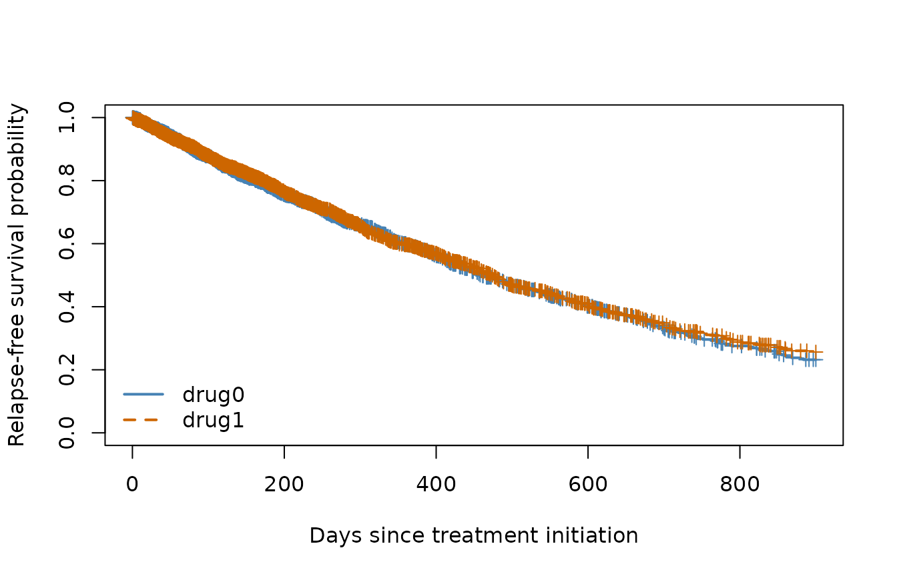
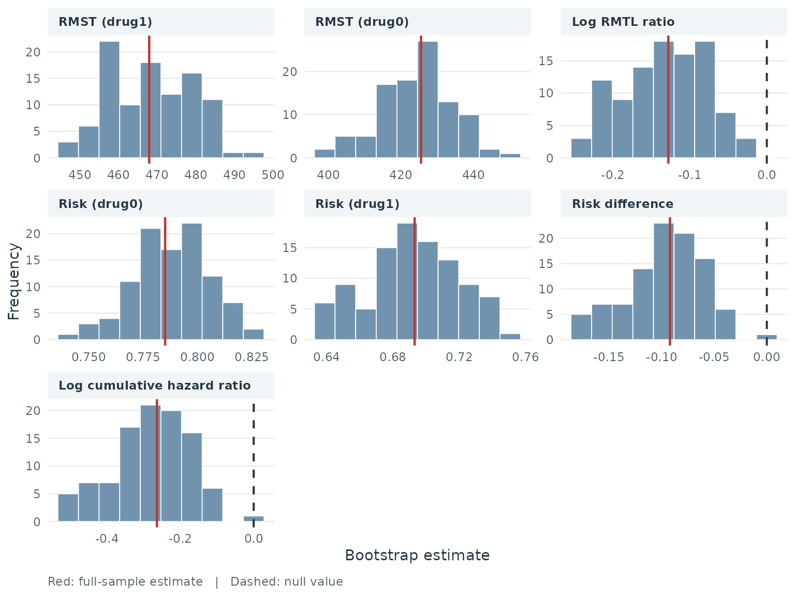

# Average treatment effects for survival outcomes

[](https://cran.r-project.org/package=precmed)
[](https://cran.r-project.org/package=precmed)

This vignette estimates population-average treatment effects over a
fixed horizon using synthetic survival data. The [survival CATE
example](https://smartdata-analysis-and-statistics.github.io/precmed/articles/Survival-CATE.md)
develops and validates conditional treatment-effect scores. Chapter 5
introduces marginal and conditional effects (Nguyen et al. 2026).

## Load required packages

``` r

library(precmed)
library(dplyr)
library(ggplot2)
library(survival)
```

## Example data

We generate 4,000 synthetic observations with
[`simulate_survival()`](https://smartdata-analysis-and-statistics.github.io/precmed/reference/simulate_survival.md)
and set a seed for reproducibility. The data contain baseline
characteristics, treatment, observed time and an event indicator.

``` r

survival_data <- simulate_survival(n = 4000, seed = 20261114)
```

Treatment is assigned according to the treatment model; its weights can
be changed to explore different treatment proportions and degrees of
overlap. For example,
`simulate_survival(n = 4000, seed = 1, ps_weights = c(intercept = -1), conditional_hr = 0.8)`
changes the propensity intercept and the conditional HR at age 48 with
no previous relapses. Named `ps_weights` and `lp_weights` override the
specified defaults; see
[`?simulate_survival`](https://smartdata-analysis-and-statistics.github.io/precmed/reference/simulate_survival.md)
for their definitions. The table below summarizes baseline
characteristics by treatment group.

[TABLE]

------------------------------------------------------------------------

The treatment and survival outcome variables have distinct roles:

- We will use `y` as the survival outcome, which is the number of days
  until the first relapse or censoring, whichever comes first.

- We will use `d` as the event indicator, where $`1`$ represents an
  event and $`0`$ represents censoring. The censoring rate is 61.8%.

- We will use `trt` as the treatment variable, which has 2 drugs (drug0
  and drug1).

For convenience, `age` is centered at 48 years and `previous_cost` is
centered at 14,362 USD and divided by 24,266 USD.

The Kaplan–Meier curves below show the observed relapse-free survival
experience in each treatment group. Marks on the curves indicate
censored observations. These are unadjusted group comparisons;
differences between the curves may reflect baseline differences as well
as treatment effects.

``` r

km_fit <- survfit(Surv(y, d) ~ trt, data = survival_data)
plot(km_fit, col = c("steelblue", "darkorange3"), lty = 1:2, lwd = 2,
     mark.time = TRUE, xlab = "Days since treatment initiation",
     ylab = "Relapse-free survival probability", ylim = c(0, 1))
legend("bottomleft", legend = c("drug0", "drug1"),
       col = c("steelblue", "darkorange3"), lty = 1:2, lwd = 2, bty = "n")
```



For the estimators and their assumptions, see [Methods for estimating
average treatment
effects](https://smartdata-analysis-and-statistics.github.io/precmed/articles/ATE-theory.md).

## Unadjusted treatment comparison

We first compare time to first relapse between treatment groups using a
Cox model with treatment as the only predictor. This unadjusted,
marginal association does not account for differences in patient
characteristics.

``` r

output_cox <- coxph(Surv(y, d) ~ trt, data = survival_data)
summary(output_cox)
#> Call:
#> coxph(formula = Surv(y, d) ~ trt, data = survival_data)
#> 
#>   n= 4000, number of events= 1530 
#> 
#>              coef exp(coef) se(coef)      z Pr(>|z|)
#> trtdrug1 -0.02602   0.97431  0.05118 -0.508    0.611
#> 
#>          exp(coef) exp(-coef) lower .95 upper .95
#> trtdrug1    0.9743      1.026    0.8813     1.077
#> 
#> Concordance= 0.502  (se = 0.007 )
#> Likelihood ratio test= 0.26  on 1 df,   p=0.6
#> Wald test            = 0.26  on 1 df,   p=0.6
#> Score (logrank) test = 0.26  on 1 df,   p=0.6
```

The estimated hazard ratio (HR) for drug 1 versus drug 0 is 0.97. It
compares instantaneous relapse hazards among patients still event-free
and does not by itself establish a causal treatment effect.

We can examine the proportional-hazards assumption using scaled
Schoenfeld residuals. A roughly horizontal curve is consistent with a
constant HR over time; the dashed curves show approximate 95%
uncertainty bands.

``` r

ph_unadjusted <- cox.zph(output_cox, transform = "identity")
print(ph_unadjusted)
#>        chisq df    p
#> trt    0.221  1 0.64
#> GLOBAL 0.221  1 0.64
plot(ph_unadjusted, var = "trt", hr = TRUE, resid = FALSE,
     xlab = "Days since treatment initiation",
     ylab = "Unadjusted hazard ratio: drug1 vs drug0")
abline(h = exp(coef(output_cox)[1]), lty = 3, col = "steelblue")
```


The dotted line is the constant HR from the Cox model. The smooth curve
suggests how the treatment association may vary over time; it is a
diagnostic rather than a precise estimate at every time point. The
proportional-hazards test for the treatment term gives p = 0.638. This
test assesses whether the treatment association changes over time; a
large p-value does not prove that the HR is constant. Later follow-up is
less informative when fewer patients remain at risk, as reflected in the
wider uncertainty bands.

## Covariate-adjusted treatment comparison

In this synthetic dataset, treatment assignment depends on baseline
characteristics rather than being randomized. To account for measured
baseline differences, we first consider a Cox model that adjusts for
age, sex, previous medical cost and previous relapses.

``` r

output_cox_adjusted <- coxph(
  Surv(y, d) ~ trt + age + female + previous_cost + previous_number_relapses,
  data = survival_data
)
summary(output_cox_adjusted)
#> Call:
#> coxph(formula = Surv(y, d) ~ trt + age + female + previous_cost + 
#>     previous_number_relapses, data = survival_data)
#> 
#>   n= 4000, number of events= 1530 
#> 
#>                               coef exp(coef)  se(coef)      z Pr(>|z|)    
#> trtdrug1                 -0.305526  0.736736  0.057627 -5.302 1.15e-07 ***
#> age                       0.033694  1.034268  0.003299 10.215  < 2e-16 ***
#> female                    0.172062  1.187751  0.057885  2.972  0.00295 ** 
#> previous_cost             0.163731  1.177898  0.060511  2.706  0.00681 ** 
#> previous_number_relapses  0.059766  1.061588  0.028293  2.112  0.03465 *  
#> ---
#> Signif. codes:  0 '***' 0.001 '**' 0.01 '*' 0.05 '.' 0.1 ' ' 1
#> 
#>                          exp(coef) exp(-coef) lower .95 upper .95
#> trtdrug1                    0.7367     1.3573    0.6581    0.8248
#> age                         1.0343     0.9669    1.0276    1.0410
#> female                      1.1878     0.8419    1.0604    1.3304
#> previous_cost               1.1779     0.8490    1.0462    1.3262
#> previous_number_relapses    1.0616     0.9420    1.0043    1.1221
#> 
#> Concordance= 0.575  (se = 0.008 )
#> Likelihood ratio test= 123.3  on 5 df,   p=<2e-16
#> Wald test            = 121.5  on 5 df,   p=<2e-16
#> Score (logrank) test = 121.7  on 5 df,   p=<2e-16
```

The adjusted HR is 0.74, compared with 0.97 in the unadjusted model. The
adjusted HR is conditional on the included covariates and does not
necessarily represent a causal average treatment effect. Adjustment
cannot remove confounding from unmeasured variables, and a causal
interpretation also requires appropriate model specification, treatment
overlap and assumptions about censoring.

For the adjusted model, the proportional-hazards test for the treatment
term gives p = 0.248. This test assesses whether the treatment HR
changes over time; it does not test whether the treatment effect is
zero. The global proportional-hazards test gives p = 0.602 and assesses
the model covariates jointly, so evidence of non-proportional hazards
may arise from covariates other than treatment. A large p-value does not
establish that the proportional-hazards assumption holds.

## Population-average treatment effects using `atefit()`

The unadjusted Cox model compares treatment groups without accounting
for differences in their characteristics. The adjusted Cox model
accounts for the selected covariates, but its HR is conditional on those
covariates and summarizes the treatment association using a single HR.
The diagnostics can be used to assess changes in this association over
time; estimates often become less informative later in follow-up.
Neither comparison directly describes the average time patients remain
relapse-free under each treatment.

We now use
[`atefit()`](https://smartdata-analysis-and-statistics.github.io/precmed/reference/atefit.md)
to estimate population-level outcomes over a specified follow-up
horizon. For restricted mean survival time (RMST) and restricted mean
time lost (RMTL), it combines outcome and treatment models with an
adjustment for censoring to estimate population-level outcomes under
each treatment. The treatment model estimates the propensity score,
while the censoring model estimates probabilities used to construct
inverse probability of censoring weights (IPCW). These measures
summarize time over the chosen period without requiring a constant
treatment HR. Under appropriate assumptions, the population-level
comparison can be interpreted as a causal treatment effect.
[`atefit()`](https://smartdata-analysis-and-statistics.github.io/precmed/reference/atefit.md)
also estimates a population-level cumulative hazard ratio at the
horizon. It uses bootstrap resampling to estimate uncertainty for all
reported measures.

RMST is the average event-free time up to a chosen horizon, `tau0`; RMTL
is `tau0 - RMST`. The RMTL ratio compares time lost under drug 1 with
time lost under drug 0 over that horizon; for relapse, a ratio below 1
favors drug 1. Its interpretation depends on the horizon. Chapter 20
discusses RMTL for ratio-based treatment effects (Jiang et al. 2026).

The cumulative hazard ratio compares the cumulative hazards,
$`-\log(S(tau0))`$, under the two treatments.
[`atefit()`](https://smartdata-analysis-and-statistics.github.io/precmed/reference/atefit.md)
estimates the treatment-specific survival probabilities using augmented
inverse probability of treatment weighting (AIPTW), combining outcome,
treatment and censoring models without discretizing event times. The
estimator requires appropriate censoring assumptions and a correctly
specified censoring model; its treatment-model double robustness does
not protect against censoring-model misspecification. The calculation
reuses the treatment-specific Cox outcome fits, propensity scores and
censoring model used for RMST. This ratio is distinct from an
instantaneous HR. If either estimated survival probability is outside
the interval (0, 1), the ratio is undefined; bootstrap inference is also
unavailable if any replicate is undefined.

For this example, we choose an illustrative horizon: the smaller 95th
percentile of observed follow-up in the two treatment groups.

``` r

tau0 <- with(survival_data,
             min(quantile(y[trt == "drug1"], 0.95), quantile(y[trt == "drug0"], 0.95)))
tau0
#> [1] 778.4532
```

The horizon is approximately 778.5 days. It defines the period over
which we compare restricted mean outcomes. This illustrative choice uses
observed times, including censoring, and does not guarantee sufficient
follow-up. Choose a clinically meaningful horizon with adequate support
and inspect numbers at risk and censoring near it in both groups. If
`tau0` is omitted,
[`atefit()`](https://smartdata-analysis-and-statistics.github.io/precmed/reference/atefit.md)
uses the largest observed event time and issues a warning. The horizon
is not derived from the proportional-hazards diagnostics and does not
establish that the HR is constant before it.

The RMTL estimator is doubly robust with respect to the treatment and
outcome models: under the required assumptions, either model may be
correctly specified. IPCW uses estimated probabilities of remaining
uncensored, and the estimator also requires a correctly specified
censoring model. Causal interpretation requires assumptions including
consistency, no unmeasured treatment confounding, adequate treatment
overlap and sufficient follow-up. If an out-of-range RMST estimate is
replaced by an outcome-model estimate, that fallback does not retain the
doubly robust guarantee. Chapter 17 discusses identification of
treatment effects in non-randomized data (Hoogland et al. 2026).

The mandatory arguments for
[`atefit()`](https://smartdata-analysis-and-statistics.github.io/precmed/reference/atefit.md)
are:

- The `response` argument specifies the type of outcome in the data. For
  survival outcomes, `response` = “survival”. This informs the function
  of the necessary arguments and methods to use.

- The argument `data` indicates the data frame in which the outcome,
  treatment and covariates specified in either `outcome_model` or
  `ps.model` should be fetched.

- The argument `outcome_model` specifies the outcome model as a formula,
  with the survival object from the `survival` package, `Surv(y, d)`,
  supplied on the left-hand side and the explanatory covariates supplied
  on the right-hand side. In the example below, we chose to specify the
  outcome model as a linear combination of the following covariates:
  age, sex, medical costs in the year prior to treatment initiation, and
  number of relapses in the year prior to treatment initiation.
  Non-linear or interaction terms could also be included. Note that the
  treatment variable is not supplied in `outcome_model` since this is an
  outcome model.

- The `ps.model` argument specifies the treatment model as a formula,
  with the treatment variable `trt` on the left-hand side and the
  covariates (age and previous treatment in this example) on the
  right-hand side. The variable `trt` must be supplied as a numeric
  variable taking only 2 values, “1” for active treatment and “0” for
  control or comparator. If it is not the case,
  [`atefit()`](https://smartdata-analysis-and-statistics.github.io/precmed/reference/atefit.md)
  will stop with error if `trt` takes more than 2 distinct values or
  will automatically transform `trt` into a numeric variable. In this
  example, `trt` (a factor variable taking values “drug0” and “drug1”)
  was transformed and an informational message is shown (see output
  below): `Variable trt was recoded to 0/1 with drug0->0 and drug1->1`.
  If the data are from a RCT, it suffices to specify `ps.model` = trt
  ~ 1. The treatment model is used in the doubly robust RMTL estimation.

We can estimate the ATE as follows, using an outcome model with age,
sex, previous cost and previous relapses, and a treatment model with
`age` and `previous_treatment`:

``` r

fit_ate <- atefit(
  response = "survival",
  data = survival_data,
  outcome_model = survival::Surv(y, d) ~ age + female +
    previous_cost + previous_number_relapses,
  ps.model = trt ~ age + previous_treatment,
  tau0 = tau0,
  n.boot = 100,
  seed = 999
)
#> Variable trt was recoded to 0/1 with drug0->0 and drug1->1.
```

By default, Cox regression is used for the outcome model and logistic
regression for the propensity model.

``` r

fit_ate
#> Average treatment effect:
#> 
#>                                estimate         SE   CI.lower    CI.upper
#> log.rmtl.ratio              -0.12798969 0.05115112 -0.2282440 -0.02773534
#> log.cumulative.hazard.ratio -0.26396371 0.10228852 -0.4644455 -0.06348190
#> risk.difference             -0.09210868 0.03585365 -0.1623805 -0.02183682
#>                                  pvalue
#> log.rmtl.ratio              0.012342853
#> log.cumulative.hazard.ratio 0.009863447
#> risk.difference             0.010198706
#> 
#> Estimated event risks at tau0:
#> 
#>        estimate         SE  CI.lower  CI.upper pvalue
#> risk1 0.6930348 0.02780136 0.6385451 0.7475244      0
#> risk0 0.7851434 0.01753849 0.7507686 0.8195182      0
#> 
#> Estimated RMST:
#> 
#>       estimate       SE CI.lower CI.upper pvalue
#> rmst1 467.9432 10.88991 446.5994 489.2870      0
#> rmst0 425.5458 10.17076 405.6115 445.4801      0
#> Variable trt was recoded to 0/1 with drug0->0 and drug1->1.
```

The output of
[`atefit()`](https://smartdata-analysis-and-statistics.github.io/precmed/reference/atefit.md)
shows the point estimate, standard error (“SE”), lower (“CI.lower”) and
upper (“CI.upper”) bound of the 95% confidence interval, and the p-value
(“pvalue”) for seven quantities:

- the restricted mean survival time under drug 1

- the restricted mean survival time under drug 0

- the log RMTL ratio, which is the log of the ratio of `tau0` - `$rmst1`
  divided by `tau0` - `$rmst0`

- the log population-level cumulative hazard ratio at `tau0`

- the population-average risks of relapse by `tau0` under drug 0 and
  drug 1 (`$risk0` and `$risk1`), and their difference, drug 1 minus
  drug 0.

For example, the log RMTL ratio of -0.13 and the 95% confidence interval
of (-0.23, -0.03) are displayed in the output. The estimated ratio and
its interval can be obtained by exponentiating these log-scale values. A
ratio above 1 indicates more time lost before `tau0` under drug 1; the
interval describes uncertainty in that comparison. The RMST estimates
provide the corresponding event-free times up to `tau0`.

### Treatment and overlap diagnostics

The RMTL and cumulative hazard ratios compare the treatment coded as 1
with the treatment coded as 0; their log ratios are reported in the
output. Here, `trt` is a factor, so
[`atefit()`](https://smartdata-analysis-and-statistics.github.io/precmed/reference/atefit.md)
recodes `drug0` to 0 and `drug1` to 1. The ratios therefore compare drug
1 with drug 0. The recoding is reported as an informational message and
can be inspected with
[`diagnostics()`](https://smartdata-analysis-and-statistics.github.io/precmed/reference/diagnostics.md):

``` r

diagnostics(fit_ate)
#>   method split iteration group subgroup type measure
#> 1   <NA>  <NA>        NA  <NA>     <NA> info    <NA>
#>                                                       message
#> 1 Variable trt was recoded to 0/1 with drug0->0 and drug1->1.
```

For other treatment labels, check the mapping before interpreting the
ratio. Alternatively, code the treatment as 0 and 1 explicitly to choose
the reference group.

A causal interpretation also requires assumptions including consistency,
conditional exchangeability and positivity; Chapter 5 discusses these
assumptions (Nguyen et al. 2026). Positivity requires that both
treatments are possible at each relevant combination of covariates in
the target population. The following diagnostics summarize estimated
propensity-score overlap and treatment-weight variability in the
analysis sample. They can help investigate potential practical
positivity problems, but cannot establish that positivity holds:

``` r

diagnostics(fit_ate, type = "propensity")
```

| Diagnostic                         | drug0            | drug1            |
|:-----------------------------------|:-----------------|:-----------------|
| Patients, n                        | 1873             | 2127             |
| Propensity score, median (min-max) | 0.42 (0.03-0.91) | 0.65 (0.09-0.91) |
| Outside other group’s range, n (%) | 38 (2.0%)        | 0 (0.0%)         |
| Truncated below / above, n         | 0 / 0            | 0 / 0            |
| Treatment weight, median (max)     | 1.71 (11.21)     | 1.55 (11.19)     |
| Effective sample size              | 1348             | 1654             |

Propensity score summaries use the estimated probabilities before
truncation. The count of patients outside the other treatment’s
propensity score range uses the observed range in the other treatment
group. Treatment weights use the truncated scores; the effective sample
size summarizes their variability. Percentages are within each treatment
group. Use `layout = "arms"` for unrounded numeric results. These
diagnostics do not establish covariate balance or exclude unmeasured
confounding.

For survival outcomes these are treatment weights only; they do not
summarize censoring weights or follow-up near the horizon.

### Inspecting bootstrap estimates

`plot(fit_ate)` displays the bootstrap estimates for the reported
quantities. By default, the first row shows treatment-specific RMST and
the log RMTL ratio, the second shows treatment-specific risks and their
difference, and the third shows the log cumulative hazard ratio. A solid
red line marks the full-sample estimate; a dashed black line marks the
null value of 0 in the log-ratio and risk-difference panels. Set
`null.value` to another value on the plotted scale, or to `NULL` or `NA`
to omit the null line. The treatment-specific RMST and risk panels have
no null line. Use `metrics` to select and order facets, for example
`metrics = c("risk0", "risk1", "risk_difference")`.

``` r

plot(fit_ate)
```



Histograms of bootstrap estimates for the reported quantities.

### Alternative outcome model

As an alternative, we can fit a Weibull outcome model separately in each
treatment arm. The Weibull models assume proportional hazards across
covariates within an arm, but different arm-specific shapes allow the
hazard ratio between treatments to change over time. The treatment
model, censoring model and horizon remain the same:

``` r

fit_ate_weibull <- atefit(
  response = "survival",
  data = survival_data,
  outcome_model = survival::Surv(y, d) ~ age + female +
    previous_cost + previous_number_relapses,
  outcome_method = "weibull",
  ps.model = trt ~ age + previous_treatment,
  tau0 = tau0,
  n.boot = 100,
  seed = 999
)
#> Variable trt was recoded to 0/1 with drug0->0 and drug1->1.
```

The table compares the estimated population-average RMTL ratio for drug
1 versus drug 0 at `tau0`, with 95% confidence intervals. Both fits use
100 bootstrap samples and estimate the same quantity; their estimates
can differ because of their outcome-model assumptions. The intervals use
the bootstrap standard errors.

|         | RMTL ratio | 95% CI lower | 95% CI upper |
|:--------|-----------:|-------------:|-------------:|
| Cox     |       0.88 |        0.796 |        0.973 |
| Weibull |       0.88 |        0.796 |        0.973 |

## Related vignettes

- [CATE scores and validation for survival
  outcomes](https://smartdata-analysis-and-statistics.github.io/precmed/articles/Survival-CATE.md)
- [Methods for estimating average treatment
  effects](https://smartdata-analysis-and-statistics.github.io/precmed/articles/ATE-theory.md)
- [Understanding doubly robust
  methods](https://smartdata-analysis-and-statistics.github.io/precmed/articles/doubly-robust.md)

## References

Hoogland, Jeroen, Thomas P. A. Debray, Guillaume Desachy, and Tri-Long
Nguyen. 2026. “Introduction to Methods for Personalizing Medicine.”
Chap. 17 in *Comparative Effectiveness and Personalized Medicine
Research Using Real-World Data*, edited by Thomas P. A. Debray, Tri-Long
Nguyen, and Robert W. Platt. Chapman & Hall/CRC.
<https://doi.org/10.1201/9781003300809-17>.

Jiang, Xiaotong, Gabrielle Simoneau, Fabio Pellegrini, Changyu Shen,
Carl de Moor, and Lu Tian. 2026. “Visualization and Interpretation of
Individualized Treatment Rule Results.” Chap. 20 in *Comparative
Effectiveness and Personalized Medicine Research Using Real-World Data*,
edited by Thomas P. A. Debray, Tri-Long Nguyen, and Robert W. Platt.
Chapman & Hall/CRC. <https://doi.org/10.1201/9781003300809-20>.

Nguyen, Tri-Long, Jessica L. Rohmann, Tat Thang Vo, Robert W. Platt, and
Thomas P. A. Debray. 2026. “Understanding and Defining Causal Effects.”
Chap. 5 in *Comparative Effectiveness and Personalized Medicine Research
Using Real-World Data*, edited by Thomas P. A. Debray, Tri-Long Nguyen,
and Robert W. Platt. Chapman & Hall/CRC.
<https://doi.org/10.1201/9781003300809-5>.
