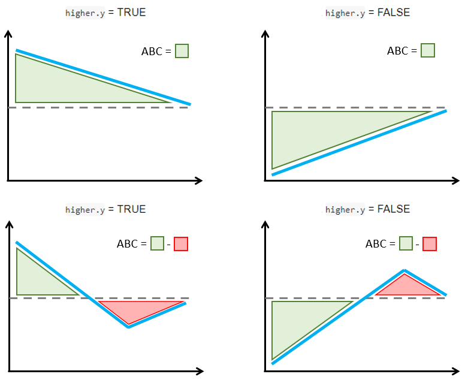

# Methods for developing and validating CATE scores

[](https://cran.r-project.org/package=precmed)
[](https://cran.r-project.org/package=precmed)

This vignette describes CATE score development and validation methods
for count and survival outcomes. A treatment model estimates the
propensity score, and a censoring model provides probabilities for
inverse probability of censoring weighting (IPCW). For average treatment
effect estimation across binary, count and survival outcomes, see
[Methods for estimating average treatment
effects](https://smartdata-analysis-and-statistics.github.io/precmed/articles/ATE-theory.md).

## Background and further reading

A CATE describes the average treatment effect among patients with the
same measured baseline characteristics; it does not identify an
individual patient’s unobservable treatment effect. Chapter 17 of Debray
et al. (2026) introduces the principles of treatment effect prediction,
model development in randomized and non-randomized data, and the
assumptions needed to identify CATEs (Hoogland et al. 2026).

Chapter 5 introduces marginal and conditional causal effects (Nguyen et
al. 2026).

The primary methodological reference for the two-regression and
contrast-regression estimators is Yadlowsky et al. (2021). For practical
guidance on interpreting and evaluating the resulting scores, the book
provides two complementary chapters:

- **Chapter 19: Validation of prediction models for patient outcomes and
  individualized treatment effect** discusses validation strategies,
  discrimination, calibration, and decision accuracy (Thao et al. 2026).
- **Chapter 20: Visualization and interpretation of individualized
  treatment rule results** discusses treatment rules, value functions,
  validation curves, and responder diagnostics, including examples using
  `precmed` (Jiang et al. 2026).

## Development of CATE scores for count outcomes

For count outcomes, the CATE score is expressed as a log-rate ratio
conditional on baseline covariates. It can be estimated with boosting,
Poisson regression, negative binomial regression, or the doubly robust
two-regression and contrast-regression estimators (Yadlowsky et al.
2021). The two-regression approach models the potential outcomes
separately by treatment group, whereas contrast regression directly
models the treatment contrast.

Assume that the following data are recorded for each of $`n`$
observations:

- $`R`$ is a binary treatment taking value 0 or 1.
- $`\boldsymbol{X}`$ is a vector of $`p`$ baseline covariates.
- $`Y`$ is a count outcome.
- $`T`$ is the exposure time during which $`Y`$ is recorded. It can vary
  across observations.

The objective is to estimate the ratio-based CATE score defined as

``` math
CATE(\boldsymbol{x})=\text{log}\left(\frac{\mathbb{E}[Y^{(1)}|\boldsymbol{X}=\boldsymbol{x},T=1]}{\mathbb{E}[Y^{(0)}|\boldsymbol{X}=\boldsymbol{x},T=1]}\right)
```
where $`Y^{(r)}`$ is the potential outcome if the patient received the
treatment $`r \in \{0,1\}`$. $`CATE(\boldsymbol{x})`$ is interpreted as
the individualized log-rate ratio of treatment 1 over treatment 0
conditional on the baseline covariates.

The package offers 5 methods to estimate the CATE score: Poisson
regression, negative binomial regression, boosting, two regressions, and
contrast regression.

### Poisson

1.  Estimate the conditional mean outcome given baseline covariates and
    log-transformed exposure time as the offset separately in each
    treatment group (i.e.,
    $`\text{log}(\mathbb{E}[Y^{(r)}|\boldsymbol{x},t])=\log(t)+\beta_r \boldsymbol{\tilde x}`$
    for $`r \in \{0,1\}`$ where $`\boldsymbol{\tilde x}`$ is the $`x`$
    with an intercept) with Poisson regression. Denote the prediction
    for one time unit as
    $`\hat Y^{(r)}(\boldsymbol{x},1)=\text{exp}(\hat \beta_r \boldsymbol{\tilde x})`$.

2.  The CATE score with Poisson is the plug-in estimator

``` math
\hat{CATE}_{Poisson}(\boldsymbol{x})=\text{log}\left(\frac{\hat Y^{(1)}(\boldsymbol{x},1)}{\hat Y^{(0)}(\boldsymbol{x},1)}\right)
```

### Negative binomial

Follow the same step as in Poisson but replace Poisson regression with
negative binomial regression in step 1.

### Boosting

Gradient boosting builds an additive prediction model using sequentially
fitted learners (Friedman 2001).

1.  Estimate the conditional mean outcome given baseline covariates and
    log-transformed exposure time as the offset separately in each
    treatment group (i.e., $`\mathbb{E}[Y^{(r)}|\boldsymbol{x},t]`$ for
    $`r \in \{0,1\}`$) with Poisson-based gradient boosting regression
    method. Denote the prediction for one time unit as
    $`\hat Y^{(r)}(\boldsymbol{x},1)`$.

    - The base learners are regression trees with depth specified with
      the argument `tree.depth` in
      [`catecvcount()`](https://smartdata-analysis-and-statistics.github.io/precmed/reference/catecvcount.md)
      and
      [`catefitcount()`](https://smartdata-analysis-and-statistics.github.io/precmed/reference/catefitcount.md).
      Default is 2.
    - The number of trees in boosting is selected via cross-validation
      with a maximum number of trees specificed with the argument
      `n.trees.boosting` in
      [`catecvcount()`](https://smartdata-analysis-and-statistics.github.io/precmed/reference/catecvcount.md)
      and
      [`catefitcount()`](https://smartdata-analysis-and-statistics.github.io/precmed/reference/catefitcount.md).
      Default is 200.

2.  The CATE score with boosting is the plug-in estimator

``` math
\hat{CATE}_{boosting}(\boldsymbol{x})=\text{log}\left(\frac{\hat Y^{(1)}(\boldsymbol{x},1)}{\hat Y^{(0)}(\boldsymbol{x},1)}\right)
```

### Two regressions

The procedure adapts the ratio-based estimator of Yadlowsky et al.
(2021) to count outcomes. Split the observations into
treatment-stratified folds $`D_k`$. For each fold, fit the initial
outcome and treatment models on $`D_{-k}`$ and predict the held-out
observations in $`D_k`$. Pool these out-of-fold predictions, denoting
each patient’s arm-specific predicted rate by $`m_{ri}`$ and propensity
for the observed arm by $`p_{ri}`$.

For each arm $`r`$, fit a weighted Poisson regression of the observed
rate $`Y_i/T_i`$ on $`\log(m_{ri})`$ and $`\tilde x_i`$, with weight
$`I(R_i=r)/p_{ri}`$. Predict the resulting mean $`q_{ri}`$ for every
observation, and fit a second unweighted Poisson regression of
$`q_{ri}`$ on $`\tilde x_i`$. Denote the resulting coefficients by
$`\hat\beta_r`$. The score is

``` math
\widehat{CATE}_{tworeg}(\boldsymbol{x})=(\hat\beta_1-\hat\beta_0)^T\tilde x.
```

Repeat the procedure $`B`$ times with new random fold assignments and
average the coefficient differences. These are repeated cross-fitting
splits, not bootstrap samples.

### Contrast regression

The contrast estimator uses the same held-out predictions and repeated
fold assignments (Yadlowsky et al. 2021). Write
$`\eta_i=\exp(\delta^T\tilde x_i)`$, $`\pi_i`$ for the out-of-fold
propensity for treatment 1, and $`m_{0i},m_{1i}`$ for the out-of-fold
rate predictions. The fitted score solves

``` math
\sum_i \tilde x_i\frac{R_i( Y_i/T_i-(\eta_i m_{0i}+m_{1i})/2)(1-\pi_i)-(1-R_i)\{\eta_iY_i/T_i-(\eta_i m_{0i}+m_{1i})/2\}\pi_i}{\eta_i\pi_i+1-\pi_i}=0.
```

The final score is $`\hat\delta^T\tilde x`$. The coefficients are
averaged across converged repetitions; if none converged, the
coefficients from all repetitions are averaged. The equation is solved
by Newton–Raphson, with numerical minimization as a fallback.

## Development of CATE scores for survival outcomes

For survival outcomes, the CATE score is expressed as a log-ratio of
restricted mean time lost conditional on baseline covariates. It can be
estimated with random forest, boosting, Poisson regression, or
adaptations of the doubly robust two-regression and contrast-regression
approaches (Yadlowsky et al. 2021). Chapter 20 of the book also
discusses restricted mean time lost as an outcome for ratio-based
treatment effects (Jiang et al. 2026). For restricted mean event time
regression using inverse probability of censoring weighting (IPCW), see
Tian et al. (2014); the procedures below adapt these ideas to the RMTL
treatment-effect setting.

Assume that the following data are recorded for each of $`n`$
observations:

- $`R`$ is a binary treatment taking value 0 or 1.
- $`\boldsymbol{X}`$ is a vector of $`p`$ baseline covariates.
- $`T`$ is a survival time.
- $`C`$ is a censoring time.
- $`Y`$ is the minimum between $`T`$ and $`C`$.
- $`\delta`$ is an indicator taking value 1 if $`Y = T`$ and 0
  otherwise.
- $`\tau`$ is a truncation time for restricted mean time lost.

The objective is to estimate the ratio-based CATE score defined as

``` math
CATE(\boldsymbol{x})=\text{log}\left(\frac{\mathbb{E}[\tau - (T^{(1)} \wedge\tau)|\boldsymbol{X}=\boldsymbol{x}]}{\mathbb{E}[\tau - (T^{(0)} \wedge\tau)|\boldsymbol{X}=\boldsymbol{x}]}\right)
```

where $`T^{(r)}`$ is the potential survival time if the patient received
the treatment $`r \in \{0,1\}`$. $`CATE(\boldsymbol{x})`$ is interpreted
as the individualized logarithm restricted mean time lost (RMTL) ratio
of treatment 1 over treatment 0 conditional on the baseline covariates.

The package offers 5 methods to estimate the CATE score: Poisson
regression, random forest, boosting, two regressions, and contrast
regression.

### Poisson

1.  Estimate the conditional mean RMTL given baseline covariates
    separately in each treatment group (i.e.,
    $`\text{log}(\mathbb{E}[\tau - T\wedge\tau|\boldsymbol{x}, r])=\beta_r \boldsymbol{\tilde x}`$
    for $`r \in \{0,1\}`$ where $`\boldsymbol{\tilde x}`$ is the $`x`$
    with an intercept) with Poisson regression weighted with IPCW.
    Denote the prediction as
    $`\hat Y^{(r)}(\boldsymbol{x})=\text{exp}(\hat \beta_r \boldsymbol{\tilde x})`$.

2.  The CATE score with Poisson is the plug-in estimator

``` math
\widehat{CATE}_{Poisson}(\boldsymbol{x})=\text{log}\left(\frac{\hat Y^{(1)}(\boldsymbol{x})}{\hat Y^{(0)}(\boldsymbol{x})}\right) = (\hat \beta_1 - \hat \beta_0) \boldsymbol{\tilde x}
```

### Boosting

Within each treatment arm, the implementation fits IPCW-weighted
Gaussian gradient boosting to the restricted survival time divided by
$`\tau`$, followed by a weighted binomial GAM calibration of the
predictions and covariates. It converts the resulting predicted
restricted mean survival time to RMTL and takes the log ratio. Gradient
boosting is described by Friedman (2001). `tree.depth` controls the
boosting trees; `n.trees.boosting` is the maximum number of trees
considered for cross-validation.

### Random forest

Random survival forests extend random forests to right-censored data
(Ishwaran et al. 2008). A forest is fitted separately in each treatment
arm. The predicted survival curve is integrated to $`\tau`$ to estimate
RMST; subtracting that integral from $`\tau`$ gives predicted RMTL
$`\hat L_r(\boldsymbol{x})`$. The score is

``` math
\widehat{CATE}_{randomForest}(\boldsymbol{x})=\log\left(\frac{\hat L_1(\boldsymbol{x})}{\hat L_0(\boldsymbol{x})}\right).
```

`n.trees.rf` specifies the number of trees (default 1,000); it is not
selected by cross-validation. Optional forest settings can be supplied
through `rf.control`, for example `list(mtry = 3, nodesize = 15)`.
`tree.depth` applies to boosting; use `rf.control$nodedepth` to set a
forest depth limit.

### Two regressions

This procedure adapts the ratio-based two-regression approach of
Yadlowsky et al. (2021) to survival outcomes, using IPCW for censoring
(Tian et al. 2014). Let $`U_i=\min(Y_i,\tau)`$ and
$`D_i^*=I(Y_i\geq\tau)+I(Y_i<\tau,\delta_i=1)`$. The censoring model is
fitted on the full data used for the fit. The weight is

``` math
w_i=\frac{D_i^*}{\max\{\hat G(U_i\mid X_i),\texttt{surv.min}\}},
```

normalized to have mean one, where $`\hat G`$ estimates censoring
survival using `ipcw.model`. The default model includes the
outcome-model covariates and treatment; a supplied `ipcw.model`
determines its covariates.

Split the data into treatment-stratified folds. Fit arm-specific initial
survival outcome models and a treatment model on each fold’s complement
and predict its held-out observations. The initial model may use random
survival forests, weighted Gaussian boosting followed by GAM
calibration, or weighted logistic regression. Pool the out-of-fold
predictions, cap predicted restricted survival time at $`0.99\tau`$, and
convert it to predicted RMTL $`m_{ri}`$.

For each arm $`r`$, fit a Poisson regression of $`\tau-U_i`$ on
$`\log(m_{ri})`$ and $`\tilde x_i`$, weighted by
$`w_i I(R_i=r)/p_{ri}`$, where $`p_{ri}`$ is the out-of-fold propensity
for that arm. Predict the fitted means for all observations and regress
them on $`\tilde x_i`$ with an unweighted Poisson regression. Denoting
the resulting coefficients by $`\hat\beta_r`$, the score is
$`(\hat\beta_1-\hat\beta_0)^T\tilde x`$.

The process is repeated for $`B`$ random fold assignments and the
coefficient differences are averaged. These are repeated cross-fitting
splits, not bootstrap samples.

### Contrast regression

Use the same IPCW and out-of-fold predictions as above. The
contrast-regression approach adapts Yadlowsky et al. (2021) to censored
survival outcomes. Let $`z_i=(\tau-U_i)/\tau`$, let $`m_{ri}`$ denote
the predicted RMTL divided by $`\tau`$, and write
$`\eta_i=\exp(\delta^T\tilde x_i)`$. With $`\pi_i`$ the out-of-fold
propensity for treatment 1, the implementation solves

``` math
\sum_i w_i\tilde x_i\frac{R_i\{z_i-(\eta_i m_{0i}+m_{1i})/2\}(1-\pi_i)-(1-R_i)\{\eta_i z_i-(\eta_i m_{0i}+m_{1i})/2\}\pi_i}{\eta_i\pi_i+1-\pi_i}=0.
```

The final score is $`\hat\delta^T\tilde x`$. The coefficients are
averaged across converged repetitions; if none converged, the
coefficients from all repetitions are averaged. Newton–Raphson is used
with numerical minimization as a fallback.

## Validation of CATE scores

The following validation curves and ABC statistics apply to count and
survival CATE scores supported by
[`catecv()`](https://smartdata-analysis-and-statistics.github.io/precmed/reference/catecv.md).
They assess ranking of treatment benefit and are distinct from the
bootstrap inference described in the [ATE methods
vignette](https://smartdata-analysis-and-statistics.github.io/precmed/articles/ATE-theory.md).

### Count outcomes

The ABC statistic summarizes the area between the validation curve and
the overall ATE reference line (Zhao et al. 2013; Yadlowsky et al.
2021). Chapter 20 provides worked examples of these curves and their
interpretation as responder diagnostics (Jiang et al. 2026). Validation
curves and ABC assess how well a score ranks patients by treatment
benefit. They do not, by themselves, establish calibration of the
predicted CATEs or the clinical value of a treatment rule; Chapter 19
discusses these complementary aspects of validation (Thao et al. 2026).

For a single CV iteration, it is implemented in the training and
validation sets separately as following:

**Step 1**. Calculate the ATE in the training or validation sets.

**Step 2**. Calculate the ATE in 100 nested subgroups based on the
estimated CATE score and derive the corresponding validation curve.
Subgroups are defined with 100 equally-spaced proportions from
`min(prop.cutoff)` to `max(prop.cutoff)` to ensure that enough data
points are available to build the validation curve.

**Step 3**. The ABC is calculated with
[`auc()`](https://smartdata-analysis-and-statistics.github.io/precmed/reference/auc.md)
from `utility.R` using the natural cubic spline interpolation, which
calculates the area between the horizontal line with y-intercept at the
ATE calculated in **step 1** over the range
\[`min(prop.cutoff)`,`max(prop.cutoff)`\] (*y*) and the validation curve
calculated in **step 2** (*x*).

The function [`plot()`](https://rdrr.io/r/graphics/plot.default.html)
allows the user to combine validation curves from 2 or more CV
iterations (i.e., `cv.n > 1`). There are 2 ways to combine the
validation curves:

1.  The option `combine`=“median” takes the median of the ATEs across
    all CV iterations in **step 1** and the median of the ATEs in the
    100 nested subgroups in **step 2**.

2.  The option `combine`=“mean” takes the mean of the ATEs across all CV
    iterations in **step 1** and the mean of the ATEs in the 100 nested
    subgroups in **step 2**.

In either case, the ABC calculations are carried out as in **step 3**
with the resulting *x* and *y*.

The figure below explains how the ABC is calculated with a simple
schema. The ABC calculations are such that larger positive ABC values
always indicate more treatment effect heterogeneity. This is implemented
by considering separately the cases when larger or smaller outcomes are
preferred.

- If larger count outcomes are preferred (`higher.y = TRUE`, e.g.,
  positive events like number of motor developmental milestones
  reached), a validation curve above the ATE line and decreasing towards
  that line is synonym with treatment effect heterogeneity (top left
  figure). However, sections of the validation curve below the ATE line
  indicate inability to capture treatment effect heterogeneity (bottom
  left figure). Hence, the ABC is defined by subtracting the areas below
  the ATE line (red) from the areas above the ATE line (green) such that
  larger positive ABC are preferred.

- If smaller count outcomes are preferred (`higher.y = FALSE`, e.g.,
  negative events like number of relapses), a validation curve below the
  ATE line and increasing towards that line is synonym with treatment
  effect heterogeneity (top right figure). However, sections of the
  validation curve above the ATE line indicate inability to capture
  treatment effect heterogeneity (bottom right figure). Hence, the ABC
  is defined by subtracting the areas above the ATE line (red) from the
  areas below the ATE line (green) such that larger positive ABC are
  preferred.



ABC calculation examples in relation with `higher.y` argument in
[`catecv()`](https://smartdata-analysis-and-statistics.github.io/precmed/reference/catecv.md)
and
[`catefit()`](https://smartdata-analysis-and-statistics.github.io/precmed/reference/catefit.md).
Validation curves are represented with a blue line and the dashed line
is the ATE

### Survival outcomes

The ABC statistic summarizes the area between the validation curve and
the overall ATE reference line (Zhao et al. 2013; Yadlowsky et al.
2021). Chapter 20 provides worked examples of these curves and their
interpretation as responder diagnostics (Jiang et al. 2026). For a
single CV iteration and a certain CATE score method, it is implemented
as following in the training and validation sets separately:

**Step 1**. Calculate the ATE in the training or validation sets.

**Step 2**. Calculate the ATE in 100 nested subgroups and derive the
corresponding validation curve. Subgroups are defined with 100
equally-spaced proportions from `min(prop.cutoff)` to `max(prop.cutoff)`
to ensure that enough data points are available to build the validation
curve.

**Step 3**. The ABC is calculated with
[`auc()`](https://smartdata-analysis-and-statistics.github.io/precmed/reference/auc.md)
from `utility.R` using the natural cubic spline interpolation, which
calculates the area between the horizontal line with y-intercept at the
ATE calculated in **step 1** (*y*) and the validation curve calculated
in **step 2** (*x*) over the range \[`min(prop.cutoff)`,
`max(prop.cutoff)`\].

The function [`plot()`](https://rdrr.io/r/graphics/plot.default.html)
allows the user combining validation curves from 2 or more CV iterations
(i.e., `cv.n > 1`). There are 2 ways to combine the validation curves:

1.  The option `combine ="median"` takes the median of the ATEs across
    all CV iterations in **step 1** and the median of the ATEs in the
    100 nested subgroups in **step 2**.

2.  The option `combine ="mean"` takes the mean of the ATEs across all
    CV iterations in **step 1** and the mean of the ATEs in the 100
    nested subgroups in **step 2**.

In either case, the ABC calculations are carried out as in **step 3**
with the resulting *x* and *y*.

The figure below explains how the ABC is calculated with a simple
schema. The ABC calculations are such that larger positive ABC values
always indicate more treatment effect heterogeneity. This is implemented
by considering separately the cases when larger or smaller outcomes are
preferred.

- If smaller survival outcomes are preferred (`higher.y = FALSE`, e.g.,
  time to a positive event like recovery), a validation curve above the
  ATE line which decreases towards it is synonym with treatment effect
  heterogeneity (top left figure). However, sections of the validation
  curve below the ATE line indicate inability to capture treatment
  effect heterogeneity (bottom left figure). Hence, the ABC is defined
  by subtracting the areas below the ATE line from the areas above the
  ATE line such that larger positive ABC are preferred.

- If larger survival outcomes are preferred (`higher.y = TRUE`, e.g.,
  time to a negative event like symptom onset), a validation curve (in
  blue) below the ATE line (dashed) which increases towards it is
  synonym with treatment effect heterogeneity (top right figure).
  However, sections of the validation curve above the ATE line indicate
  inability to capture treatment effect heterogeneity (bottom right
  figure). Hence, the ABC is defined by subtracting the areas above the
  ATE line (in red) from the areas below the ATE line (in green) such
  that larger positive ABC are preferred.


ABC calculation examples in relation with `higher.y` argument in
[`catecv()`](https://smartdata-analysis-and-statistics.github.io/precmed/reference/catecv.md)
and
[`catefit()`](https://smartdata-analysis-and-statistics.github.io/precmed/reference/catefit.md).
Validation curves are represented with a blue line and the dashed line
is the ATE.

## Other `precmed` vignettes in this series

- [Estimating and validating treatment effects for binary
  outcomes](https://smartdata-analysis-and-statistics.github.io/precmed/articles/Binary-examples.md)
- [Estimating and validating treatment effects for count
  outcomes](https://smartdata-analysis-and-statistics.github.io/precmed/articles/Count-examples.md)
- [Estimating and validating treatment effects for survival
  outcomes](https://smartdata-analysis-and-statistics.github.io/precmed/articles/Survival-examples.md)
- [Customizing CATE models and
  validation](https://smartdata-analysis-and-statistics.github.io/precmed/articles/Additional-examples.md)
- [Methods for estimating average treatment
  effects](https://smartdata-analysis-and-statistics.github.io/precmed/articles/ATE-theory.md)

## References

Debray, Thomas P. A., Tri-Long Nguyen, and Robert W. Platt, eds. 2026.
*Comparative Effectiveness and Personalized Medicine Research Using
Real-World Data*. 1st ed. Chapman & Hall/CRC.
<https://doi.org/10.1201/9781003300809>.

Friedman, Jerome H. 2001. “Greedy Function Approximation: A Gradient
Boosting Machine.” *The Annals of Statistics* 29 (5): 1189–232.
<https://doi.org/10.1214/aos/1013203451>.

Hoogland, Jeroen, Thomas P. A. Debray, Guillaume Desachy, and Tri-Long
Nguyen. 2026. “Introduction to Methods for Personalizing Medicine.”
Chap. 17 in *Comparative Effectiveness and Personalized Medicine
Research Using Real-World Data*, edited by Thomas P. A. Debray, Tri-Long
Nguyen, and Robert W. Platt. Chapman & Hall/CRC.
<https://doi.org/10.1201/9781003300809-17>.

Ishwaran, Hemant, Udaya B. Kogalur, Eugene H. Blackstone, and Michael S.
Lauer. 2008. “Random Survival Forests.” *The Annals of Applied
Statistics* 2 (3): 841–60. <https://doi.org/10.1214/08-AOAS169>.

Jiang, Xiaotong, Gabrielle Simoneau, Fabio Pellegrini, Changyu Shen,
Carl de Moor, and Lu Tian. 2026. “Visualization and Interpretation of
Individualized Treatment Rule Results.” Chap. 20 in *Comparative
Effectiveness and Personalized Medicine Research Using Real-World Data*,
edited by Thomas P. A. Debray, Tri-Long Nguyen, and Robert W. Platt.
Chapman & Hall/CRC. <https://doi.org/10.1201/9781003300809-20>.

Nguyen, Tri-Long, Jessica L. Rohmann, Tat Thang Vo, Robert W. Platt, and
Thomas P. A. Debray. 2026. “Understanding and Defining Causal Effects.”
Chap. 5 in *Comparative Effectiveness and Personalized Medicine Research
Using Real-World Data*, edited by Thomas P. A. Debray, Tri-Long Nguyen,
and Robert W. Platt. Chapman & Hall/CRC.
<https://doi.org/10.1201/9781003300809-5>.

Thao, Le Thi Phuong, Orestis Efthimiou, Tibor V. Varga, Jeroen Hoogland,
and Thomas P. A. Debray. 2026. “Validation of Prediction Models for
Patient Outcomes and Individualized Treatment Effect.” Chap. 19 in
*Comparative Effectiveness and Personalized Medicine Research Using
Real-World Data*, edited by Thomas P. A. Debray, Tri-Long Nguyen, and
Robert W. Platt. Chapman & Hall/CRC.
<https://doi.org/10.1201/9781003300809-19>.

Tian, Lu, Lihui Zhao, and Lee-Jen Wei. 2014. “Predicting the Restricted
Mean Event Time with the Subject’s Baseline Covariates in Survival
Analysis.” *Biostatistics* 15 (2): 222–33.
<https://doi.org/10.1093/biostatistics/kxt050>.

Yadlowsky, Steve, Fabio Pellegrini, Federica Lionetto, Stefan Braune,
and Lu Tian. 2021. “Estimation and Validation of Ratio-Based Conditional
Average Treatment Effects Using Observational Data.” *Journal of the
American Statistical Association* 116 (533): 335–52.
<https://doi.org/10.1080/01621459.2020.1772080>.

Zhao, Lihui, Lu Tian, Tianxi Cai, Brian Claggett, and Lee-Jen Wei. 2013.
“Effectively Selecting a Target Population for a Future Comparative
Study.” *Journal of the American Statistical Association* 108 (502):
527–39. <https://doi.org/10.1080/01621459.2013.770705>.
