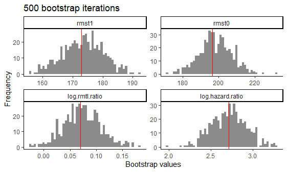

<!-- badges: start -->
[](https://cran.r-project.org/package=precmed)
[](https://cran.r-project.org/package=precmed)
<!-- badges: end -->
```{r setup, include=FALSE}
knitr::opts_chunk$set(echo = TRUE)
knitr::opts_chunk$set(comment = "#>", collapse = TRUE)
options(rmarkdown.html_vignette.check_title = FALSE) #title of doc does not match vignette title
doc.cache <- TRUE
# Recompute cached results after R or dependency updates.
vignette.packages <- c("precmed", tools::package_dependencies(
  "precmed", db = utils::installed.packages(),
  which = c("Depends", "Imports"), recursive = TRUE
)[["precmed"]])
knitr::opts_chunk$set(cache.extra = list(
  R = R.version.string,
  packages = vapply(setdiff(vignette.packages, "R"), function(pkg) {
    as.character(utils::packageVersion(pkg))
  }, character(1))
))
```


This vignette demonstrates how to use `precmed` to estimate average and conditional average treatment effects (ATEs and CATEs) for survival outcomes. Using simulated multiple sclerosis data, we model restricted mean time lost, compare CATE scoring methods through internal validation, and interpret treatment effects in responder subgroups.

```{r, include=FALSE}
###################################################################
#
# Project: Comprehensive R package for precision medicine
#
#
# Objective: Demonstrate the main features of the survival outcome functions
#
#
# Contributors: Phoebe Jiang, Gabrielle Simoneau
###################################################################
knitr::opts_chunk$set(echo = TRUE)
```

## Load required packages
```{r, echo = T, message=F}
library(precmed)
library(dplyr)
library(ggplot2)
```

## Example data

For these survival examples, we use the simulated dataset `survivalExample`, based on real-world claims data in multiple sclerosis. It contains 4,000 observations and 9 variables: six baseline characteristics, one treatment variable, and two survival outcome variables. The table below summarizes the baseline characteristics by treatment group.

```{r data, echo = F, eval = T, include = F, results = 'hide'}
data(survivalExample)
survivalExample$age <- as.numeric(survivalExample$age + attr(survivalExample$age, "scaled:center"))
survivalExample$previous_cost <- as.numeric(survivalExample$previous_cost* attr(survivalExample$previous_cost, "scaled:scale") + attr(survivalExample$previous_cost, "scaled:center"))
survivalExample$female <- factor(survivalExample$female, levels = c(0, 1), labels = c("male", "female"))

library(tableone)

## Vector of variables to summarize
myVars <- c("age", "female", "previous_treatment", "previous_cost", "previous_number_symptoms", "previous_number_relapses")
## Vector of categorical variables that need transformation
catVars <- c("female", "previous_treatment", "previous_number_symptoms", "previous_number_relapses")
t.table1 <- print(CreateTableOne(vars = myVars, factorVars = catVars, strata = "trt", data = survivalExample, addOverall = T, test = F), showAllLevels = TRUE, contDigits = 1)
row.names(t.table1) <- c("Number of patients", "Age (mean (SD))", "Gender (%)", "", "Previous treatment (%)", "", "", "Previous medical cost ($) (mean (SD))", "Previous number of symptoms (%)", "", "", "Previous number of relapses (%)", rep("", 5))


```

```{r, echo = F, eval = T, include = T}
# Show group sizes beneath the group names in the table header.
colnames(t.table1)[-1] <- paste0(
  colnames(t.table1)[-1], "<br>(n = ", trimws(t.table1[1, -1]), ")"
)
display.table <- t.table1[-1, , drop = FALSE]
# Escape cell values (e.g., >=2) while retaining the HTML header breaks.
display.table[] <- htmltools::htmlEscape(display.table)
knitr::kable(display.table, format = "html", escape = FALSE)
```

--- 

The treatment and survival outcome variables have distinct roles:

* We will use `y` as the survival outcome, which is the number of days until the first relapse or censoring, whichever comes first.

* We will use `d` as the event indicator, where $1$ represents an event and $0$ represents censoring. The censoring rate is about 84%.

* We will use `trt` as the treatment variable, which has 2 drugs (drug0 and drug1).


To avoid multicollinearity issues, the continuous variable `age` was centered at 48 years old and the medical costs in the year prior to treatment initiation `previous_cost` was centered at 14,362 USD and scaled with standard deviation 24,266 USD.

The first six records of the final dataset `survivalExample` are shown below:

```{r, echo = F, eval = T}
data(survivalExample) #get clean dataset
knitr::kable(head(survivalExample), row.names = FALSE)
```


## Estimate the average treatment effect 

### Unadjusted treatment comparison

We first compare time to first relapse between treatment groups using a Cox model with treatment as the only predictor. This unadjusted, marginal association does not account for differences in patient characteristics.

```{r, eval = T, echo = T}
library(survival)
output_cox <- coxph(Surv(y, d) ~ trt, data = survivalExample)
summary(output_cox)
```

The estimated hazard ratio (HR) for drug 1 versus drug 0 is `r round(exp(output_cox$coefficients), 2)`. It compares instantaneous relapse hazards among patients still event-free and does not by itself establish a causal treatment effect.

We can examine the proportional-hazards assumption using scaled Schoenfeld residuals. A roughly horizontal curve is consistent with a constant HR over time; the dashed curves show approximate 95% uncertainty bands.

```{r ph_unadjusted, fig.width = 7, fig.height = 4.5}
ph_unadjusted <- cox.zph(output_cox, transform = "identity")
print(ph_unadjusted)
plot(ph_unadjusted, var = "trt", hr = TRUE, resid = FALSE,
     xlab = "Days since treatment initiation",
     ylab = "Unadjusted hazard ratio: drug1 vs drug0")
abline(h = exp(coef(output_cox)[1]), lty = 3, col = "steelblue")
```

The dotted line is the constant HR from the Cox model. The smooth curve suggests how the treatment association may vary over time; it is a diagnostic rather than a precise estimate at every time point. The treatment test gives p `r if (ph_unadjusted$table["trt", "p"] < 0.001) "< 0.001" else paste0("= ", sprintf("%.3f", ph_unadjusted$table["trt", "p"]))`, suggesting that the treatment HR varies over time. Later follow-up is less informative when fewer patients remain at risk, as reflected in the wider uncertainty bands.

### Covariate-adjusted treatment comparison

Next, we adjust for age, sex, previous medical cost and previous relapses using a Cox model:

```{r adjusted_cox, eval = T, echo = T}
output_cox_adjusted <- coxph(
  Surv(y, d) ~ trt + age + female + previous_cost + previous_number_relapses,
  data = survivalExample
)
summary(output_cox_adjusted)
```

The adjusted HR is `r round(exp(coef(output_cox_adjusted)["trtdrug1"]), 2)`, compared with `r round(exp(coef(output_cox)[1]), 2)` in the unadjusted model. Age differs substantially between groups and has limited overlap, so the adjusted comparison relies heavily on the model. An adjusted HR is conditional on the included covariates and is not automatically a causal average treatment effect.

```{r ph_adjusted, fig.width = 7, fig.height = 4.5}
ph_adjusted <- cox.zph(output_cox_adjusted, transform = "identity")
print(ph_adjusted)
plot(ph_adjusted, var = "trt", hr = TRUE, resid = FALSE,
     xlab = "Days since treatment initiation",
     ylab = "Adjusted hazard ratio: drug1 vs drug0")
abline(h = exp(coef(output_cox_adjusted)["trtdrug1"]), lty = 3, col = "steelblue")
```

The adjusted treatment test gives p `r if (ph_adjusted$table["trt", "p"] < 0.001) "< 0.001" else paste0("= ", sprintf("%.3f", ph_adjusted$table["trt", "p"]))` and the global test gives p `r if (ph_adjusted$table["GLOBAL", "p"] < 0.001) "< 0.001" else paste0("= ", sprintf("%.3f", ph_adjusted$table["GLOBAL", "p"]))`. A large treatment p-value does not prove proportional hazards, and the global test also assesses the other covariates. The two plots describe the unadjusted and covariate-adjusted models, respectively.

### Population-level treatment comparison over a fixed horizon

The unadjusted Cox model compares treatment groups without accounting for differences in their characteristics. The adjusted Cox model accounts for the selected covariates, but its HR is conditional on those covariates and summarizes the treatment association using a single HR. The diagnostics suggest that this association may vary over time, and estimates become less informative later in follow-up. Neither comparison directly describes the average time patients remain relapse-free under each treatment.

We now use `atefit()` to estimate population-level outcomes over a specified follow-up horizon. For restricted mean survival time (RMST) and restricted mean time lost (RMTL), it combines outcome and propensity score models with an adjustment for censoring to estimate population-level outcomes under each treatment. These measures summarize time over the chosen period without requiring a constant treatment HR. Under appropriate assumptions, the population-level comparison can be interpreted as a causal treatment effect. `atefit()` also estimates a population-level cumulative hazard ratio at the horizon and reports a separate covariate-adjusted Cox HR. It uses bootstrap resampling to estimate uncertainty for all reported measures.

RMST is the average event-free time up to a chosen horizon, `tau0`; RMTL is `tau0 - RMST`. The RMTL ratio compares time lost under drug 1 with time lost under drug 0 over that horizon; for relapse, a ratio below 1 favors drug 1. Its interpretation depends on the horizon. Chapter 20 discusses RMTL for ratio-based treatment effects [@jiang2026visualization].

The cumulative hazard ratio compares the cumulative hazards, $-\log(S(tau0))$, under the two treatments. `atefit()` estimates the treatment-specific survival probabilities using outcome, propensity score and censoring models. The calculation reuses the treatment-specific Cox outcome fits, propensity scores and censoring model used for RMST. This ratio is distinct from an instantaneous HR. If either estimated survival probability is outside the interval (0, 1), the ratio is undefined; bootstrap inference is also unavailable if any replicate is undefined. The separate covariate-adjusted Cox HR censors follow-up at `tau0` and does not use the propensity-score or censoring models.

For this example, we choose an illustrative horizon of roughly 500 days: the smaller 95th percentile of observed follow-up in the two treatment groups.

```{r define_tau0, eval = T, echo = T}
tau0 <- with(survivalExample,
             min(quantile(y[trt == "drug1"], 0.95), quantile(y[trt == "drug0"], 0.95)))
tau0
```

The horizon is approximately `r round(tau0, 1)` days. It defines the period over which we will compare restricted mean outcomes. This choice is not derived from the proportional-hazards diagnostics and does not establish that the HR is constant before the horizon. It uses observed times, including censoring, and does not guarantee sufficient follow-up; inspect numbers at risk and censoring near the horizon in both groups and choose a clinically meaningful horizon with adequate support.

The RMTL estimator is doubly robust with respect to the propensity score (PS) and outcome models: under the required assumptions, either model may be correctly specified. It also depends on inverse probability of censoring weights (IPCW) and a correctly specified censoring model. The function provides standard errors, confidence intervals and p-values based on bootstrap. If an out-of-range RMST estimate is replaced by an outcome-model estimate, that fallback does not retain the doubly robust guarantee.

IPCW adjusts for censoring by weighting patients according to their estimated probability of remaining uncensored. Causal interpretation requires assumptions including no unmeasured treatment confounding, adequate treatment overlap, appropriate censoring assumptions and sufficient follow-up. Chapter 17 discusses identification of treatment effects in non-randomized data [@hoogland2026introduction]. The Cox hazard ratio and the RMTL ratio describe different aspects of survival and should be interpreted separately.

The mandatory arguments for `atefit()` are:

* The `response` argument specifies the type of outcome in the data. For survival outcomes, `response` = "survival". This informs the function of the necessary arguments and methods to use.

* The argument `data` indicates the data frame in which the outcome, treatment and covariates specified in either `cate.model` or `ps.model` should be fetched. 

* The argument `cate.model` specifies the CATE model as a formula, with the survival object from the `survival` package, `Surv(y, d)`, supplied on the left-hand side and the explanatory covariates supplied on the right-hand side. In the example below, we chose to specify to CATE as a linear combination of the following covariates: age, sex, medical costs in the year prior to treatment initiation, and number of relapses in the year prior to treatment initiation. Non-linear or interaction terms could also be included. Note that the treatment variable is not supplied in `cate.model` since this is an outcome model.

* The `ps.model` argument specifies the PS model as a formula, with the treatment variable `trt` on the left-hand side and the
    covariates (age and previous treatment in this example) on the right-hand side. The variable `trt` must be supplied as a numeric variable taking only 2 values, "1" for active treatment and "0" for control or comparator. If it is not the case, `atefit()` will stop with error if `trt` takes more than 2 distinct values or will automatically transform `trt` into a numeric variable. In this example, `trt` (a factor variable taking values "drug0" and "drug1") was transformed and a warning message was left to the user (see output below): `Variable trt was recoded to 0/1 with drug0->0 and drug1->1`. If the data are from a RCT, it suffices to specify `ps.model` = trt \~ 1. The PS model is used in the doubly robust RMTL estimation.

We also specify the optional argument `tau0`, the horizon for RMST and RMTL, using the value calculated above.

Now estimate the ATE using an outcome model with age, sex, previous cost and previous relapses, and a PS model with `age` and `previous_treatment`.

```{r run_atefit, eval = T, echo = T, cache = doc.cache}
output_atefit <- atefit(response = "survival",
                        data = survivalExample,
                        cate.model = survival::Surv(y, d) ~ age + female + previous_cost + previous_number_relapses,
                        ps.model = trt ~ age + previous_treatment,
                        tau0 = tau0)
```

When `verbose` = 1, the function outputs a progress bar in the console.

```{r print_atefit, eval = T, echo = T}
output_atefit
```

The output of `atefit()` shows the point estimate, standard error ("SE"), lower ("CI.lower") and upper ("CI.upper") bound of the 95% confidence interval, and the p-value ("pvalue") for 5 estimands:

* the restricted mean survival time under drug 1 (`$rmst1`)

* the restricted mean survival time under drug 0 (`$rmst0`)

* the log RMTL ratio (`$log.rmtl.ratio`), which is the log of the ratio of `tau0` - `$rmst1` divided by `tau0` - `$rmst0`

* the log HR (`$log.hazard.ratio`)

* the log population-level cumulative hazard ratio at `tau0` (`$log.cumulative.hazard.ratio`).

The log HR comes from a Cox model adjusted for the variables in `cate.model`, with follow-up censored at `tau0`. Exponentiating it gives the adjusted HR: `r round(exp(output_atefit$log.hazard.ratio$estimate), 2)`. Because follow-up is censored at `tau0`, this may differ from the adjusted Cox HR above, which uses all available follow-up. In these simulated data, age differs substantially between treatment groups, and the groups have limited overlap in age; consequently, the adjusted comparison relies heavily on the model. The Cox HR is not the doubly robust RMTL estimate and should be interpreted separately.

For example, the log RMTL ratio of `r round(output_atefit$log.rmtl.ratio$estimate, 2)` and the 95% confidence interval of (`r round(output_atefit$log.rmtl.ratio$CI.lower, 2)`, `r round(output_atefit$log.rmtl.ratio$CI.upper, 2)`) are displayed in the output. The estimated ratio and its interval can be obtained by exponentiating these log-scale values. A ratio above 1 indicates more time lost before `tau0` under drug 1; the interval describes uncertainty in that comparison. The RMST estimates provide the corresponding event-free times up to `tau0`. 

The output of `atefit()` is expressed in terms of treatment 0 vs 1, where the RMTL and hazard ratios are expressed as the ratio of the treatment coded as 1 over the treatment coded as 0. If the treatment variable is not coded as 0/1 in the data set, the function returns a warning `output_atefit$warning` which indicates what key was used to recode the treatment variable into a 0/1 variable.

```{r warning_atefit, eval = T, echo = T}
output_atefit$warning
```

Using `plot(output_atefit)`, a histograms is generated of the point estimates across the `n.boot` bootstrap iterations for 5 estimands (`rmst1`, `rmst0`, `log.rmtl.ratio`, `log.hazard.ratio`, `log.cumulative.hazard.ratio`). A red vertical line marks the estimate from the original sample.


```{r, echo = F}

```
   
Histograms of bootstrap estimators for 5 estimands after 500 bootstrap


## Estimate CATE scores

Chapter 17 describes treatment effect heterogeneity and CATE prediction [@hoogland2026introduction]. In this example, scores are on the log-RMTL-ratio scale, so exponentiating a score gives an estimated conditional RMTL ratio. Lower scores indicate greater estimated benefit from drug 1. Fitting scores on the full dataset does not establish their performance in new patients.

Now we have calculated the ATE we know the effect of both treatments on average, but this effect might not be the same for all patients. Thus, it might be worthwhile to check if there are subgroups that respond differently to the treatments. We can calculate the Conditional Average Treatment Effect (CATE) score which calculates the ATE for different subgroups in the data. If no internal validation is needed (we get back to that later), we can use the `catefit()` function to a model directly to the entire data set to estimate the CATE score. For the `catefit()` function we have to define the `score.method`. This arguments specifies the precision medicine (PM) method to be used to calculate the CATE scores. There are a total of 5 scoring methods implemented:


The mandatory arguments in `catefit()` are:

* `response`: "survival" in this example because we use have data with a survival outcome (e.g., number of days until the first relapse or censoring))

* `data`: the name of the data set. (survivalExample)

* `score.method`: argument specifies the precision medicine (PM) methods to be used to calculate the CATE scores. There are a total of 5 scoring methods implemented:

    *   `poisson` fits a Poisson model separately by treatment group.

    *   `boosting` uses gradient boosted regression models (GBM) separately by treatment group.
        
    *   `randomForest` fits a random forest model by treatment group.

    *   `twoReg` implements the doubly robust two regressions estimator in [@yadlowsky2020estimation].

    *   `contrastReg` implements the doubly robust contrast regression estimator from [@yadlowsky2020estimation].

* `cate.model`: A formula describing the outcome model to be fitted. The outcome must appear on the left-hand side. In the example, we choose to specify to outcome model as a linear combination of the following covariates: age, sex, medical costs in the year prior to treatment initiation, and number of relapses in the year prior to treatment initiation. Non-linear or interaction terms could also be included. Note that the treatment variable is not supplied in `cate.model` since this is an outcome model.

* `ps.model`: A formula describing the propensity score (PS) model to be fitted. The treatment must appear on the left-hand side and the covariates (age and previous treatment in this example) on the right-hand side. The variable `trt` must be supplied as a numeric variable taking only 2 values, 1 for active treatment and 0 for control or comparator. If it is not the case, the function will stop with error if  `trt` takes more than 2 distinct values or will automatically transform `trt` into a numeric variable. In this example, `trt` (a factor variable taking values "drug0" and "drug1") was transformed and a warning message was left to the user (see output below): `Variable trt was recoded to 0/1 with drug0->0 and drug1->1`. If the data are from a RCT, it suffices to specify `ps.model` = trt ~ 1. Note that the PS model is only used in the estimation of the 2 doubly robust methods (two and contrast regressions).  

We also specified the following non-mandatory arguments to fit with the data and problem at hand: `initial.predictor.method`, `tau0`, `higher.y`, `seed`, and `plot.gbmperf`.

* `initial.predictor.method` specifies how predictions of the outcome are estimated in two regressions and contrast regression. Flexible models can be used such as GBM ("boosting"), random forests ("randomForest") or logistic regression ("logistic"). We chose "logistic" because it is relatively faster than boosting methods and random forest.

* `tau0` is the horizon for RMTL, chosen as described above; assess follow-up support near this horizon in both treatment groups. 

* `higher.y` was set to `TRUE` because relapse is a negative event and longer time to first relapse is more desirable in our example. Hence, we are telling the function that subgroups of high responders to drug1 vs drug0 should have later onset of the first relapse. For a positive event such as discharge, a shorter time may instead be preferable, so `higher.y = FALSE` may be appropriate. It is important for this argument to match with the nature of `y` outcome because it will affect how the subgroups are defined by the CATE scores and the performance metrics.

* We set a random seed `seed` = 999 to reproduce the results.

* We avoided generating the boosting performance plots by specifying `plot.gbmperf` = FALSE.

Please see the [Function description](https://smartdata-analysis-and-statistics.github.io/precmed/reference/catefitsurv.html) section for details. 

If you run into errors or warnings with your data, it might be helpful to go over the descriptions to see if you need to alter the default values. In this toy example, we keep the default values of the remaining arguments.
For this toy example we selected `randomForest` and `contrastReg` to limit run time. 
```{r example_catefit, eval = T, echo = T, cache = F}
tau0 <- with(survivalExample,
             min(quantile(y[trt == "drug1"], 0.95), quantile(y[trt == "drug0"], 0.95)))

output_catefit <- catefit(response = "survival",
                          data = survivalExample,
                          score.method = c( "randomForest", "contrastReg"),
                          cate.model = survival::Surv(y, d) ~ age + female + previous_cost + previous_number_relapses,
                          ps.model = trt ~ age + previous_treatment,
                          initial.predictor.method = "logistic",
                          tau0 = tau0, 
                          higher.y = TRUE,
                          seed = 999,
                          plot.gbmperf = FALSE)
```

Each method specified in `score.method` has the following sets of results in `catefit()`: 

1.  `score` contains the log-transformed estimated CATE scores for each subject. The relationship between covariates and the score depends on the scoring method. For survival outcomes, lower scores correspond to high responders to drug 1 when `higher.y` = TRUE; higher scores correspond to high responders when `higher.y` = FALSE. In our example, the survival outcome is time to first relapse, which is a negative event, so higher values indicate later onset of the first relapse. Hence, we specify `higher.y` = TRUE in the example. Each subject has 1 CATE score so the length of this output is 4,000 for our toy example. Below we show the CATE scores estimated with contrast regression for the first 6 subjects in the data.

```{r print_catefit.score, eval = T, echo = T}
length(output_catefit$score.contrastReg)
head(output_catefit$score.contrastReg)
```

2.  `coefficients` contains the estimated coefficients of the CATE score for each scoring method. It is a data frame of the covariates (including intercept) as rows and scoring methods as columns. In our toy example, there are 4 covariates in the `cate.model`, plus the intercept, so there are 5 rows of estimated coefficients within each column. Boosting method does not estimate coefficients (it directly predicts the score) so they do not have coefficient results here.

```{r print_catefit.coefs, eval = T, echo = T}
output_catefit$coefficients
```

We can define the estimated CATE scores for contrast regression like shown below. The user can use this information to study the influence of each covariate. 
$$ 
\begin{aligned}
\widehat{CATE} = 0.25 & - 0.19 \times \text{age} \\
& + 0.14 \times \text{female (vs male)} \\ 
& + 0.56 \times \text{previous medical costs} \\
& + 0.37 \times \text{previous number of relapses} 
\end{aligned} 
$$

3.  `ate` contains estimated ATEs by each nested subgroup of high responders to drug 1 defined by `prop.cutoff`. The subgroups are defined based on the estimated CATE scores with the specified scoring method. In this example, we show the estimated ATEs of subgroups identified by CATE scores of the contrast regression. For example, the estimated ATE for the subgroup of subjects constructed based on the 50% ("prop0.5") lowest CATE scores estimated from the contrast regression is `r round(output_catefit$ate.contrastReg[1], 2)`.

```{r print_catefit.ate, eval = T, echo = T}
output_catefit$ate.contrastReg
```

You are encouraged to summarize and visualize the outputs in whichever way that fits their particular situation outside the package's functions. For example, it is possible to plot the densities of all CATE scores with `ggplot`. There are some subjects with extremely high estimated CATE scores but most of the samples fall between -10 and 10.

```{r plot_score, eval = T, echo = T, fig.align='center'}
dataplot <- data.frame(score = factor(rep(c("Random Forest", "Contrast regression"), 
                                          each = length(output_catefit$score.randomForest))), 
                       value = c(output_catefit$score.randomForest,output_catefit$score.contrastReg))

dataplot %>% 
  ggplot(aes(x = value, fill = score)) + 
  geom_density(alpha = 0.5) +
  theme_classic() + 
  labs(x = "Estimated CATE score", y = "Density", fill = "Method")
```

## Internally validate CATE scores 

### How internal validation works

For broader guidance on validation strategies and the assessment of discrimination, calibration, and decision accuracy, see Chapter 19, "Validation of prediction models for patient outcomes and individualized treatment effect" [@thao2026validation].

In each iteration, scores are fitted in a training set and evaluated in a separate validation set. For example, the 60% of validation patients with the lowest scores form a high-responder subgroup in this example. Repeating the split shows variation across iterations. Selecting the best method using the same validation results can make its reported performance optimistic; an independent evaluation can assess the selected method.


The `catecv()` function provides the same estimation as the `catefit()` but via cross-validation (CV). With the `catecv()` function internal CV is applied to reduce optimism in choosing the CATE estimation method that captures the most treatment effect heterogeneity. The CV is applied by repeating the following steps `cv.n` times:

* Split the data into a training and validation set according to `train.prop` argument. The training and validation sets must be balanced with respect to covariate distributions and doubly robust treatment effect estimates (see `error.max` argument).

* Estimate the CATE score in the training set with the specified scoring method.

* Predict the CATE score in the validation set using the scoring model fitted from the training set.

* Build nested subgroups of treatment responders in the training and validation sets, separately, and estimate the ATE within each nested subgroup. For each element i of `prop.cutoff` argument (e.g., `prop.cutoff[i] = 0.6`), take the following steps:

    * Identify high responders as observations with the 60% (i.e., `prop.cutoff[i]x100%`) lowest (if `higher.y = TRUE`) or highest (if `higher.y = FALSE`) estimated CATE scores.

    * Estimate the ATE in the subgroup of high responders using a doubly robust estimator.

    * Conversely, identify low responders as observations with the 40% (i.e., `1 - prop.cutoff[i]x100%`) highest (if `higher.y = TRUE`) or lowest (if `higher.y = FALSE`) estimated CATE scores.

    * Estimate the ATE in the subgroup of low responders using a doubly robust estimator.

* If `abc = TRUE`, calculate the area between the ATE and the series of ATEs in nested subgroups of high responders in the validation set. (for more information about the abc score, see [Validation curves and the ABC statistics](Theoretical-details.html))

* Build mutually exclusive subgroups of treatment responders in the training and validation sets, separately, and estimate the ATE within each subgroup. Mutually exclusive subgroups are built by splitting the estimated CATE scores according to prop.multi.


### Run internal validation

Now we can use the `catecv()` function to run internal validation to compare the different scoring methods. The mandatory arguments are similar to `atefit()` and `catefit()`: 
The mandatory arguments are: `response`, `data`, `score.method`, `cate.model`, and `ps.model`. See above for more details on these arguments. For this toy example we again selected `randomForest` and `contrastReg` limit run time. 

We also specified the following non-mandatory arguments to fit with the data and problem at hand: `initial.predictor.method`, `ipcw.model`, `verbose`, `followup.time`, `tau0`, `higher.y`, `cv.n`, `surv.min`, `seed`, and `plot.gbmperf`.

* `initial.predictor.method` specifies how predictions of the outcome are estimated in two regressions and contrast regression. Flexible models can be used such as GBM ("boosting"), random forests ("randomForest") or logistic regression ("logistic"). We chose "logistic" because it is relatively faster than boosting methods and random forest.

* `followup.time` specifies the maximum follow-up time in the data. We set it default as `NULL`, which indicates unknown potential censoring time.

* `tau0` is the horizon for RMTL, chosen as described above; assess follow-up support near this horizon in both treatment groups. 

* `higher.y` was set to `TRUE` because relapse is a negative event and longer time to first relapse is more desirable in our example. Hence, we are telling the function that subgroups of high responders to drug1 vs drug0 should have later onset of the first relapse. For a positive event such as discharge, a shorter time may instead be preferable, so `higher.y = FALSE` may be appropriate. It is important for this argument to match with the nature of `y` outcome because it will affect how the subgroups are defined by the CATE scores and the performance metrics.

* `surv.min` truncates the censoring probability estimated from the IPCW model with a lower limit to prevent extremely small censoring probabilities. It is recommended to choose a small positive value close to 0. We chose `0.025` in the example, which corresponds to the default value.

* We performed 5 CV iterations by specifying `cv.n` = 5. Typically, more CV iterations are desirable although associated with longer computational times.

* We set a random seed `seed` = 999 to reproduce the results.

* We avoided generating the boosting performance plots by specifying `plot.gbmperf` = FALSE.

* When `verbose` = 1, progress messages are printed in the R console but errors and warnings are not printed. The current CV iteration is printed, followed by the steps of the CV procedure (splitting the data, training the models, validating the models). A timestamp and a progress bar are also displayed upon completion of a CV iteration. If `contrastReg` was selected as one of the methods in `score.method`, an additional line of output message will indicate whether the algorithm has converged.

There are many other non-mandatory arguments that `catecv()` can accept. Please see the [Customizing CATE models and validation](Additional-examples.html) vignette for more examples and the Function description [Function description](https://smartdata-analysis-and-statistics.github.io/precmed/reference/catecvsurv.html) for details. If you run into errors or warnings with your data, it might be helpful to go over the descriptions to see if you need to alter the default values. In this toy example, we keep the default values of the remaining arguments.


We reuse the `tau0` calculated above so that validation estimates RMTL over the same horizon as the average treatment effect example.

```{r example_catecv, eval = T, echo = T, cache = doc.cache}
output_catecv <- catecv(response = "survival",
                        data = survivalExample,
                        score.method = c("randomForest", "contrastReg"),
                        cate.model = survival::Surv(y, d) ~ age + female +
                                     previous_cost + previous_number_relapses,
                        ps.model = trt ~ age + previous_treatment,
                        initial.predictor.method = "logistic",
                        followup.time = NULL,
                        tau0 = tau0,
                        higher.y = TRUE,
                        surv.min = 0.025,
                        prop.cutoff = seq(0.6, 1, length = 5),
                        prop.multi = c(0, 0.5, 0.6, 1),
                        cv.n = 5,
                        seed = 999,
                        plot.gbmperf = FALSE,
                        verbose = 1)
```


### Inspect validation results

The output of `catecv()` is an object of class "precmed" and here we named it `output_catecv`. It carries the relevant information to use in the next step of the workflow which selects the method (among those specified in the argument `score.method`) capturing the highest level of treatment effect heterogeneity. The output, which is described below, will be used in the functions `abc()`, `plot()` and `boxplot()`. 

For each method specified in the argument `score.method`, the following 3 groups of outputs are generated: `high`, `low` and `group`. We use the results from `randomForest` as an example.

#### Nested subgroups of high responders

This output stores the ATEs - the ratio of RMTL between drug1 vs drug0 in this example - in nested subgroups of patients of high responders to drug 1 in the training (`$ate.est.train.high.cv`) and validation (`$ate.est.valid.high.cv`) sets across all CV iterations. When `higher.y` = TRUE for survival outcomes, which is the case in this example, lower CATE scores correspond to high responders to drug1. When `higher.y` = FALSE for survival outcomes, higher CATE scores correspond to high responders to drug1. Note that this is different for count outcomes. The direction of CATE scores depends on both `higher.y` and outcome type.

```{r example_print_catecv, eval = T, echo = T}
output_catecv$ate.randomForest$ate.est.train.high.cv
output_catecv$ate.randomForest$ate.est.valid.high.cv
```

The output is a matrix with columns corresponding to the CV iterations, labeled from 1 to `cv.n`, and rows corresponding to nested subgroups. The nested subgroups of patients are defined by the argument `prop.cutoff`. Here, we use `seq(0.6, 1, length = 5)` which defines nested subgroups with the 60%, 70%, 80%, 90% and 100% lowest (highest if `higher.y = FALSE`) CATE scores estimated by random forest. The rows in the output are labeled to reflect the user-specified proportions used to build the subgroups.

For example, in the training set and in the 4th CV iteration (4th column labeled "cv4"), the subgroup defined with the 80% lowest CATE scores (3rd row labeled "prop0.8") has an estimated RMTL ratio of `r round(output_catecv$ate.randomForest$ate.est.train.high.cv[3,4], 3)`. In contrast, the subgroup defined with all patients (last row labeled "prop1") in the 4th CV iteration has an estimated RMTL ratio of `r round(output_catecv$ate.randomForest$ate.est.train.high.cv[5,4], 3)`.
<!-- This suggests that the CATE score estimated with random forests identifies high responders to drug 1 vs drug 0 because patients with the 50\% lowest estimated CATE score have a better (lower) RMTL ratio compared to all patients. If lower outcomes were preferable (as specified through the argument `higher.y`), subgroups would be defined with proportion of patients with *highest* estimated CATE score and *higher* RR would be better. -->

#### Nested subgroups of low responders

This output stores the ATEs in nested subgroups of *low responders* to drug1 in the training (`$ate.est.train.low.cv`) and validation (`$ate.est.valid.low.cv`) sets across all CV iterations. When `higher.y` = TRUE for survival outcomes, higher CATE scores correspond to low responders to drug1. When `higher.y` = FALSE for survival outcomes, lower CATE scores correspond to low responders to drug1. Again, this is different for count outcomes. The direction of CATE scores depends on both `higher.y` and outcome type. 

```{r example_print_train_catecv, eval = T, echo = T}
output_catecv$ate.randomForest$ate.est.train.low.cv
```

The outputs are also matrices with columns corresponding to the CV iterations and rows corresponding to nested subgroups. 

The output for the low responders brings additional information to the user. It gives the ATEs in the complement of each nested subgroup of high responders. For example, the complement of the subgroup of high responders defined as patients with the 60% lowest (highest if `higher.y` = FALSE) estimated CATE scores is the subgroup of low responders defined as patients with the 40% highest (lowest if `higher.y` = FALSE) estimated CATE scores, labeled as "prop0.4". In the training set and in the first CV iterations, the estimated RMTL ratio is `r round(output_catecv$ate.randomForest$ate.est.train.high.cv[1,1], 3)` in the 60% high responders to drug 1 and `r round(output_catecv$ate.randomForest$ate.est.train.low.cv[1,1], 3)` in the 40% low responders.

#### Mutually exclusive subgroups

This output stores the ATEs in mutually exclusive multi-category subgroups of patients in the training (`$ate.est.train.group.cv`) and validation (`$ate.est.valid.group.cv`) sets across all CV iterations.

```{r example_print_group_catecv, eval = T, echo = T}
output_catecv$ate.randomForest$ate.est.train.group.cv
output_catecv$ate.randomForest$ate.est.valid.group.cv
```

The output is a matrix with columns corresponding to the CV iterations and rows corresponding to the mutually exclusive subgroups. The previous 2 outputs only focus on binary subgroups (high or low responders). Here, the mutually exclusive subgroups can be more than 2 and are defined by the argument `prop.multi`. We use `c(0, 0.5, 0.6, 1)` which defines 3 subgroups of patients with the 50% lowest, 10% middle and 40% highest estimated CATE scores when `higher.y` = TRUE (as in this example), or with the 40% highest, 10% middle and 50% lowest estimated CATE scores when `higher.y` = FALSE. Taking the first column as an example, the first CV iteration calculated `r round(output_catecv$ate.randomForest$ate.est.train.group.cv[1,1], 3)` as the RMTL ratio for the subgroup with the 50% lowest estimated CATE scores, `r round(output_catecv$ate.randomForest$ate.est.train.group.cv[2,1], 3)` as the RMTL ratio for the subgroup with the middle 10% estimated CATE scores, and `r round(output_catecv$ate.randomForest$ate.est.train.group.cv[3,1], 3)` as the RMTL ratio for the subgroup with the 40% highest estimated CATE scores.

### Inspect errors and warnings

Subgroup estimates can be missing or unstable, for example when a subgroup has few patients or observed events. The `catecv()` output records errors and warnings for each method, subgroup and iteration. The following code checks the first iteration for low-responder subgroups using the random forest method:

```{r errwarn, eval = T, echo = T}
output_catecv$`errors/warnings`$randomForest$est.train.low.cv$cv1
output_catecv$`errors/warnings`$randomForest$est.valid.low.cv$cv1
```

For mutually exclusive subgroups, inspect ``output_catecv$`errors/warnings`$randomForest$est.train.group.cv``. Review any convergence warnings and interpret affected estimates with caution.

## Compare scoring methods using the ABC statistic

The ABC statistic is calculated by `abc()` for each scoring method specified in `catecv()` and for each of the `cv.n` CV iterations using the output object `output_catecv` from `catecv()`. The ABC corresponds to the area between the curve formed by the ATEs in subgroups of high responders in the validation set (e.g., `output_catecv$ate.randomForest$ate.est.valid.high.cv` for random forest) and the horizontal line representing the ATE in the validation set. A higher ABC indicates greater separation in the expected direction in this example. Chapter 20 discusses this responder diagnostic [@jiang2026visualization].

```{r example_abc, eval = T, echo = T}
output_abc <- abc(output_catecv)
output_abc
```

The output is a matrix with columns corresponding to the CV iterations and rows corresponding to the scoring methods specified in `score.method`. For example, random forest in CV iteration 1 has an ABC of `r round(output_abc[1,1], 3)`, which is the highest in this CV iteration, meaning that random forest offers the best performance in the first CV iteration. The user can combine the ABC for each method across iterations:

```{r example_abc_combine, eval = T, echo = T}
average_abc <- apply(output_abc, 1, mean)
average_abc
```

In this example, random forest also offers the best overall performance because it has the highest average ABC, followed closely by contrast regression.

## Assess responder discrimination with validation curves

Chapter 20 discusses validation curves, ABC statistics, and their interpretation as responder diagnostics [@jiang2026visualization]. These summaries assess how well a score ranks patients by treatment benefit; they do not, by themselves, establish calibration of the predicted CATEs or the clinical value of a treatment rule [@thao2026validation].

The ATEs of nested subgroups of high responders to drug1 (e.g., `output_catecv$ate.randomForest$ate.est.train.high.cv` and `output_catecv$ate.randomForest$ate.est.valid.high.cv` for random forest) can be visualized as a side-by-side line plot, with training results on the left and validation results on the right. The x-axis is determined by `prop.cutoff` and the y-axis is the estimated ATEs averaged over `cv.n` CV iterations as specified by `cv.i` = NULL (default). The estimated ATE is expressed as a RMTL ratio of drug1 versus drug0 for our toy example. By default, the function retrieves the name of the treatment variable (`trt`) and the original labels (`drug0` and `drug1`) to specify a meaningful y-axis label. Otherwise, it is possible to customize the y-axis label via the `ylab`, for example, by specifying `ylab` = "RMTL ratio of drug1 vs drug0 in each subgroup".

A stronger separation between the curve and the overall ATE can indicate better ranking of patients by treatment benefit. Because `higher.y` = TRUE in this example, the slopes should be increasing from left (`prop.cutoff` = 0.6) to right (`prop.cutoff` = 1) if treatment effect heterogeneity is present (see section [Validation curves and the ABC statistics](Theoretical-details.html) for illustration). The validation curves and ABC can help compare methods, but selection on these same results warrants an independent assessment.

```{r example_plot_lineplot1, eval = T, echo = T, fig.width = 11}
plot(output_catecv)
```

In this example, the generally increasing validation curves suggest that the methods rank patients reasonably well by treatment benefit in the validation splits. The curves alone do not establish calibration or performance in a new population. The dashed gray line is the ATE in the entire data set, which is why all lines merge to this reference line when subgroup size is 100% of the data (`prop.cutoff` = 1). For more explanation on the validation curves, see the function description.

The plot's legend includes the ABC statistics in the validation set. The user can choose to mute the ABC annotations by specifying `show.abc` = FALSE. 

```{r example_plot_lineplot1.1, eval = T, echo = T}
plot(output_catecv, 
     show.abc = FALSE, 
     ylab = c("RMTL ratio of drug1 vs drug0 in each subgroup"))
```

The user can choose to plot the validation curves of only 1 CV iteration instead of the average of all CV iterations. In the following example, we plot the validation curves of the second CV iteration by specifying `cv.i` = 2 and in grayscale by specifying `grayscale` = TRUE.

```{r example_plot_lineplot2, eval = T, echo = T}
plot(output_catecv, 
     cv.i = 2, 
     grayscale = TRUE, 
     ylab = c("RMTL ratio of drug1 vs drug0 in each subgroup"))
```

The user can also choose to use the median (instead of mean [default]) of the ATEs across CV iterations by specifying the argument `combine` = "median" in `plot()`.

## Compare treatment effects across responder subgroups

Unlike the nested groups in validation curves, these subgroups are mutually exclusive within each iteration. The boxes summarize variation in subgroup estimates across validation iterations. Chapter 20 compares these responder diagnostics [@jiang2026visualization].

The ATEs of multi-category subgroups that are mutually exclusive can be visualized as box plots, with 1 box plot for each scoring method. Only validation results are visualized here. The x-axis is determined by `prop.multi` and the y-axis is the estimated ATEs in each subgroup. We specify the `ylab` argument accordingly. The subgroups correspond to each row of the `ate.est.valid.group.cv` result in `output_catecv`, so in this example the subgroups are patient with the 50% lowest (0-50%), middle 10% (50-60%), and highest 40% (60-100%) estimated CATE scores. Notice that the groups do not have to be equally spaced in terms of percentiles. The box plot shows the distribution of the ATEs over all `cv.n` CV iterations, instead of a summary statistics like mean or median in `plot()`.

```{r example_plot_boxplot, eval = T, echo = T}
boxplot(output_catecv,
        ylab = "RMTL ratio of drug1 vs drug0 in each subgroup")
```

The box plots compare estimated RMTL ratios across mutually exclusive score-based subgroups for random forest and contrast regression. Read them alongside the validation curves and ABC statistics to assess subgroup separation and variation across CV iterations. Note that the y-axis can have different scales for different scoring methods.

<br><br>

> So far we provided 3 different metrics to summarize, visualize, and evaluate the `catecv()` outputs. The user is encouraged to choose their own way of data wrangling that fits to their particular situation.

<br><br>


## Other `precmed` vignettes in this series  
  
[1. Estimating and validating treatment effects for count outcomes](Count-examples.html)  
[2. Estimating and validating treatment effects for survival outcomes](Survival-examples.html)  
[3. Customizing CATE models and validation](Additional-examples.html)  
[4. Methods for estimating and validating treatment effects](Theoretical-details.html)    
 

## References  
